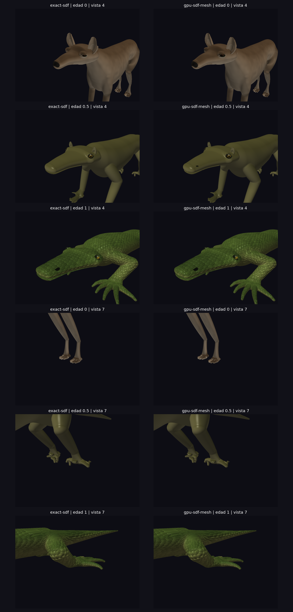

# Superficie GPU del Ager — trabajo en curso — 30-09-2026

**Estado global: PARTIALLY IMPLEMENTED. La arquitectura completa todavía no satisface 30 FPS ni cobertura fina y pelaje certificados.** El arranque interactivo utiliza `sdf-raymarch`; los extractores volumétricos y `legacy-handoff` se seleccionan explícitamente. La regresión del arranque denso se corrigió el 6 de octubre; véase `AGER_INTERACTIVE_REPAIR_2026-10-06.md`. Los gates históricos de píxel no acreditan los criterios regionales endurecidos; véase también `AGER_DIAGNOSTIC_REPAIR_2026-10-06.md`.

## Arquitectura ejecutada

`CreatureMorph/MonsterAger(actual) → MonsterSDF visual actual → escena compartida → muestreo denso GPU por franjas → clasificación y lista compacta de celdas activas → emisión GPU → comando indirecto → rasterización/material canónico`.

La ruta nueva no llama a `MorphSurfaceTracker`, `MorphSurfacePatcher`, `MorphChunkManager_AssembleMesh` ni a `SurfaceMapper` sobre vértices generados. No descarga muestras/vértices para construir geometría CPU. Las descargas geométricas sólo ocurren con `--validate-compute`; las capturas son diagnósticas. El shader de malla no incluye `morph_handoff.glsl`. Se conserva el árbol heredado y hay instantáneas en `build/ager-gpu-baseline/` y `build/ager-gpu-dense-reference/`.

La retícula se define una vez con 33 edades y dos voxels de margen. Salir de ella es un error explícito. No constituye una envolvente analítica para cualquier receta futura. Las franjas reutilizan los buffers temporales, remuestrean sus planos comunes y procesan toda celda una vez; **no son bricks persistentes ni una caché dispersa**. La lista compacta sólo evita ejecutar el costoso emisor con lanes inactivos. El campo completo sigue remuestreándose cada frame.

Se reutilizan las tablas MC CPU. Los extremos de cada arista tienen orden global estable y el refinamiento secante 0–3 permanece en la arista. Las normales vienen de cuatro evaluaciones del campo actual. Los dos extremos globales de cada arista también se almacenan como identidad diagnóstica; la aparición no depende del triángulo. La salida tiene capacidad explícita de 64 MiB (2.097.152 vértices); el overflow muestra un cuadro rojo y nunca una malla parcial. Los buffers se acotan por el límite SSBO de cada GPU y franjas de hasta 128 celdas Z, sin modificar el voxel.

Se usan barreras SSBO/comando, despacho y dibujo indirectos, y timestamps diferidos. Dos fences limitan a dos los frames pendientes para que el envío CPU no se confunda con FPS reales. No hay `glFinish` en la extracción normal; sí en las capturas y en el trazador diagnóstico con paso máximo explícito.

## Referencia y medición de calidad

El raymarch anterior podía saltar una raíz y seguir dentro del sólido hasta una cara posterior. La nueva referencia explícita usa escena completa, detecta cambios de signo y acota esa raíz mediante bisección, con tolerancia escalar 0,00001. `--exact-sdf` conserva el comportamiento heredado; `--surface-mode=exact-sdf` selecciona la referencia reparada. La comparación congelada anterior dio cero diferencias de píxel antes de esta reparación: [baseline](validation/ager-gpu-sdf/baseline-parity.json).

Esto no demuestra que el raymarch detecte una lámina omitida entre dos muestras positivas. El experimento de convergencia con paso 0,004 y 8.192 iteraciones produjo capturas inválidas o tardó excesivamente en AMD/NVIDIA; **esas capturas no forman parte de la evidencia aceptada**. La referencia sigue necesitando una certificación de primera raíz independiente.

El MSAA introduce otro error de comparación: la profundidad del raymarch puede representar el centro del píxel y la malla una submuestra. En edad 0,5/vista 3, el p95 era 0,02099 con 4×MSAA y 0,00100 con centros de píxel coincidentes. La herramienta de métricas usa ahora `--no-msaa` para ambos modos; `--msaa` conserva la comparación con cuatro muestras. El renderizado normal mantiene 4×MSAA. No se mezclan esos resultados.

### Matriz densa validada

GPU: NVIDIA RTX 3050 Laptop, controlador 580.173.02, OpenGL 4.6. Framebuffer 1100×820, sin pelaje, voxel 0,0175, refinamiento 2.

- Edades `0,.1,.2,.35,.5,.65,.8,.9,1`; vistas 3 (cuerpo), 4 (cabeza/cuello), 7 (autopodio posterior): **27/27** superan XOR <2% y profundidad p95 ≤un voxel. [Métricas](validation/ager-gpu-sdf/dense-center0175-metrics.json).
- XOR máximo 0,4577%; profundidad p95 máxima 0,001646; normal p95 máxima 2,692°; MAE de color máximo 0,592/255. Los máximos aislados de profundidad/normal siguen siendo mucho mayores en siluetas y detalles; no se ocultan.
- Retícula: origen `[-3.6925,-2.2925,-14.1225]`, `422×489×1011` celdas, 209.757.240 esquinas. La extracción por franjas permite probar esta resolución sin un SSBO para todo el volumen.
- Paridad CPU visual/fragment/compute: 655 puntos por captura; máximo 7,15e-7 frente a tolerancia 2e-4. [Auditoría](validation/ager-gpu-sdf/dense-center0175-field-audit.json).
- Salida: 1.052.112–1.601.208 vértices. En todas las auditorías: cero bordes abiertos, cero aristas no manifold y cero aristas con orientación inconsistente. Se compara identidad de arista global, evitando soldar por una tolerancia espacial arbitraria.
- Residuales **muestreados** máximos: vértice 0,002007; centro de triángulo 0,009250. La orientación frente al gradiente registra 56–179 triángulos opuestos y 241–436 degenerados. No se han corregido ocultando triángulos ni invirtiéndolos localmente.
- Tras compactar celdas activas se repiten seis pares de cabeza/autopodio en edades 0/.5/1: todos pasan y sus métricas son idénticas. La comparación directa de edad .5/vista 3 tiene cero diferencias de color, silueta y profundidad frente al denso anterior. [Revalidación](validation/ager-gpu-sdf/dense-compact0175-metrics.json).
- El gate visual está demostrado para esta matriz, sin antiguo mesh, doble cuerpo ni handoff. Faltan la distancia euclídea bidireccional completa, todos los demás pares X→Y, las otras cámaras y la validación temporal/material con fibras.



Los resultados anteriores a la reparación del raymarch se conservan como evidencia histórica en `dense-035-metrics.json`; sus discrepancias de profundidad no se atribuyen exclusivamente al meshing.

## Rendimiento medido

AMD Renoir/Mesa 25.2.8, voxel 0,035, edad 0/vista 3, 40 frames, ocho de calentamiento y 32 generaciones GPU distintas medidas, cola acotada a dos frames. Son pruebas estáticas; no certifican p99 de ciclos completos. Se ejecutaba validación en NVIDIA simultáneamente, con CPU/bus compartidos.

| Mediana | Denso anterior | Lista activa compacta |
|---|---:|---:|
| Muestreo GPU | 625,93 ms | 618,02 ms |
| Clasificación GPU | 6,94 ms | 7,44 ms |
| Emisión/raíces/normales GPU | 1.205,52 ms | 129,56 ms |
| Raster GPU | 29,37 ms | 28,41 ms |
| Span GPU completo | 1.867,79 ms | 785,05 ms |
| Frame wall | 1.871,19 ms | 786,58 ms |
| CPU del hilo | 4,36 ms | 3,33 ms |

Frame wall p99: 1.882,90 →794,13 ms. GPU span p99: 1.877,23 →791,10 ms. No equivale a 30 FPS. [Antes](validation/ager-gpu-sdf/mesa-bounded-profile.json), [después](validation/ager-gpu-sdf/mesa-compact-profile.json). Se ha eliminado un cuello de botella real de ocupación del emisor; ahora domina remuestrear todo el volumen.

NVIDIA RTX 3050, voxel 0,0175, edad 0/vista 3: 24 frames estáticos, ocho de calentamiento, 16 generaciones distintas. Tras sustituir la espera activa por consulta de fence con timeout cero y `SDL_Delay(1)`, el hilo CPU tiene mediana 20,49 ms y p99 22,57 ms. La GPU sigue en mediana 2.200,00 ms y el frame wall p99 2.203,99 ms; reducir el consumo CPU de la espera no acelera la extracción. Muestreo 1.786,73 ms, clasificación 15,68 ms, emisión 387,52 ms y raster 9,89 ms. [Perfil y muestras](validation/ager-gpu-sdf/nvidia-fence-sleep-profile.json).

Los perfiles históricos con cola sin acotar en `profile-summary.json` se etiquetan como envío y queries parciales; no son percentiles de presentación.

## Rangos antes de la caché dispersa

La auditoría detecta que `MonsterSDF_GetCellRangeWrapper` no contiene el campo visual completo: omite mandíbula posada y párpados, mezcla las orejas con 0,28 en lugar de 0,42 y usa una derivada finita no válida junto a la punta del pabellón. La mandíbula del lagarto abre 0,08 y el ángulo cambia durante el morph; no puede tratarse como cerrada. La caché nueva deberá conservar como activos los rangos desconocidos y reparar/generar intervalos compartidos, con expansión del error flotante, antes de rechazar bricks. No se ha utilizado ese rango inseguro para podar el prototipo denso.

### Intervalos compartidos en desarrollo

`SDFInterval.h/.c` introduce aritmética de intervalos con redondeo exterior por operación y recetas para pabellón, elipsoide, cápsula, slot oral, unión y resta suaves. El generador traduce esas mismas funciones C a GLSL compute; el raymarch 3.3 no adquiere dependencia de `double`. Los cocientes que cruzan cero mantienen incertidumbre. Se cubren las dos formas de interpolación permitidas por `mix` y las ramas del centro elipsoidal y cápsulas degeneradas.

En el pabellón, `SDF_SinHalfTurn` sustituye el seno nativo en **ambos** evaluadores por el mismo polinomio sobre [0,pi]; no existe un campo aproximado exclusivo del mesher. La prueba de 100.001 ángulos exige diferencia <3e-7 frente a `sinf`. El resto analítico es <6e-8 y la cota usada por el intervalo incluye 8e-6 para reducción y operaciones float. La precisión del seno nativo GLSL no está especificada, por lo que no se ha usado una derivada estimada para certificarlo. [Especificación GLSL 4.30](https://registry.khronos.org/OpenGL/specs/gl/GLSLangSpec.4.30.pdf).

La contención CPU se prueba en 34.000 evaluaciones de pabellones variados y 68.000 puntos para las otras primitivas y composiciones, incluyendo cajas puntuales, puntas y tramos nulos. El diagnóstico GPU usa 512 cajas ×9 puntos por receta, compara los intervalos CPU y GPU con los escalares de ambos backends y sólo descarga resultados con `--validate-compute`. La prueba inicial del pabellón pasa en AMD y NVIDIA; las seis recetas también pasan tras añadir la barrera SSBO entre despachos diagnósticos. [AMD](validation/ager-gpu-sdf/interval-recipes-mesa.log), [NVIDIA](validation/ager-gpu-sdf/interval-recipes-nv.log). La repetición visual tras cambiar el seno compartido conserva 27/27 pares dentro del gate, con XOR máximo 0,4577%, profundidad p95 máxima 0,001646 y normal p95 máxima 2,692°. [Matriz revalidada](validation/ager-gpu-sdf/dense-interval0175-metrics.json).

**Límite:** estas pruebas son evidencia de contención, no una certificación del campo visual completo. Se han añadido las recetas de barridos Hermite y conectores con perfil cuadrático, con 34.000 evaluaciones CPU de cada una. Las ocho recetas pasan contención cruzada en edades 0/.5/1, AMD Renoir y NVIDIA RTX 3050: 24.576 cajas y 221.184 puntos escalares GPU; diferencia escalar máxima CPU/GPU 2,584e-6. [Validación y logs](validation/ager-gpu-sdf/shared-intervals-validation.json). `make -B -j6 test demos` pasa tras el último cambio, sin warnings. [Log forzado](validation/ager-gpu-sdf/intervals-forced-test-demos.log). Todavía falta la composición craneal con párpados, cutters y mandíbula posada. No se descarta ningún brick mediante intervalos en el renderizado actual. Tampoco se ha implementado almacenamiento persistente de muestras. El trabajo de intervalos prepara la fase 6 y no equivale a superarla.

## Reproducción

```sh
make -B -j6 test demos
DISPLAY=:0 python3 tools/validate_gpu_sdf_surface.py --ages=0,.1,.2,.35,.5,.65,.8,.9,1 --views=3,4,7 --voxel=.0175 --out=build/gpu-sdf-validation/center0175
DISPLAY=:1 __GLX_VENDOR_LIBRARY_NAME=mesa ./demos/demo_morph_dog_lizard --surface-mode=gpu-sdf-mesh --age=0 --gpu-voxel=.035 --no-fur --frames=40 --validate-cycle=build/gpu-sdf-profile/mesa-compact
```

Las capturas manuales necesitan un directorio existente. `--capture-normals` produce color de normales; PPM y PFM conservan color y profundidad. `--validate-compute` activa exclusivamente diagnósticos con readback. En GL 3.3 se rechaza el modo compute explícitamente: [comprobación Mesa](validation/ager-gpu-sdf/unsupported-mesa33.log).

## Registro por fase

`FAILED` en las fases posteriores significa aceptación pendiente por el gate anterior; se indica expresamente cuando no se ha iniciado su implementación. No significa que se hayan ejecutado y fallado pruebas de una caché todavía inexistente.

### Fase 0 — Congelar referencia y modos

**STATUS:** PARTIALLY IMPLEMENTED

**FILES CHANGED:** `demos/demo_morph_dog_lizard.c`; instantánea en `build/ager-gpu-baseline/`.

**TESTS:** Referencia anterior recompilada y comparación exacta de edad 0/vista 4.

**VISUAL RESULT:** Cero diferencias en esa captura; legacy continúa accesible.

**CPU RESULT:** No se reejecutó una matriz completa de tiempos del legacy congelado.

**GPU RESULT:** Se conserva el informe y las capturas heredadas, sin atribuirles tiempos actuales.

**KNOWN LIMITATIONS:** La congelación no es un commit del árbol heredado; el control nuevo es experimental.

**NEXT ACTION:** Completar el baseline de rendimiento de todos los modos cuando exista una calidad certificada.

### Fase 1 — Evaluador y escena compartidos

**STATUS:** PARTIALLY IMPLEMENTED

**FILES CHANGED:** `shaders/sdf_scene.glsl`, `tools/generate_sdf_shader.py`, `src/MonsterSDFShader.generated.h`, `src/MonsterSDFCompute.generated.h`, `src/OpenGLRenderer.c`.

**TESTS:** Paridad de 655 puntos por captura en nueve edades; máximo 7,15e-7 en la matriz nueva.

**VISUAL RESULT:** Fragment y compute comparten fórmulas y parámetros, no una aproximación separada.

**CPU RESULT:** Un único empaquetado CPU de escena para ambos productores.

**GPU RESULT:** Paridad de distancia aceptada en los puntos probados.

**KNOWN LIMITATIONS:** `SDFResult` reserva module/region/material, pero esos IDs devuelven cero; falta resolución semántica.

**NEXT ACTION:** Resolver semántica conservando la distancia y ampliar pruebas próximas a las superficies.

### Fase 2 — Infraestructura compute

**STATUS:** PARTIALLY IMPLEMENTED

**FILES CHANGED:** `src/OpenGLRenderer.c`, `include/OpenGLRenderer.h`, `Makefile`.

**TESTS:** Shaders compute y raster compilados/enlazados y ejecutados en GL 4.6; checks de capacidades y memoria.

**VISUAL RESULT:** Dibujo indirecto de buffers residentes; overflow visible.

**CPU RESULT:** La CPU envía escena, rejilla, comandos y dominio material, no una malla corporal.

**GPU RESULT:** Queries asíncronas por muestreo, clasificación, emisión y raster; despachos densos acotados.

**KNOWN LIMITATIONS:** No hay fibras todavía; la capacidad de buffers y la cola acotada no garantizan un presupuesto de tiempo.

**NEXT ACTION:** Completar perfiles y comprobaciones de salida/límites en más hardware.

### Fase 3 — Prototipo denso / gate A

**STATUS:** IMPLEMENTED

**FILES CHANGED:** `GpuSDFSurfaceCache.h/.c`; shaders `sdf_surface_common`, `sample`, `classify`, `emit`, `finalize`, `mesh.vert/.frag`; `tests/test_gpu_sdf_surface.c`.

**TESTS:** Rejilla inmutable, cotas inválidas, desbordamiento de índices y conservación ante errores; matriz 27 pares.

**VISUAL RESULT:** 27/27 pares de centros de píxel pasan; superficies cerradas en la auditoría de aristas. Gate A superado en esta matriz.

**CPU RESULT:** Sin reconstrucción Mesh CPU ni dependencia del worker geométrico.

**GPU RESULT:** Todas las esquinas/celdas se procesan cada frame; capacidad y memoria explícitas.

**KNOWN LIMITATIONS:** No es una caché dispersa; los índices de tablas clásicas no certifican toda la topología.

**NEXT ACTION:** Mantener la calidad y reparar rangos conservadores antes de podar bricks en fase 6.

### Fase 4 — Precisión de superficie

**STATUS:** PARTIALLY IMPLEMENTED

**FILES CHANGED:** `shaders/sdf_surface_emit.comp`, `shaders/sdf_scene.glsl`, diagnóstico `OpenGLRenderer_ValidateGpuSurface`.

**TESTS:** Refinamiento configurable 0–3; posiciones restringidas a aristas; residuales de vértices/centros.

**VISUAL RESULT:** Voxel 0,0175 mejora los detalles y supera los umbrales; quedan máximos locales y triángulos degenerados que auditar.

**CPU RESULT:** La evaluación CPU de geometría es sólo diagnóstico explícito.

**GPU RESULT:** Normal tetraédrica exacta por arista activa; su coste es importante.

**KNOWN LIMITATIONS:** No hay Hausdorff bidireccional ni certificación topológica; no basta un residual bajo en vértices.

**NEXT ACTION:** Investigar detalles omitidos, casos ambiguos y discrepancias del oráculo.

### Fase 5 — Métricas visuales

**STATUS:** PARTIALLY IMPLEMENTED

**FILES CHANGED:** `tools/validate_gpu_sdf_surface.py`; captura de profundidad y normal compartida; `docs/validation/ager-gpu-sdf/`.

**TESTS:** Color, XOR, profundidad p50/p95/p99/máximo, normales angulares, grupos faltantes y sobrantes.

**VISUAL RESULT:** 27/27 pasan con profundidad del mismo centro de píxel; seis pares revalidados tras compactación.

**CPU RESULT:** El script descarga framebuffer/diagnóstico, fuera del camino normal.

**GPU RESULT:** Capturas idénticas de cámara y edad; prueba de igualdad tras separar handoff.

**KNOWN LIMITATIONS:** Sólo tres vistas; sin identificación anatómica de grupos ni superficie oculta.

**NEXT ACTION:** Extender cámaras y medir distancia bidireccional de superficies completas.

### Fase 6 — Caché SDF dispersa real

**STATUS:** FAILED

**FILES CHANGED:** Preparación conservadora en `SDFInterval.h/.c`, primitivas compartidas, generador, shader diagnóstico, renderer y pruebas. Sin modificaciones de caché persistente en `MorphSpatialCache`; su implementación no está iniciada.

**TESTS:** Contención CPU de primitivas/barridos/conectores y contención cruzada de ocho recetas en dos GPUs y tres edades; todas pasan. No ejecutadas para una caché: rango del campo visual completo pendiente.

**VISUAL RESULT:** No hay resultado disperso.

**CPU RESULT:** No existe control de bricks limpios/sucios del camino GPU.

**GPU RESULT:** Los samples siguen recalculándose completos; no se ha podado con el rango inseguro.

**KNOWN LIMITATIONS:** No hay banda estrecha ni generaciones de muestras por brick.

**NEXT ACTION:** Componer intervalos de cabeza/párpados, cutters y mandíbula posada; validar el campo visual completo antes de implementar rechazo y persistencia de bricks.

### Fase 7 — Fronteras de bricks

**STATUS:** FAILED

**FILES CHANGED:** Ninguno para bricks; la retícula y las aristas globales ya pertenecen al prototipo denso.

**TESTS:** No se han probado halos ni fronteras de bricks.

**VISUAL RESULT:** No hay bricks visibles que comparar.

**CPU RESULT:** Sin gestión de halos.

**GPU RESULT:** Arista global determinista en la rejilla densa; no certificación dispersa.

**KNOWN LIMITATIONS:** No equivale a implementación de fronteras/LOD.

**NEXT ACTION:** Añadir halos y pruebas de igualdad tras fase 6.

### Fase 8 — Dibujo independiente por brick

**STATUS:** PARTIALLY IMPLEMENTED

**FILES CHANGED:** Renderer y demo nuevos.

**TESTS:** La ruta GPU usa `glDrawArraysIndirect` y no `AssembleMesh`.

**VISUAL RESULT:** Un único buffer denso de la edad actual.

**CPU RESULT:** No recibe vértices en presentación normal.

**GPU RESULT:** Todavía un comando global, sin unidades persistentes por brick.

**KNOWN LIMITATIONS:** No cumple actualización local ni MultiDrawIndirect.

**NEXT ACTION:** Introducir slots y comandos de bricks después de fase 6.

### Fase 9 — Optimización GPU

**STATUS:** PARTIALLY IMPLEMENTED

**FILES CHANGED:** Clasificador/emisor, `sdf_surface_prepare.comp`, comando indirecto y renderer.

**TESTS:** Captura A/B idéntica en edad .5/vista 3; seis pares de revalidación; perfil AMD de 40 frames.

**VISUAL RESULT:** Sin diferencia observada frente a la misma extracción sin compactación.

**CPU RESULT:** El trabajo activo se genera en GPU; no se descarga la cuenta de celdas.

**GPU RESULT:** Emisión mediana 1.205,52 →129,56 ms. Muestreo denso todavía 618,02 ms.

**KNOWN LIMITATIONS:** No hay caché dispersa ni deduplicación de normales entre celdas. La medición agrupa raíces y normales.

**NEXT ACTION:** Reducir muestras mediante intervalos conservadores y medir raíces/normales independientemente.

### Fase 10 — Ambigüedades MC

**STATUS:** FAILED

**FILES CHANGED:** No se modificaron `MarchingCubes.c` ni sus tablas.

**TESTS:** Suite CPU existente y auditoría de orientación/área GPU; sin nueva certificación MC33/decider.

**VISUAL RESULT:** Persisten irregularidades y degenerados en detalles finos.

**CPU RESULT:** CPU y GPU usan la misma tabla.

**GPU RESULT:** No se introdujo una regla diferente de conectividad.

**KNOWN LIMITATIONS:** Sin pruebas exhaustivas de caras ambiguas, saddle, manifold o componentes.

**NEXT ACTION:** Auditar las ambigüedades detectadas con la misma decisión en ambos backends.

### Fase 11 — Estabilidad temporal

**STATUS:** PARTIALLY IMPLEMENTED

**FILES CHANGED:** Rejilla fija, barreras de muestreo/emisión/comando y queries del renderer.

**TESTS:** Nueve edades estáticas y ejecución de scrubbing; retícula idéntica.

**VISUAL RESULT:** La geometría solicitada no usa una malla de otra edad.

**CPU RESULT:** No espera resultados del worker.

**GPU RESULT:** Muestreo y dibujo del mismo campo en el mismo flujo de comandos.

**KNOWN LIMITATIONS:** Sin bricks front/pending, métrica de jitter ni certificación de popping.

**NEXT ACTION:** Medir continuidad temporal tras corregir los detalles.

### Fase 12 — Semántica sin identidad triangular

**STATUS:** PARTIALLY IMPLEMENTED

**FILES CHANGED:** `shaders/surface/morph_domain.glsl` reutilizado; material SDF compartido; `SDFResult`.

**TESTS:** La apariencia reconstruye dominio desde posición/anatomía y semillas.

**VISUAL RESULT:** No depende del índice de triángulo emitido.

**CPU RESULT:** Se actualiza el dominio anatómico, sin mapear todos los vértices.

**GPU RESULT:** Resolución del dominio en fragment.

**KNOWN LIMITATIONS:** Los IDs de `SDFResult` aún son marcadores cero; no atributos semánticos emitidos.

**NEXT ACTION:** Resolver IDs y certificar costes/continuidad después del gate.

### Fase 13 — Escamas procedurales

**STATUS:** PARTIALLY IMPLEMENTED

**FILES CHANGED:** Material/GLSL de escamas existentes, reutilizados por ambas representaciones.

**TESTS:** Capturas hasta edad 1; misma receta/semilla/dominio.

**VISUAL RESULT:** Misma evaluación procedural; la discretización modifica impactos y normales.

**CPU RESULT:** Sin mallas geométricas de escamas.

**GPU RESULT:** No se utiliza identidad de triángulo/vértice para patrón.

**KNOWN LIMITATIONS:** No se ha certificado estabilidad temporal al remallar.

**NEXT ACTION:** Añadir comparación con misma anatomía y generaciones distintas.

### Fase 14 — Folículos canónicos

**STATUS:** FAILED

**FILES CHANGED:** `Fur.c` y guard hairs no modificados por este pivote.

**TESTS:** No iniciadas.

**VISUAL RESULT:** El prototipo tiene sombreado de cobertura heredado; no fibras con silueta.

**CPU RESULT:** No se crean raíces corporales nuevas.

**GPU RESULT:** No existe proyección GPU de folículos canónicos.

**KNOWN LIMITATIONS:** No satisface pelaje coherente ni furry→furry.

**NEXT ACTION:** Diseñar IDs canónicos y proyección contra el campo después de calidad de superficie.

### Fase 15 — Material compartido

**STATUS:** PARTIALLY IMPLEMENTED

**FILES CHANGED:** `shaders/sdf_surface_material.glsl`, generador y subida `UploadMorphMaterial`.

**TESTS:** Referencia anterior idéntica; seis pares repetidos tras separar completamente handoff.

**VISUAL RESULT:** Coloración procedural procede de una única función.

**CPU RESULT:** Receta y dominio compartidos.

**GPU RESULT:** El shader nuevo importa dominio material sin lógica de clipping/handoff.

**KNOWN LIMITATIONS:** Se hereda máscara de piel por color y aproximación de cobertura; fibras/semántica completa pendientes.

**NEXT ACTION:** Reemplazar heurísticas de semántica mediante IDs y completar fur.

### Fase 16 — 30/60 FPS

**STATUS:** FAILED

**FILES CHANGED:** Queries de etapas, CSV de GPU, tiempo de frame y CPU del hilo.

**TESTS:** Perfil final y refinamiento, detallados arriba.

**VISUAL RESULT:** La calidad tampoco está certificada.

**CPU RESULT:** Coste del hilo y espera de presentación se separan en telemetría.

**GPU RESULT:** El prototipo denso excede 33,3 ms ampliamente.

**KNOWN LIMITATIONS:** No es una solución en tiempo real.

**NEXT ACTION:** Reducir muestreo y normales sin alterar el campo ni la calidad demostrada.

### Fase 17 — Calidad adaptativa

**STATUS:** FAILED

**FILES CHANGED:** Ninguno; no iniciado.

**TESTS:** No pruebas octree/LOD/Transvoxel.

**VISUAL RESULT:** No se redujo resolución en silencio.

**CPU RESULT:** Sin árbol adaptativo.

**GPU RESULT:** Voxel uniforme configurado por experimento.

**KNOWN LIMITATIONS:** No existe sistema uniforme disperso probado.

**NEXT ACTION:** No iniciar antes de medir fase 6/16.

### Fase 18 — Validación completa

**STATUS:** PARTIALLY IMPLEMENTED

**FILES CHANGED:** Herramienta y evidencia de 27 pares; perfiles y checks de núcleo.

**TESTS:** Nueve edades, tres vistas, sin pelaje; casos core de morph existentes; scrubbing de diagnóstico.

**VISUAL RESULT:** Gate A falla y quedan huecos en orejas.

**CPU RESULT:** No equivale a validar X→Y arbitrario en GPU.

**GPU RESULT:** Faltan cámara completa, furry morph, jitter, manifold y métricas por brick.

**KNOWN LIMITATIONS:** Las pruebas core heredadas no certifican la arquitectura GPU final.

**NEXT ACTION:** Extender cámaras, pares, tiempo, fibras y distancias geométricas antes de aceptación global.

### Fase 19 — Nuevo modo predeterminado

**STATUS:** FAILED

**FILES CHANGED (registro histórico; corregido 06-10-2026):** El código auditado arranca con `gpu-sdf-dense`. No se acredita aceptación regional ni de rendimiento por ser el predeterminado.

**TESTS:** Se verifican selección y errores de modos; no promoción.

**VISUAL RESULT:** GPU disponible exclusivamente como experimento.

**CPU RESULT:** Legacy permanece disponible.

**GPU RESULT:** No se ha sustituido la ruta normal del motor.

**KNOWN LIMITATIONS:** Fases obligatorias pendientes.

**NEXT ACTION:** Promover sólo cuando todos los criterios anteriores pasen.
