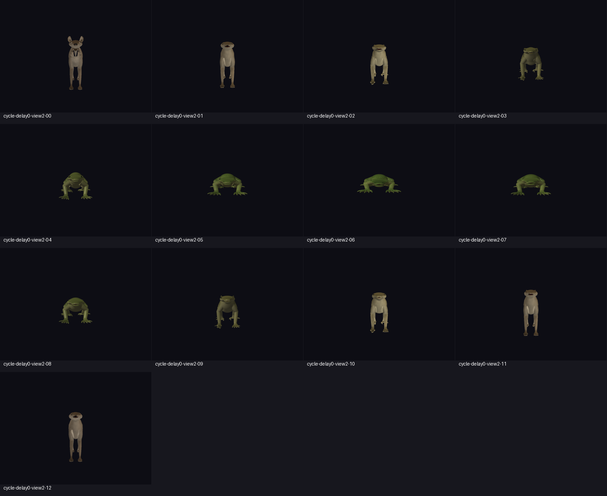
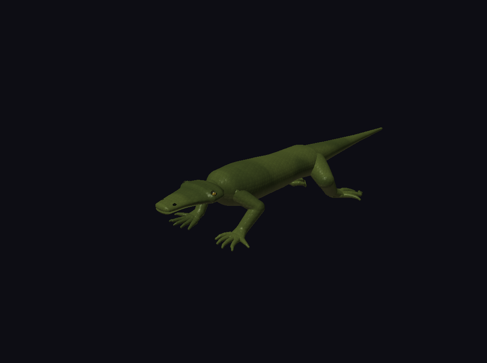
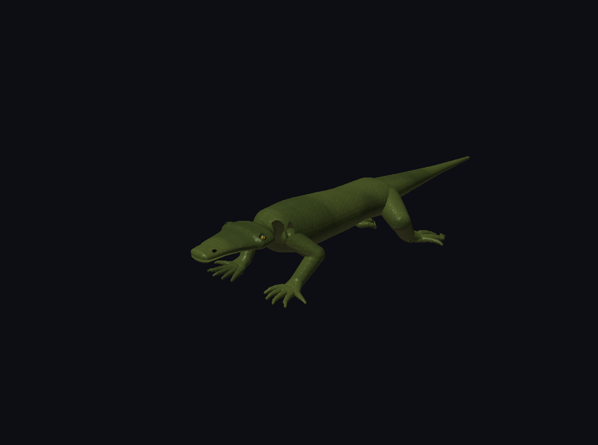
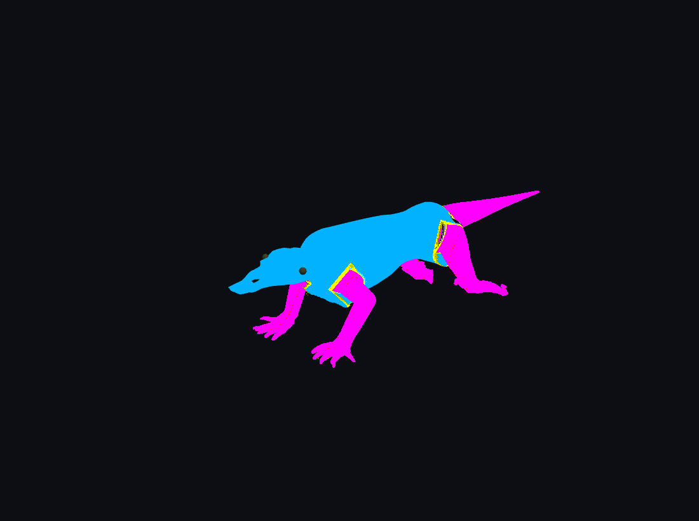
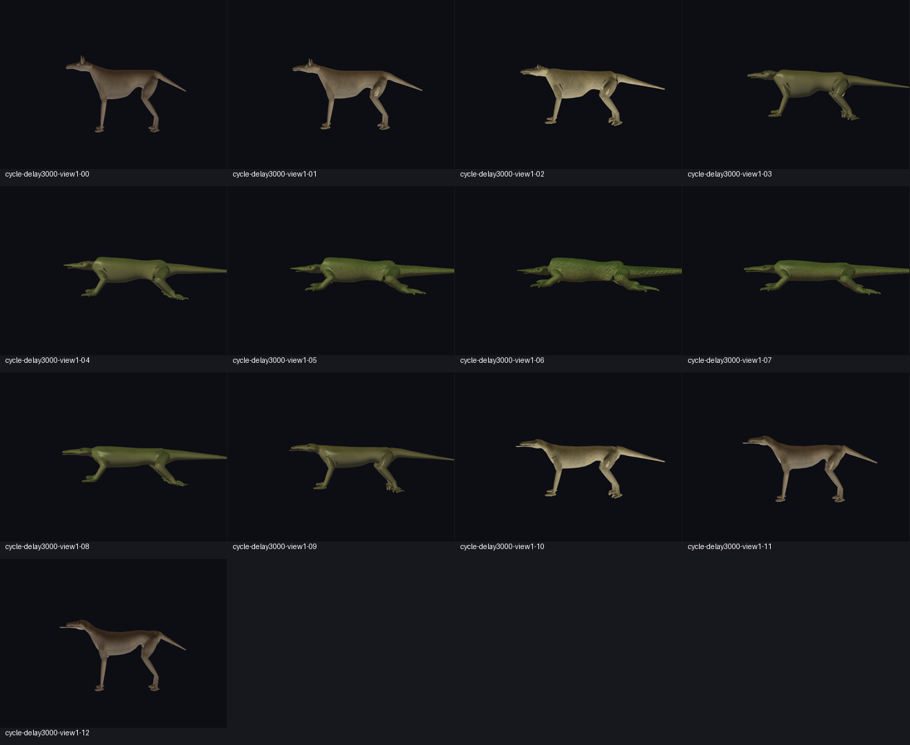

# Reparación visual de la cesión del Ager — 30-09-2026

**Estado global: PARTIALLY IMPLEMENTED; aceptación rechazada.** La nueva propiedad
anatómica está integrada, pero la reparación no satisface todavía continuidad
visual completa ni 30 FPS continuos. No se debe interpretar una compilación,
un benchmark de CPU o una silueta final correcta como certificación del morph.

Se conservó el árbol de trabajo anterior. Los cambios de esta reparación no
rediseñan el gestor de chunks ni certifican su publicación incremental.

## Evidencia y reproducción

- Compilación forzada y suites: `make -B -j6 test demos` (log conservado en
  [final/build-tests.log](validation/ager-handoff/final/build-tests.log)).
- `benchmark_morph_dynamic --worker-delays`: 0, 20, 50, 100, 250, 500, 1000 y
  3000 ms. [Log](validation/ager-handoff/final/benchmark-worker-delays.log).
- `benchmark_ager_realtime`: [log](validation/ager-handoff/final/benchmark-ager-realtime.log).
  Es un benchmark de núcleo sin GL; su resultado de FPS no mide el respaldo SDF.
- La compilación forzada final, posterior a la última edición, terminó con todas
  las suites correctas y sin warnings de compilación.
- Comparación del endpoint a edad 1 y retardo 3000: [log](validation/ager-handoff/final/endpoint-silhouette.log).
  Frente al SDF exacto: 3225 píxeles extra (7,7%) y 2293 faltantes (5,5%).
  El límite heredado de 10% da PASS; no certifica ausencia de huecos o costuras.
- Matriz GPU secuencial, pelaje activado, resolución original 1100×820:
  `DISPLAY=:0 python3 tools/validate_morph_handoff.py docs/validation/ager-handoff/final/matrix --stress`.
  [Resultados por ejecución](validation/ager-handoff/final/matrix/summary.json),
  [log del orquestador](validation/ager-handoff/final/matrix-run.log),
  [tabla de tiempos](validation/ager-handoff/final/measurements.md).
- `demos/demo_ager_3d --validate-gpu`: [paridad del campo general](validation/ager-handoff/final/gpu-parity.log),
  diez edades, error máximo observado 0,000000596; no es una certificación de
  gradientes ni de las interfaces perro→lagarto.
- Edades de cada ciclo: 0, 0,20, 0,35, 0,50, 0,65, 0,80, 1, 0,80, 0,65,
  0,50, 0,35, 0,20, 0. El demostrador fija la edad exacta al capturar.
  Cámaras 2/9/1/8/3: frente/izquierda/derecha/posterior/tres cuartos.
  Retardos 0/500/3000 ms. Estrés adicional con ráfaga 0→1→0→1 y scrubbing
  cada tres frames, conservando worker, materiales y resolución.

Los tiempos GPU positivos incluyen todos los frames disponibles de cada ciclo;
no se filtran picos para alcanzar el objetivo. La compilación inicial de shaders
aparece además en los máximos de CPU. Las consultas GPU entregan tiempos con
latencia respecto al frame actual. `render_gpu_ms` agrega mesh, SDF y auxiliares;
`exact_sdf_submit_ms` es tiempo CPU de envío, **no tiempo GPU SDF**.

La vuelta al perro muestra pérdida transitoria de pabellones auriculares en
la cabeza predicha. Este defecto invalida la aceptación de «una cabeza completa»
aunque no haya dos cuerpos. La anatomía cefálica necesita una certificación de
su interfaz y de sus cambios de superficie antes de volver a activar respaldo
cefálico. No se oculta el defecto mediante una tolerancia de silueta más grande.

## Fase 0 — Línea base

STATUS: PARTIALLY IMPLEMENTED.

FILES CHANGED: este informe y `validation/ager-handoff/baseline/`.

TESTS RUN: recompilación forzada del demostrador; ciclo real de 3000 ms,
sin pelaje, tres cuartos. Se distinguió el binario antiguo de las fuentes actuales.

VISUAL RESULT: costuras en hombro/cuello y cambio de patrón entre torso y patas.

PERFORMANCE RESULT: GPU p50 24,8445; p95 41,8612; p99 49,9458; máximo 100,656 ms
(602 muestras positivas). La línea base actual ya falla 33,3 ms.

KNOWN LIMITATIONS: no se repitió toda la matriz de cámaras/retardos antes de
editar. Los informes anteriores no se usan como prueba de rendimiento actual.

## Fase 1 — Caja de trabajo y raíces reales

STATUS: PARTIALLY IMPLEMENTED.

FILES CHANGED: `src/OpenGLRenderer.c`, `shaders/monster_sdf_trace.glsl`,
`tools/generate_sdf_shader.py`, cabecera SDF generada.

TESTS RUN: ciclo aislado de cambio de bounds; suites y compilación final;
compilación GLSL en el visor real.

VISUAL RESULT: `RenderSDFRegion` conserva el collar solicitado, sin intersectarlo
con una caja semántica menor. Una distancia negativa al entrar en la caja no
se acepta como impacto: se busca una raíz con `abs(distance) < hitTolerance`.
El ensayo aislado expuso el hueco de la propiedad anterior y no fue aceptado.

PERFORMANCE RESULT: p50 26,174; p95 34,1388; p99 37,3428; máximo 63,674 ms.

KNOWN LIMITATIONS: el modo `--handoff-debug` colorea rojo impactos próximos a
paredes de cajas, pero no existe todavía un contador GPU de impactos fronterizos
ni una prueba exhaustiva de raíces bajo rayos casi tangentes al campo.
El diagnóstico final registra entre 0 y 116 píxeles rojos por captura; incluye
proximidad a paredes de cajas solapadas, por lo que no distingue por sí solo
un corte de un impacto legítimo. No se certifica cero impactos fronterizos.

## Fase 2 — Restricción del respaldo axial y cefálico

STATUS: PARTIALLY IMPLEMENTED.

FILES CHANGED: `src/MonsterVisualAsync.c` y demostrador.

TESTS RUN: suites morph/async, ciclos de regresión.

VISUAL RESULT: se retira la activación axial/cefálica basada en una muestra de
residual >0,25. Los modos siguen disponibles como interfaces diagnósticas;
el cuerpo estable permanece explícito durante el respaldo apendicular.

PERFORMANCE RESULT: evita pases grandes activados por un único residual;
el pase apendicular sigue excediendo el presupuesto GPU.

KNOWN LIMITATIONS: no se certifican eventos de la superficie cefálica, incluidos
pabellones. El ciclo inverso revela pérdida de orejas; esta fase no autoriza
reactivar la cabeza completa por una heurística de residual.

## Fase 3 — Interfaz anatómica compartida

STATUS: PARTIALLY IMPLEMENTED.

FILES CHANGED: `include/MorphHandoff.h`, `src/MorphHandoff.c`,
`MonsterVisualAsync.h/.c`, `OpenGLRenderer.h/.c`.

TESTS RUN: construcción de interfaces reales, normal unitaria, soporte curvado,
localidad y bounds conservadores; ejecución de shaders en visor.

VISUAL RESULT: raíz obtenida de la conexión entrante de otro módulo, eje proximal,
radio resuelto, banda proporcional y soporte de cápsulas por conexión. Las cajas
aceleran el trabajo y no definen la propiedad visible. No hay coordenadas por
especie. La misma interfaz llega a malla, raíces de pelaje y SDF.

PERFORMANCE RESULT: se prueban envolventes convexas y se descartan del soporte
actual por su excesiva cobertura/coste. El soporte actual sigue conexiones.

KNOWN LIMITATIONS: falta demostrar que todo vértice de topología antigua que
pueda plegarse queda oculto por el soporte actual en cualquier morph. El
certificado de interfaz sigue siendo generacional, no una prueba geométrica.
Capacidades explícitas: 16 interfaces, 128 segmentos por interfaz, 1024 GPU.

## Fase 4 — Caras que cruzan la interfaz

STATUS: IMPLEMENTED para el recorte geométrico; continuidad visual sin certificar.

FILES CHANGED: `MonsterVisualAsync.h/.c`, shaders de mesh/pelaje,
`tests/test_morph.c`, `tests/test_morph_handoff.c`.

TESTS RUN: suite completa; prueba de muestras a ambos lados de una cara cruzada;
regresión que exige conservar todos los índices y cero triángulos eliminados.

VISUAL RESULT: `GetOwnedMesh` devuelve la malla completa. El shader evalúa el
soporte sobre la posición interpolada por fragmento y recorta dentro de las caras,
sin borrar una cara porque uno de sus vértices pertenece al módulo.

PERFORMANCE RESULT: no se reconstruyen índices por frame. El coste se desplaza
al predicado geométrico compartido en los shaders.

KNOWN LIMITATIONS: el recorte correcto no iguala las posiciones de una malla
predicha y de la raíz exacta SDF; quedan costuras cuando esas superficies difieren.

## Fase 5 — Campo completo evaluado localmente

STATUS: IMPLEMENTED para la ruta visible; aceptación visual global pendiente.

FILES CHANGED: demostrador, renderer y trazador.

TESTS RUN: compilación GLSL y ciclos GPU; referencia exacta con la misma API.

VISUAL RESULT: las vistas aisladas de módulo dejan de usarse para respaldo visible.
Todos los intervalos reciben el campo actual completo, con contexto de torso,
conectores, cabeza y operaciones booleanas. Un único pase recorre la unión de
intervalos locales; saltar espacio vacío no cambia el campo de un impacto.
Las regiones ausentes retiran referencia explícita sin generar SDF visible.

PERFORMANCE RESULT: el pase único y los intervalos de cápsula reducen evaluaciones
repetidas. No se utiliza renderizado adaptativo a menor resolución.

KNOWN LIMITATIONS: falta una auditoría GPU por interfaz contra el campo CPU
completo, incluyendo gradientes en la banda. Los tests de vistas aisladas se
conservan como diagnósticos y no prueban esta aceptación.

## Fase 6 — Banda espacial

STATUS: PARTIALLY IMPLEMENTED.

FILES CHANGED: `MorphHandoff.c`, include GLSL común y renderer.

TESTS RUN: smoothstep, extremo proximal/distal, cola curvada, bounds del soporte.

VISUAL RESULT: banda 0,15×radio proximal, con mínimo físico de 0,006;
el evaluador usa semiancho mínimo 0,01. Collar de suavizado incluido en las cajas.
El plano proximal queda limitado a la inserción, de modo que una cola curvada
pueda volver al lado proximal lejos de su raíz.

PERFORMANCE RESULT: poda conservadora por caja antes de recorrer cápsulas.

KNOWN LIMITATIONS: no se ha certificado error posicional/normal de ambas
superficies en la banda. La banda no puede reparar por sí sola una mala predicción.

## Fase 7 — Dither complementario

STATUS: PARTIALLY IMPLEMENTED.

FILES CHANGED: `shaders/morph_handoff.glsl`, shaders de superficie y SDF,
generadores de ambas cabeceras.

TESTS RUN: ejecución GPU de ciclos y modo de propiedad.

VISUAL RESULT: un include común define cobertura, ganador determinista y umbral
Bayer 8×8. Mesh usa `threshold >= coverage`, SDF `threshold < coverage`.
El híbrido se dibuja al framebuffer común a resolución completa, con profundidad.
No se mezcla un buffer SDF reducido mediante blit lineal.

PERFORMANCE RESULT: conserva resolución y evita pases SDF superpuestos.

KNOWN LIMITATIONS: complementariedad algebraica en un punto no demuestra
complementariedad por píxel si las superficies tienen posiciones distintas.
Falta contabilizar píxeles sin dueño/con doble dueño en todas las transiciones.

## Fase 8 — Estados temporales e histéresis

STATUS: PARTIALLY IMPLEMENTED.

FILES CHANGED: `MorphModuleState.h/.c`, `MonsterVisualAsync.h/.c`, demostrador,
pruebas de cesión.

TESTS RUN: publicación sin cambio instantáneo, final de salida, ruido en umbral,
rampa sin inversión adyacente e interfaz inválida que conserva respaldo.

VISUAL RESULT: MESH_ACTIVE / ENTERING_SDF / SDF_ACTIVE / ENTERING_MESH.
Entrada por lag o interfaz inválida, salida con lag < mitad del umbral y certificado.
Residencia de 0,4×duración antes de invertir; rampa de 120 ms en el consumidor.
La función pura recibe duración configurable.

PERFORMANCE RESULT: actualización O(número de módulos), sin remallado para la rampa.

KNOWN LIMITATIONS: la validez de interfaz todavía comprueba generación. No se
certifica ausencia de pop en publicaciones con cambio de conectividad ni la
seguridad de la referencia durante los primeros frames de la entrada gradual.

## Fase 9 — Pelaje

STATUS: PARTIALLY IMPLEMENTED.

FILES CHANGED: shaders de shells/guarda y trazador SDF.

TESTS RUN: matriz con pelaje activado; pruebas sin pelaje separadas como diagnóstico.

VISUAL RESULT: shell y guarda consultan propiedad en la raíz, no en la punta.
Se conservan índices y raíces persistentes. La apariencia común comparte
coordenadas canónicas, perfiles y semillas.

PERFORMANCE RESULT: sin crear cada pelo en CPU ni remallar para la transición.

KNOWN LIMITATIONS: el SDF aplica iluminación/ocupación de fibras sobre la piel;
no reproduce la silueta geométrica de shells/guarda. Tampoco se certifica la
proyección de raíces predichas a la piel exacta. Esta fase impide aceptar el morph.

## Fase 10 — Escamas y material común

STATUS: PARTIALLY IMPLEMENTED.

FILES CHANGED: `SurfaceMapper.h/.c`, `shaders/surface/morph_domain.glsl`,
renderer, shaders de piel/guarda y trazador; pruebas del dominio empaquetado.

TESTS RUN: identidades homólogas, escala canónica, rotación identidad, hojas BVH
sin pérdida/duplicación y cotas conservadoras de extremos/radios; ciclos GPU.

VISUAL RESULT: ambos productores consultan el mismo dominio anatómico canónico,
transportado por identidad de conexiones, con cuatro pesos continuos y perfiles
regionales. BVH conservador evita búsqueda exhaustiva por fragmento. El shader
material, iluminación y semillas se comparten.

PERFORMANCE RESULT: todavía costoso por fragmento; el benchmark GPU completo
sigue suspendiendo. No se reduce la densidad ni calidad de las escamas.

KNOWN LIMITATIONS: piel SDF todavía identifica integumento desde color de tejido;
falta transportar una identidad material explícita. No se certifican continuidad
de fase, Jacobiano y normales bajo todos los cambios de pose/topología.

## Fase 11 — Articulaciones proximales

STATUS: PARTIALLY IMPLEMENTED.

FILES CHANGED: modo `--handoff-debug`, informe y capturas.

TESTS RUN: cámaras frente/izquierda/derecha/posterior/tres cuartos y edades exactas;
modo debug separado de los benchmarks de apariencia.

VISUAL RESULT: cyan mesh, magenta SDF, amarillo banda; rojo indica impacto próximo
a una pared de caja. Las cajas se pueden mostrar con `--fallback-region`.

PERFORMANCE RESULT: no se utiliza el modo diagnóstico para medir apariencia normal.

KNOWN LIMITATIONS: no hay contador GPU, vector normal o error angular por interfaz;
la revisión de hojas de capturas no sustituye primeros planos de cada articulación.

[Conteo de píxeles rojos por captura](validation/ager-handoff/final/band-debug-boundary.json).
Es una lectura de color de diagnóstico, no un contador GPU de todos los impactos.

## Fase 12 — Ruta heredada

STATUS: PARTIALLY IMPLEMENTED.

FILES CHANGED: async, renderer y demostrador.

TESTS RUN: conservación de índices; compilación de todos los demos.

VISUAL RESULT: se eliminan las cachés visibles de índices filtrados y el AABB-discard.
`SetMeshClipRegions` queda deprecado; las vistas aisladas son diagnósticas.
La ruta híbrida inicializada usa deformación actual y propiedad geométrica.

PERFORMANCE RESULT: sin copias/remarcado de índices completos para enmascarar.

KNOWN LIMITATIONS: consumidores que no inicializan la cesión todavía usan la
predicción congelada anterior. Se conserva por compatibilidad de núcleo;
no se presenta como una segunda ruta de producción equivalente ya certificada.

## Fase 13 — Rendimiento

STATUS: PARTIALLY IMPLEMENTED; objetivo GPU suspendido.

FILES CHANGED: harness de validación, CSV, logs e informe.

TESTS RUN: ambos benchmarks solicitados y matriz GPU secuencial. El benchmark de
latencias cubre todos los retardos solicitados y añade 20 ms.

VISUAL RESULT: los tiempos corresponden a apariencia normal, sin debug, a
resolución completa. Los ensayos sin pelaje se etiquetan por separado.

PERFORMANCE RESULT: el núcleo de Ager obtuvo p50 2,289 / p95 3,467 / máximo
5,002 ms y lag p95 0,0187; preservó 20/20 dígitos. Esto no certifica GL.
El ensayo local sin pelaje de cápsulas obtuvo p50 32,494 / p95 58,7504 /
p99 62,0392 / máximo 65,023 ms. Frente final con pelaje y retardo 0 obtuvo
p50 40,2005 / p95 56,5014 / p99 66,6020 / máximo 78,078 ms.

KNOWN LIMITATIONS: faltan consultas GPU separadas para mesh/SDF y un presupuesto
por componente de cesión CPU. Los retardos 50/100/250/1000 ms también se
ejecutaron en GPU a tres cuartos: [resultados](validation/ager-handoff/final/performance/summary.json). Hay regresión respecto a la línea base de esta
sesión; la coincidencia material y el SDF completo tienen un coste sin resolver.
No se declara ≥30 FPS continuos. La prioridad pendiente es alinear y certificar
la geometría de la banda y la cabeza antes de ampliar optimizaciones GPU.

## Fase 14 — Regresión visual final

STATUS: PARTIALLY IMPLEMENTED; no certificada.

FILES CHANGED: `tools/validate_morph_handoff.py`, demostrador, evidencias e informe.

TESTS RUN: consultar `summary.json` para las ejecuciones realmente terminadas.
Se completaron 21 ejecuciones de la matriz (273 capturas) y cuatro ciclos
adicionales de rendimiento (52 capturas). Las 15 secuencias normales capturaron
las 13 edades exactas y ningún log contiene errores GLSL/GL.
Cada ejecución conserva CSV, log, PPM originales y hoja de revisión PNG.
Los GPU p99 de las 25 ejecuciones van de 58,787 a 84,913 ms.
Un código de salida 0 significa que el visor completó el ensayo, no que cumple
continuidad visual o rendimiento. El harness no transforma un fallo visual en PASS.

VISUAL RESULT: mejora del hombro frente a la eliminación de caras anterior;
persisten defectos cefálicos al invertir y dudas en bandas de cadera/pelaje.

KNOWN LIMITATIONS: no existe certificación de todo el checklist visual ni auditoría
por píxel de propiedad. Tampoco hay vídeo continuo revisado para flicker/pop.

PERFORMANCE RESULT: suspendido según fase 13 y resultados completos conservados.
