# Brumacerno: cuerpo y pezuñas hendidas

Revisión sobre `7daa35f`, con la receta externa 3 como fuente canónica. Las imágenes se obtienen con el SDF, Marching Cubes, materiales y renderer del motor. No se importan modelos. La comparación sin textura utiliza la misma cámara ortográfica de 1200 × 900, iluminación y escala de encuadre.

## Referencias y diagnóstico

Se contrastaron el [toro Hereford THR Thor](https://www.universalsemensales.com/breeds/hereford/thr-thor), los [bisontes fotografiados por NPS / Jim Peaco](https://www.nps.gov/yell/learn/nature/bison.htm) y el [pie bovino de la Universidad de Kentucky](https://afs.mgcafe.uky.edu/extension/4-h-youth/livestock/beef-discovery/judging-market-steers). Las fotografías y su procedencia quedan en [references](validation/bovine-body-hooves/references/sources.json). El toro aporta el barril profundo, el vientre lleno y las transiciones musculares; el bisonte aporta una concentración secundaria de masa en cruz/cuello. No se reproduce su joroba extrema.

La [anatomía de grandes animales de la Universidad de Minnesota](https://open.lib.umn.edu/largeanimalanatomy/chapter/distal-limb/) distingue dos dedos sustentantes, paredes de queratina, bulbos del talón, suela y espolones elevados. Esta referencia fundamenta la separación entre el plano sustentante y la corona, además de evitar un cojín común que cierre la hendidura.

El estado inicial tenía un dorso casi cilíndrico, abdomen demasiado recogido, esferas escapulares/femorales y metapodios poco diferenciados. La pezuña consistía en varias falanges superelípticas: producía botones bajos y las posiciones especiales ignoraban `digitSpread` y `digitAngles`. La forma de la uña y la transición posterior a la cruz requerían cambiar el motor; las proporciones del barril, abdomen y pelvis podían resolverse con controles existentes.

`demo_ecosystem` ejecuta `CreatureRecipeRegistry_LoadDirectory("recipes",...)`; `recipes/catalog.txt` incluye `brumacerno.creature.json`. El registro externo tiene prioridad en `CreatureRecipes_Find()`. Las capturas registran `recipe=3`, malla residente, LOD, componentes y errores de pose. El respaldo C continúa generándose desde el JSON.

## Proporciones y reconstrucción

H es `withersHeight × totalScale`, una referencia anatómica constante; no incluye cuernos. Las medidas de la tabla son estaciones del grafo, no cajas de pantalla. Las fotografías sirven para comparar contornos; la perspectiva, postura y hierba impiden tratarlas como mediciones osteométricas exactas.

| Medida adulta / H | Inicial | Final |
|---|---:|---:|
| Distancia entre anclajes pectoral y pélvico | 1,056 | 1,004 |
| Anchura escapular | 0,675 | 0,688 |
| Profundidad torácica anterior | 0,686 | 0,700 |
| Profundidad abdominal | 0,545 | 0,622 |
| Anchura pélvica | 0,525 | 0,556 |
| Altura de pared anterior de cada uña delantera | ≈0,048 | 0,079 |

El tronco mantiene su longitud nominal de calibración. La compactación física se expresa mediante `profile[].longitudinalOffset`, con anchura, altura y desplazamiento vertical distintos por estación. Así la cara conserva sus parámetros y la escala de referencia ecológica anterior. El volumen abdominal aumenta sin ensanchar indiscriminadamente todo el cuerpo. El perfil posterior a la cruz interpola techo y vientre de los anclajes reales: deja de imponer otra sección torácica casi cilíndrica e ignora menos los desplazamientos del perfil.

Los miembros ungulados diferencian proporciones delanteras/traseras: hombro–codo–carpo–menudillo frente a cadera–babilla–corvejón–menudillo. Se conservan las cuatro articulaciones de cada cadena, las bisagras y la orientación del metapodio. Las masas proximales se integran con radios y plenitudes menores; el muslo mantiene más musculatura que el antebrazo, sin las esferas anteriores. Perros y felinos conservan sus constantes de resolución.

Las medidas resueltas de las cuatro etapas, articulaciones y cápsulas están en [anatomy.json](validation/bovine-body-hooves/after/anatomy.json). Cabeza, envolvente cefálica, ojos, cuernos, cola y superficie conservan exactamente los valores de las cuatro etapas de la [receta inicial](validation/bovine-body-hooves/before/recipe.creature.json).

## Pezuña procedural reutilizable

`ClovenFoot()` publica dos cápsulas sustentantes. Cada una utiliza una única conexión de queratina entre talón y región anterior. Las estaciones adicionales siguen disponibles para anatomía y rig, pero sus aristas de soporte no vuelven a materializar falanges redondeadas. Los espolones son apéndices elevados con pedículos de piel; no aumentan la altura de apoyo.

`SDF_KeratinClaw()` combina una planta redondeada y ahusada, pared retraída hacia la corona, talón de altura independiente, punta anterior redondeada, bisel de corona y plano de suela. La transición de piel termina por encima de la hendidura sustentante. El campo es continuo y aproximado; no se presenta como distancia euclídea exacta.

| Control | Efecto real |
|---|---|
| `footScale`, `footWidthScale`, `footHeightScale` | Dimensiones globales, transversales y verticales del casco. |
| `digitThicknessScale`, `digitLengths[2]` | Anchura individual y longitud independiente de ambas uñas. |
| `digitSpread`, `digitAngles[2]`, `footYaw` | Separación, orientación de cada uña y giro del pie. |
| **`hoofWallSlope`** | Retracción longitudinal de la corona, relativa a la longitud. |
| **`hoofToeRoundness`** | Radio anterior relativo al semiancho de la uña. |
| **`hoofHeelHeight`** | Altura del talón relativa a la pared anterior. |
| **`dewclawSize`** | Tamaño de espolones no sustentantes; cero los omite. |

Los cuatro campos nuevos son opcionales en JSON, se normalizan y se interpolan. `BodyConnection` conserva el perfil resuelto (`crownInset`, `toeRounding`); `CreatureMorph` lo interpola y `MonsterSDF` lo compila. La misma primitiva C genera el evaluador GLSL; su intervalo reproduce las mismas operaciones. Las cajas y cotas de poda contienen la suela, corona y extremos. Normales y materiales siguen los caminos habituales de muestreo y extracción.

El detalle de las uñas considera también la anchura de la hendidura en todos los LOD. Los pabellones anchos conservan su espesor distal al cambiar la retícula; una prueba intervalar limita ese refinamiento al cartílago. La política anterior se conserva en pabellones estrechos. No se borran triángulos ni componentes para aprobar continuidad.

El descriptor ungulígrado publica la distancia real menudillo–suela. `LimbRig.unguligrade` distingue este apoyo del digitígrado; ambos reutilizan el solver existente de metapodio y las restricciones articulares. La animación sigue deformando plantillas compartidas: no se añade remallado por frame.

## Comparación y evidencias

| Vista sin textura | Antes | Después |
|---|---|---|
| Lateral | 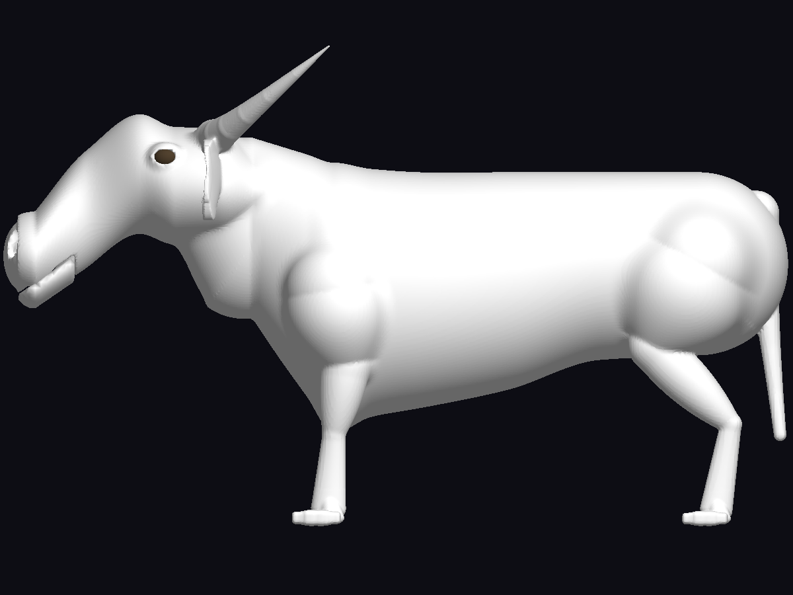 | 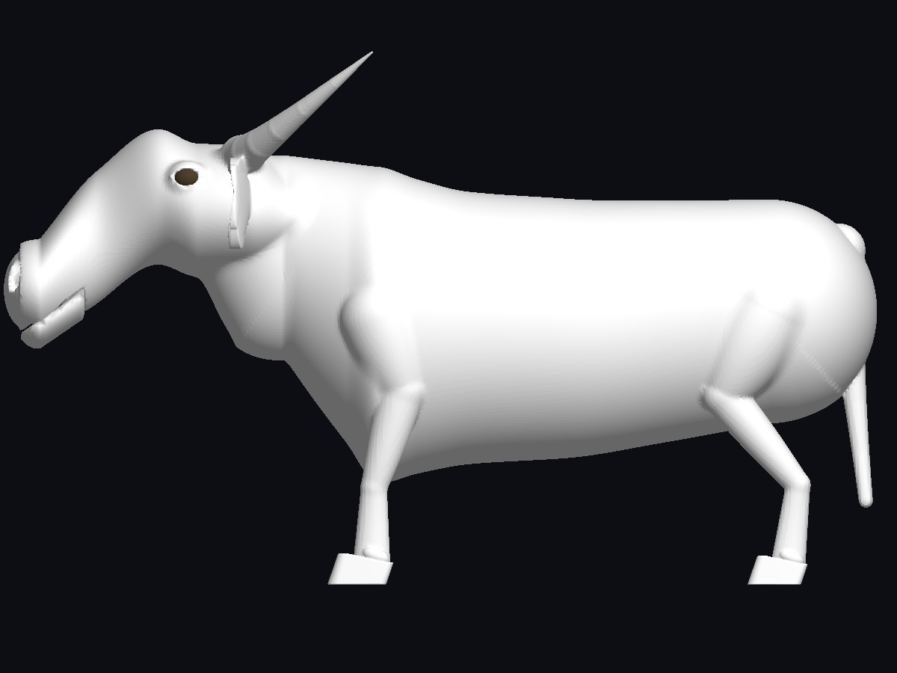 |
| Frontal | 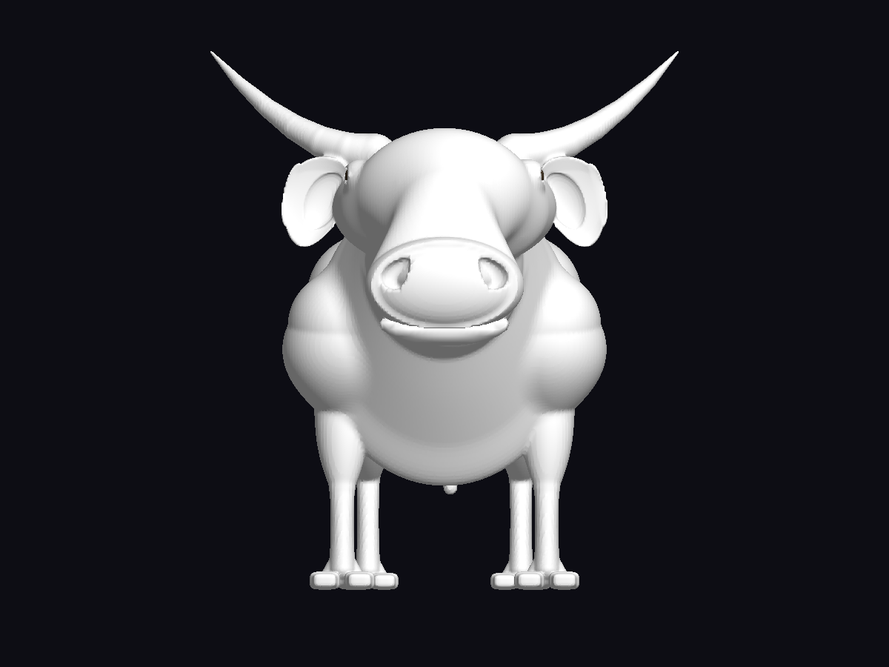 | 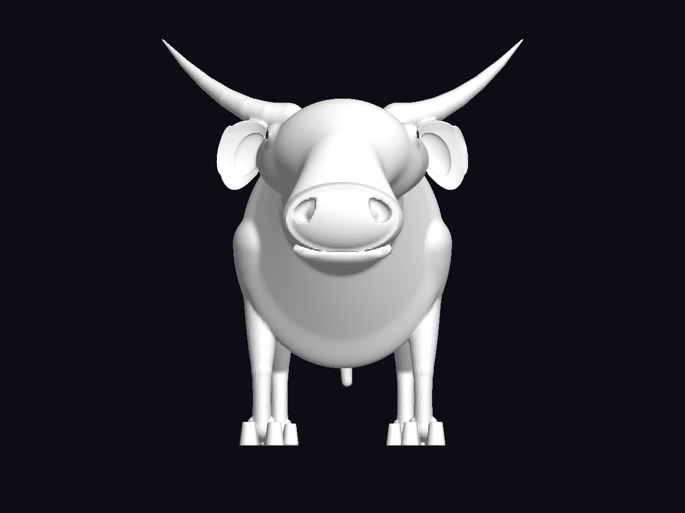 |
| Posterior | 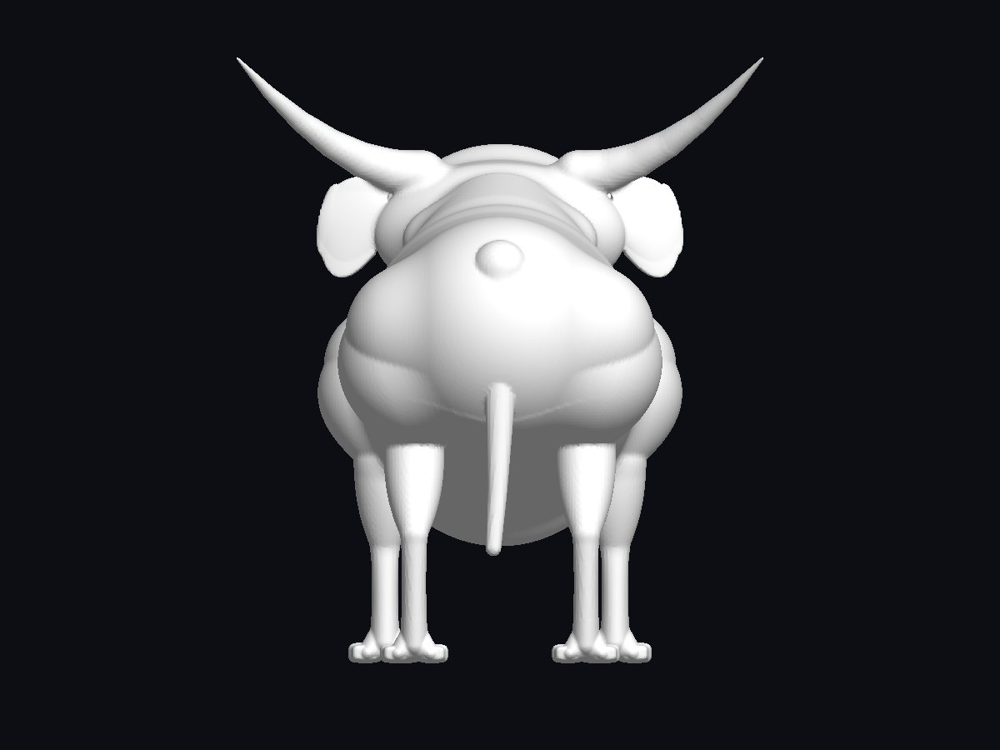 | 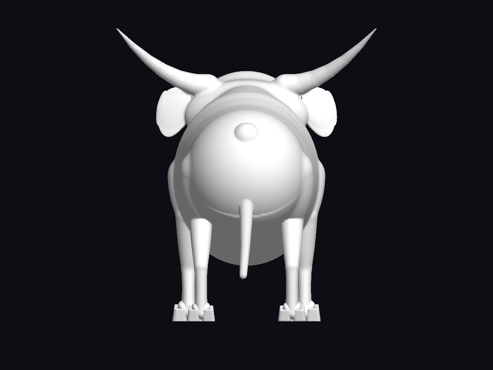 |
| Tres cuartos | 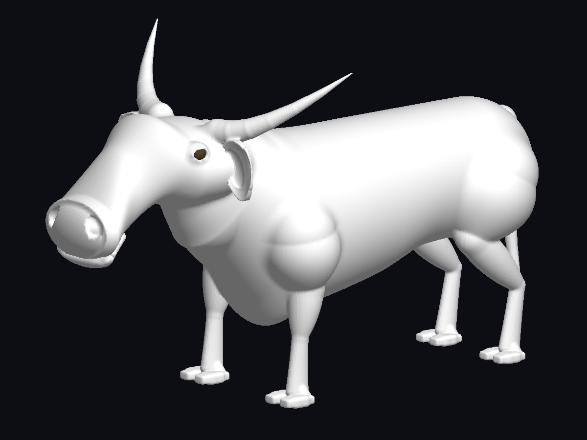 | 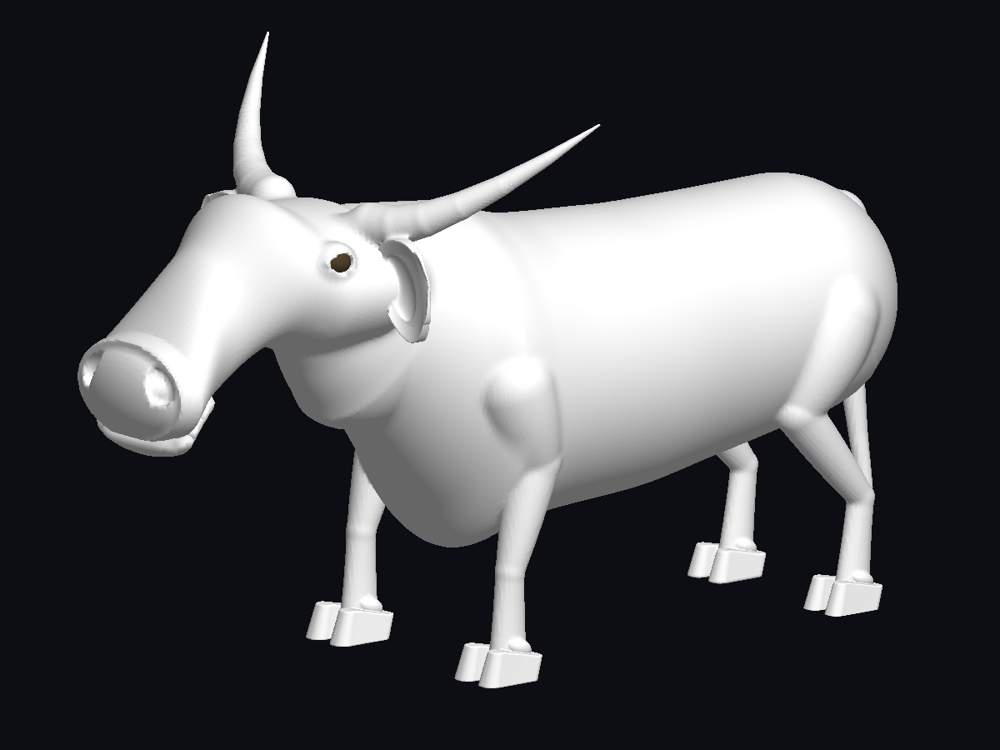 |
| Uña delantera lateral | 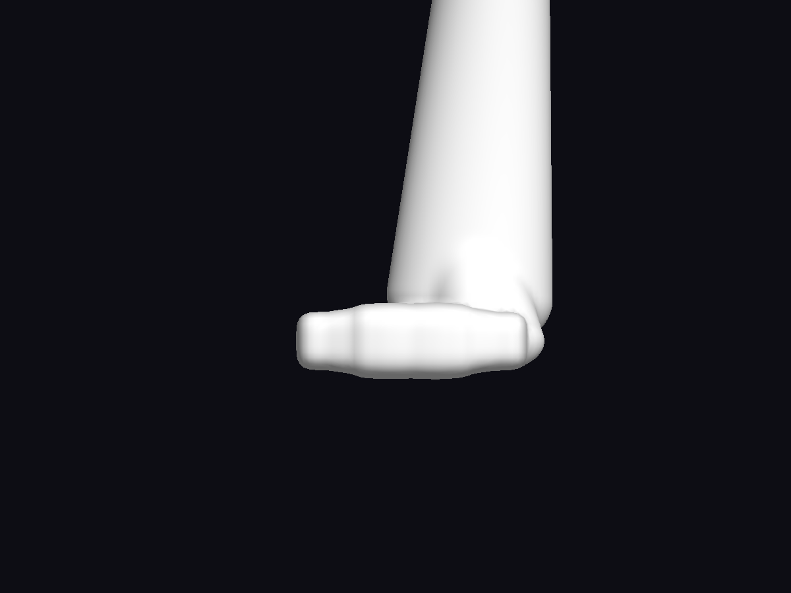 | 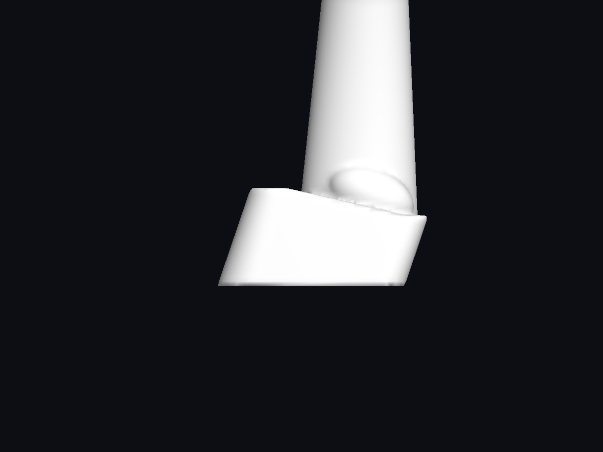 |
| Uñas delanteras, frente | 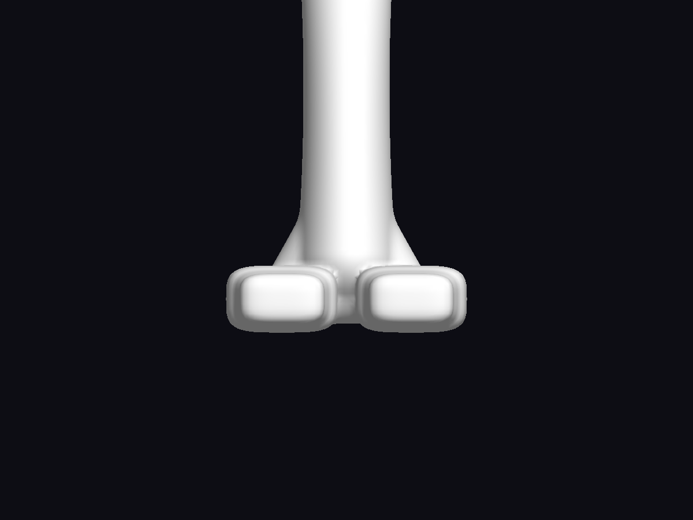 | 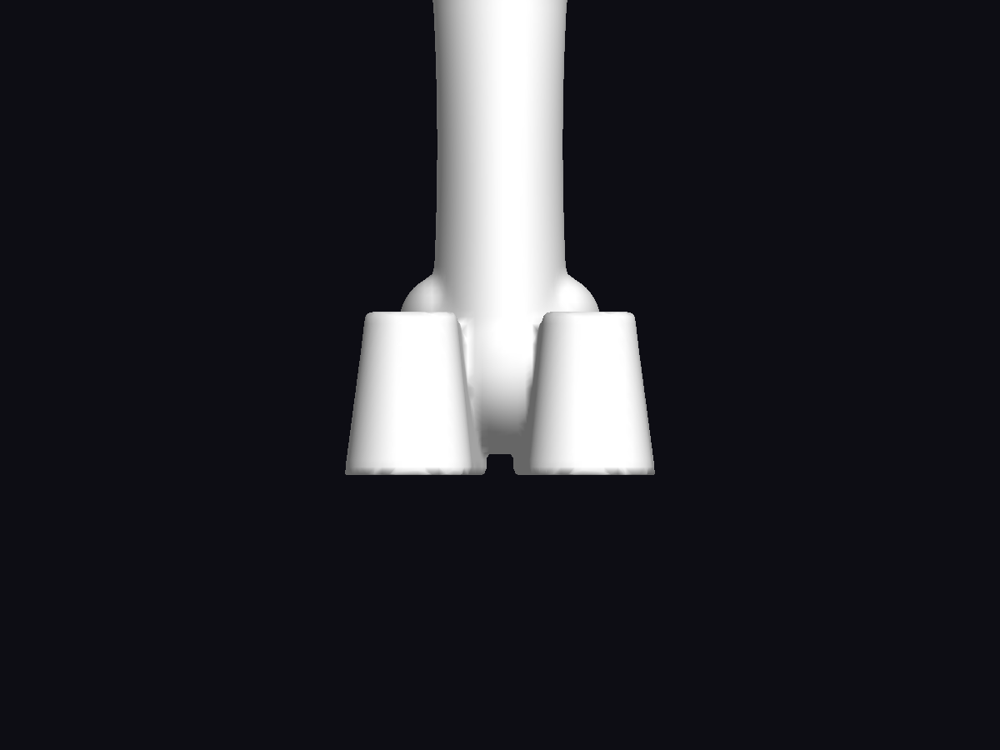 |
| Suela | 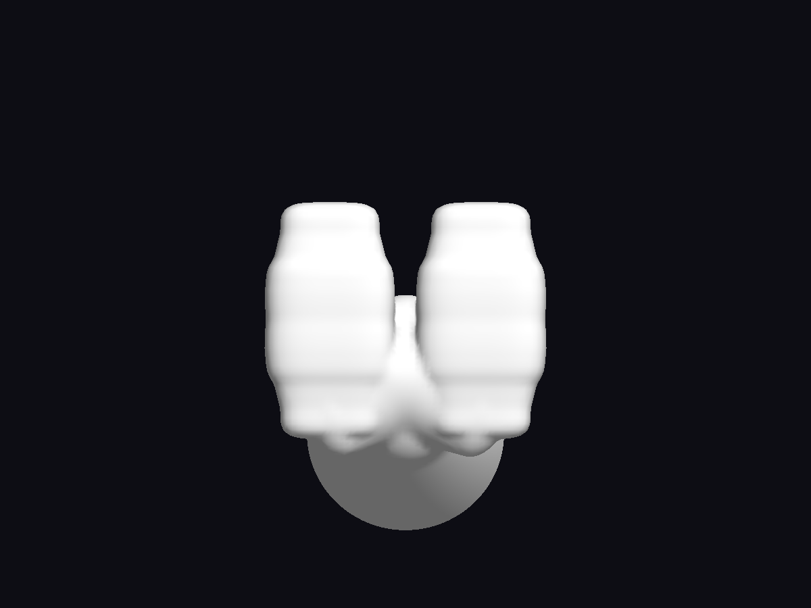 | 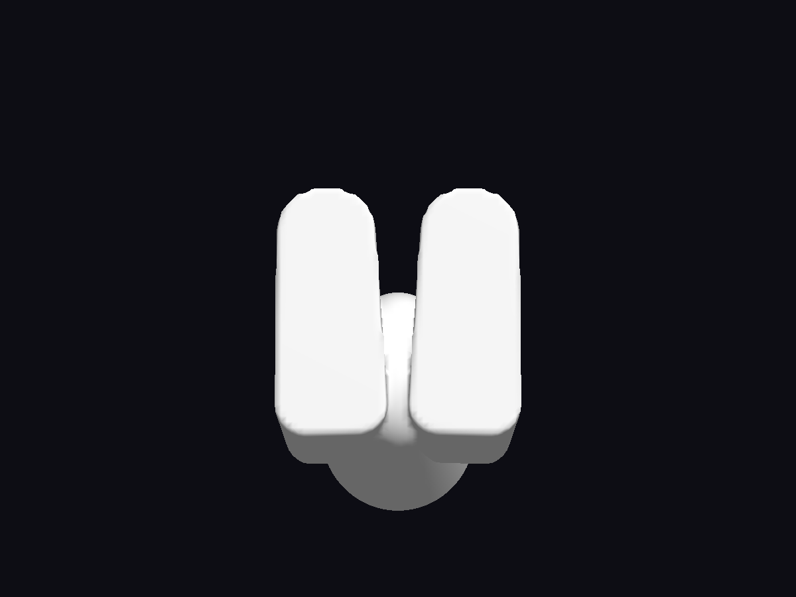 |

Cada directorio [adult](validation/bovine-body-hooves/after/adult/), [juvenile](validation/bovine-body-hooves/after/juvenile/) y [newborn](validation/bovine-body-hooves/after/newborn/) contiene cuatro vistas completas y veinte detalles: frente, lado, posterior, tres cuartos y suela de cada uno de los cuatro pies. Los índices 0/1 son delanteros izquierdo/derecho y 2/3 traseros izquierdo/derecho. Los detalles aíslan el campo anatómico del miembro para evitar oclusiones del pie opuesto; las vistas completas conservan toda la criatura.

Las acciones proceden de la demo real: [marcha](validation/bovine-body-hooves/after/ecosystem-walking.png), [giro observado](validation/bovine-body-hooves/after/ecosystem-turning.png), [bebida](validation/bovine-body-hooves/after/ecosystem-drinking.png), [alimentación](validation/bovine-body-hooves/after/ecosystem-feeding.png) y [huida](validation/bovine-body-hooves/after/ecosystem-fleeing.png). Beber/comer exige `REACH_REACHED`; el giro exige velocidad angular medida, no una intención de girar. Se comprueban también neonatos, juveniles, skinning CPU, readback GPU, ciclo de LOD y Velkar.

Los comandos, hashes de ejecutables y recetas, resultados de capturas y logs están en [manifest.json](validation/bovine-body-hooves/after/manifest.json). Las iteraciones intermedias se conservan en `iteration1/` y `iteration2/`. El resumen cuantitativo final de pruebas y rendimiento se guarda en `validation/bovine-body-hooves/results.json`.

## Archivos y funciones

| Archivos | Funciones o estructuras modificadas |
|---|---|
| `recipes/brumacerno.creature.json` | Cuatro etapas: perfiles axiales, proporciones de miembros y controles de pezuña. |
| `src/AxialBodyUprightTetrapod.c` | `AxialBodyUprightTetrapod_BuildSweepStations`. |
| `src/LimbMammal.c` | `ClovenFoot`, `LimbMammal_Resolve`, `LimbMammal_BuildRigDescriptor`, `LimbMammal_ConfigureRig`. |
| `include/CreaturePhenotype.h`, `src/CreaturePhenotype.c` | `LimbPhenotype`, `CreaturePhenotype_Normalize`, `CreaturePhenotype_Interpolate`. |
| `include/Anatomy.h`, `src/CreatureMorph.c` | `BodyConnection`; interpolación de conexiones de `MixGraph`. |
| `include/RigBuilder.h`, `src/ProceduralAnimator.c` | `LimbRig`; selección ungulígrada en `ProceduralAnimator_Update`. |
| `include/SDFPrimitives.h`, `src/SDFPrimitives.c` | `SDF_KeratinClaw`. |
| `include/SDFInterval.h`, `src/SDFInterval.c` | `SDF_KeratinClawInterval`. |
| `include/MonsterSDF.h`, `src/MonsterSDF.c` | `MonsterSDFConnector`; compilación en `MonsterSDF_Build`, `MonsterSDF_ConnectorSublevelBounds`, `MonsterSDF_EvalConnectorDistance`, `MonsterSDF_ConnectorRange`, `MonsterSDF_AppendageDetails`, `MonsterSDF_PinnaTarget`, `MonsterSDF_GetDetailRegions`. |
| `tools/generate_sdf_shader.py`, `src/MonsterSDFShader.generated.h`, `src/MonsterSDFCompute.generated.h` | Generación automática de primitiva, empaquetado e intervalo; cabeceras regeneradas. |
| `shaders/sdf_interval_validate.comp`, `src/OpenGLRenderer.c` | Intervalo de cápsula; sondeos GPU alrededor de una uña en `OpenGLRenderer_ValidatePinnaIntervals`. |
| `tools/generate_recipe_schema.py`, `src/CreatureRecipeSchema.inc`, `src/CreatureRecipeBrumacerno.generated.inc` | Campos opcionales y respaldo canónico regenerados. |
| `tests/test_cloven_hoof.c` | `ClawField`, `AnatomicalFeet`, `MorphologyControls`; registro en `tests/main_test.c` y `Makefile`. |
| `tests/test_bovine_editor.c` | `BovineNearTemplate`: ocho uñas también en MID/FAR. |
| `tools/capture_bovine_anatomy.c`, `Makefile` | Capturas ortográficas sin textura y campos de cada pie. |
| `tools/inspect_brumacerno.c` | Medidas normalizadas, articulaciones, suelas y cápsulas. |
| `tools/validate_recipe_gpu.c` | Sondeos de las uñas y espolones; validación fragmento por lotes. |
| `demos/demo_ecosystem.c` | Captura de giro observado en `matchesCapture` y bucle de simulación. |
| `tools/validate_bovine_body.py` | Matriz reproducible de etapas, vistas, acciones, LOD y GPU. |

Reproducción:

```sh
make -B -j6 test demos build/capture_bovine_anatomy build/inspect_brumacerno build/validate_recipe_gpu
python3 tools/generate_builtin_brumacerno.py --check
python3 tools/validate_bovine_body.py
make visual-morph-gpu-regressions
python3 tools/validate_ecosystem.py --output=build/bovine-ecosystem-validation
```
