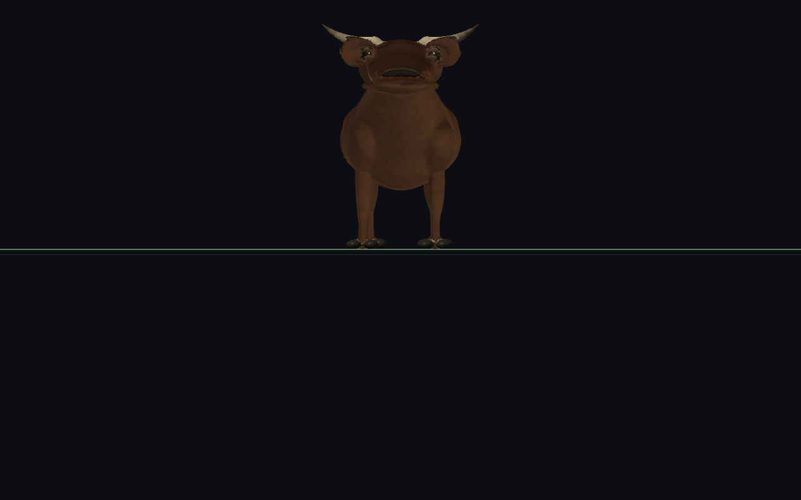
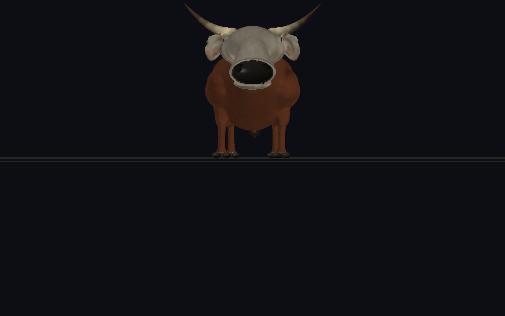
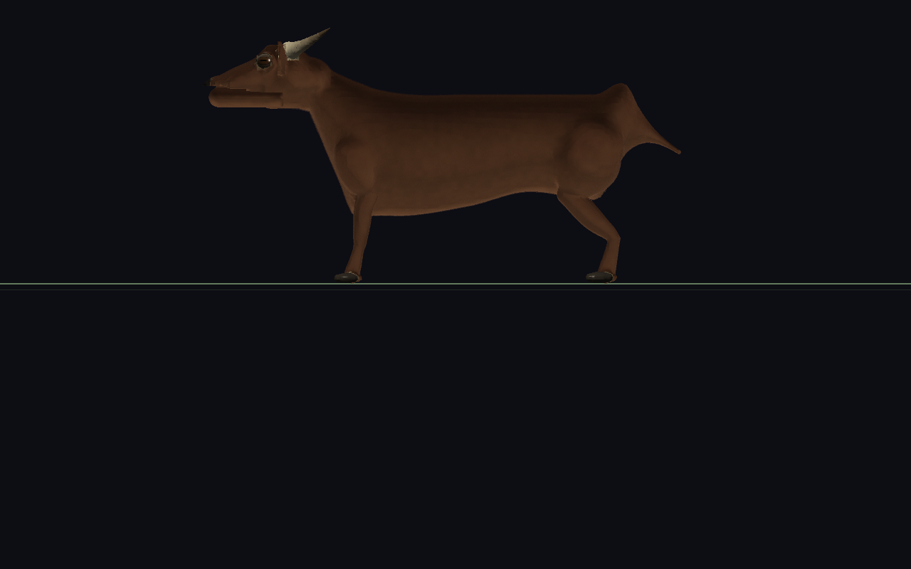
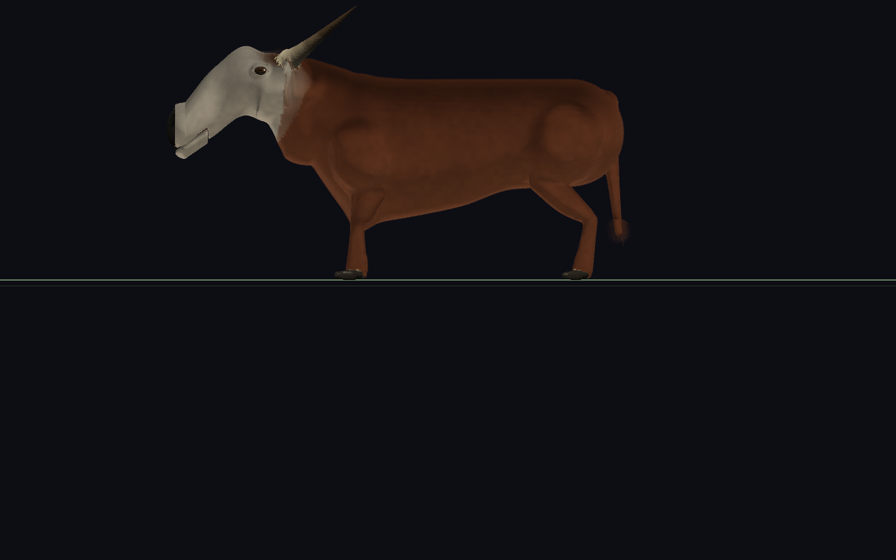
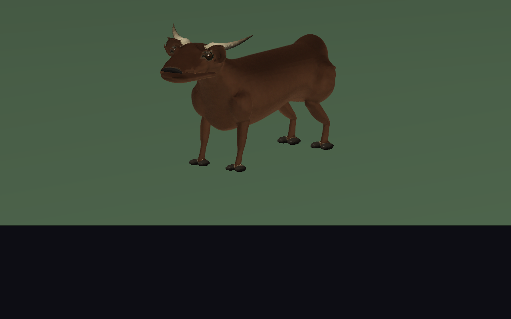
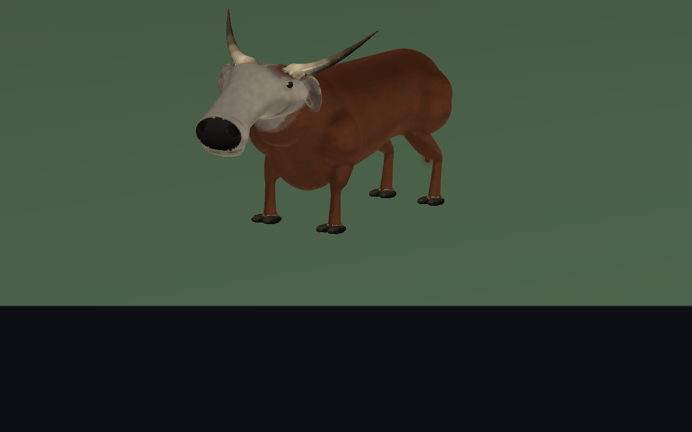

# Brumacerno: revisión anatómica bovina

La receta 3 conserva sus nueve módulos, las cuatro etapas de desarrollo y la anatomía procedural SDF. El cambio concentra masa en los cuartos delanteros, reconstruye el perfil facial de rumiante y diferencia cara, pelo, planum nasal, cuernos y cascos. Las imágenes proceden del ecosistema real; no son imágenes generadas ni un modelo importado.

## Referencia y diagnóstico inicial

Referencia: [Realistic Bull 3D Model, WildMesh 3D](https://sketchfab.com/3d-models/realistic-bull-3d-model-b8b9e4eb79454afcb839d720aceeb515). Se pudo consultar su [miniatura pública de 1920 × 1080](validation/bull-overhaul/reference-preview.jpg), una vista de tres cuartos. La página del visor respondió 403. Se observaron frente ancha, cara inclinada y alargada, cuello potente, pecho profundo, orejas bajo los cuernos, pelaje marrón y cara clara. El lado opuesto, la sección ventral y el recorrido tridimensional posterior de los cuernos se estimaron; no se inspeccionó la malla de referencia. [Procedencia de la imagen](validation/bull-overhaul/reference.json).

`CreatureRecipes_Find()` consulta primero `CreatureRecipeRegistry_Find()`. `recipes/catalog.txt` incluye `brumacerno.creature.json`: esa receta externa, no la implementación C anterior, produjo las capturas iniciales. La receta incorporada anterior usaba extremidades mamíferas genéricas, ojos mayores y otro pelaje. Cambiarla por sí sola no habría corregido el ecosistema.

La receta externa original tenía cráneo `.72/.68/.60`, envolvente vertical `1.35`, hocico `.46/.96`, pendiente `.08`, párpados `.38`, compresión `.34` y miembros `LIMB_ARCHETYPE_UNGULATE`. El resultado tenía perfil canino casi horizontal, abertura oral larga, cuello poco desarrollado, patas distales finas, cola corta y poca diferenciación regional. El planum se confundía con una trufa de perro y los ojos sobresalían visualmente.

El límite del resolver estaba en la composición, además de los números: el hocico BLUNT conserva una punta de como máximo `.82 × rootWidth`, mientras que su estación intermedia interpola entre raíz y punta. No podía estrechar un puente y volver a ensanchar la premaxila. La [prueba con parámetros existentes](validation/bull-overhaul/parameters-only/side.png) alargó la cara, pero conservó esa composición canina y una mandíbula horizontal.

La [receta inicial completa](validation/bull-overhaul/before/recipe.creature.json), su [identificación de versión](validation/bull-overhaul/before/baseline.json), los comandos y las capturas se conservan. El ejecutable inicial queda en `build/bull-overhaul-baseline`; es un artefacto local que `make clean` puede eliminar. Las vistas ortogonales se instrumentaron antes de modificar la morfología. Todas las capturas enfocadas exigen una malla residente del LOD solicitado y registran su número de vértices: no se compararon proxies con el toro final.

## Cambios anatómicos

- **Familia bóvida:** `HEAD_ARCHETYPE_BOVID = 3`, añadido después de lagarto, cánido y ave, sin renumerarlos. Resuelve puente estrecho, morro distal ancho, descenso facial y casquete terminal independiente. Reutiliza las seis estaciones existentes, los pabellones, las órbitas y el sistema mandibular.
- **Frente y maxilares:** mayor anchura relativa, menor relación altura/anchura y apoyos maxilares contenidos en el rostro. La envolvente vertical final no es directamente comparable con el antiguo resolver: se revisó el volumen resuelto y no solamente el valor del deslizador.
- **Boca:** el plano labial acompaña la pendiente de la cara; la comisura pasa del 18 % al 62 % de la longitud facial. La sección mandibular llega al labio también lateralmente. La pieza móvil termina anatómicamente detrás de la abertura distal, evitando la sonrisa canina larga.
- **Contacto funcional:** `oralContactPoint` distingue la abertura oral de `mandibularSymphysis`. El rig usa el primero; el punto óseo permanece disponible. En el adulto canónico, la abertura queda aproximadamente a 2–3 mm de las superficies labiales al aplicar la escala ecológica. Las etapas anteriores mantienen sus puntos resueltos y sus límites de alcance.
- **Nariz y ojos:** planum amplio con el material nasal existente; cutters nasales curvos y simétricos; globos laterales oscuros, párpados comprimidos y rebordes integrados en el cráneo. Se corrigió además el inicio del arco palpebral, que antes partía del centro de la abertura. El reborde nuevo evita las pequeñas láminas desconectadas que aparecieron durante las iteraciones.
- **Cuernos y orejas:** bases sólidas, crecimiento inicial lateral y arco ascendente/posterior usando los marcos reales de los slots. La simetría se comprueba en coordenadas resueltas. Las orejas usan las pinnae existentes, con raíces laterales bajo los cuernos y concha visible.
- **Cuello y pecho:** `dewlapDepth` y `brisketDepth` desplazan el contorno ventral de las secciones cervicales y pectorales existentes. No son elipsoides flotantes. Se interpolan durante el desarrollo y siguen los mismos huesos cervicales.
- **Miembros y cascos:** se conserva el arquetipo ungulado 6. Sus tres tramos tienen proporciones propias y la longitud total se recalcula con la altura escapular y la suela. Cada casco conserva dos mitades separadas; la sección superelíptica de queratina proporciona paredes y apoyo más planos que los dedos redondeados anteriores.
- **Cola:** más larga y colgante, con pincel terminal de pelo. Una cola casi vertical no puede representarse como función del eje Z del tronco: ahora sus conectores permanecen activos y no se sustituyen por ese barrido. La propiedad compilada `axialSweepMember` mantiene la misma decisión en CPU, GPU, cotas y extracción de regiones.

La receta externa es ahora la fuente canónica. `tools/generate_builtin_brumacerno.py` genera el respaldo C al compilar. Una prueba compara los documentos normalizados completos, incluidas sus cuatro etapas. Los nuevos campos JSON neutros son opcionales para mantener la lectura de recetas antiguas; continúan rechazándose duplicados, conteos incoherentes y documentos incompletos.

## Material y coste geométrico

`PigmentLayer.regionMask` permite capas anatómicas sin comprobar el ID de especie en el renderer. El cero conserva el comportamiento global anterior. Los cuatro componentes disponibles de las filas de dirección guardan las máscaras, incluidos los bancos de transición: no se aumentó el tamaño de `SurfaceRecipe`.

La mezcla regional se calcula por vértice y se interpola como peso, evitando interpolar identificadores discretos de región. La receta combina pelo corto marrón rojizo, cara gris crema y pelo algo más largo en cuello y hombros. El extremo anatómico de la cola admite el perfil de ornamentación pilosa. Se reutilizan `SDF_MATERIAL_NASAL_PAD`, `SDF_MATERIAL_HORN` y `SDF_MATERIAL_HOOF`; la queratina y el planum no generan pelo.

La resolución adicional se limita a cabeza, órbitas y narinas cercanas. El tronco conserva su resolución anterior. El LOD lejano mantiene muestreo local en pabellones y rasgos faciales para evitar su desaparición. La geometría sigue perteneciendo a plantillas compartidas por receta, etapa, cubeta y LOD. El crecimiento, la pose y cada individuo no provocan remallado por frame.

## Comparación visual

Misma iluminación del motor, sin HUD, cámaras relativas al individuo y encuadre reproducible. Las vistas frontal y lateral son ortogonales al eje del animal, sin la elevación de cámara que tenía la captura original.

| Vista | Antes | Después |
|---|---|---|
| Frente |  |  |
| Lateral |  |  |
| Tres cuartos |  |  |

Detalles finales: [cabeza frontal](validation/bull-overhaul/after/brumacerno-head-front.png), [cabeza lateral](validation/bull-overhaul/after/brumacerno-head-side.png), [ojos, narinas y concha](validation/bull-overhaul/after/brumacerno-head-three-quarter.png), [cuernos completos](validation/bull-overhaul/correctness/horns-front.png), [cascos frontales](validation/bull-overhaul/after/brumacerno-feet-front.png), [cascos laterales](validation/bull-overhaul/after/brumacerno-feet-side.png), [cuello y hombros](validation/bull-overhaul/after/brumacerno-neck-side.png).

Desarrollo y acciones reales: [neonato](validation/bull-overhaul/after/brumacerno-newborn-side.png), [juvenil](validation/bull-overhaul/after/brumacerno-juvenile-side.png), [marcha](validation/bull-overhaul/after/brumacerno-walking.png), [bebida](validation/bull-overhaul/after/brumacerno-drinking.png), [alimentación](validation/bull-overhaul/after/brumacerno-feeding.png), [huida](validation/bull-overhaul/after/brumacerno-fleeing.png). Se conserva también la captura de Velkar y sus acciones para detectar regresiones del camino compartido.

Los manifiestos guardan comandos, códigos de salida, SHA-256 del ejecutable y hashes de los documentos externos. Cada captura tiene un `.log` y un perfil `.json` junto al PNG. Los perfiles de un solo frame incluyen subidas iniciales y no representan FPS estable.

## Validación reproducible

```sh
make -B -j6 test demos build/inspect_brumacerno build/validate_recipe_gpu
python3 tools/generate_builtin_brumacerno.py --check
python3 tools/capture_ecosystem_creatures.py --actions --details \
  --output=docs/validation/bull-overhaul/after
./build/inspect_brumacerno recipes/brumacerno.creature.json
./build/validate_recipe_gpu recipes/brumacerno.creature.json 3
./demos/demo_ecosystem --herbivores=1 --carnivores=0 --plants=0 \
  --focus=3 --frames=720 --lod-cycle --validate-skinning \
  --validate-mouth=720 --profile=build/bull-lod.json
```

La suite ampliada comprueba sincronización del catálogo, familia bóvida aleatoria, orden y simetría de landmarks, puente más estrecho que el morro, comisura distal, contacto en la abertura, continuidad del campo entre estaciones, intervalos alrededor de ojos/narinas, máscara regional y sus bancos de metamorfosis. La regresión asíncrona espera la plantilla NEAR real y exige una única componente, sin borrar triángulos.

El validador GPU toma puntos de los nodos, del dominio global y de los alrededores de narinas, órbitas y puente. Compara CPU, compute y fragmento, además de intervalos de primitivas y barrido. La demo valida mediante readback las posiciones y normales de skinning; vuelve a hacerlo al cambiar la malla residente durante un cambio de LOD. La matriz adicional ejecuta el fallback CPU completo y un ciclo NEAR → MID → FAR → NEAR.

## Archivos modificados y motivo

| Archivos | Motivo |
|---|---|
| `recipes/brumacerno.creature.json` | Proporciones, estadios, ungulados, cuernos, cola y superficie del catálogo que usa el ecosistema. |
| `src/CreatureRecipeBrumacerno.c`, `src/CreatureRecipeBrumacerno.generated.inc`, `tools/generate_builtin_brumacerno.py`, `Makefile` | Respaldo compilado generado desde el JSON y dependencia de compilación; objetivo de inspección sin GL. |
| `include/Head.h`, `src/Head.c` | Familia bóvida, perfil facial, márgenes orbitales y contacto oral semántico. |
| `src/CreatureRig.c`, `src/CreatureMorph.c` | Uso del contacto funcional y transporte continuo de los campos nuevos durante metamorfosis. |
| `include/CreaturePhenotype.h`, `src/CreaturePhenotype.c` | Papada, pecho y caída caudal normalizados e interpolados; también se interpolan los controles cervicales que faltaban. |
| `src/AxialBodyUprightTetrapod.c` | Volumen ventral continuo dentro del barrido cervical/pectoral. |
| `src/LimbMammal.c`, `src/Tail.c` | Proporciones unguladas y marco de cola colgante, conservando módulos y rig. |
| `include/MonsterSDF.h`, `src/MonsterSDF.c`, `src/MonsterSDFRayBounds.h` | Compilación de rasgos, boca inclinada, cutters curvos, cascos y pertenencia real al barrido; cotas conservadoras. |
| `include/SDFInterval.h`, `src/SDFInterval.c` | Intervalos de la misma sección elíptica/superelíptica utilizada por el campo escalar. |
| `include/PigmentPattern.h`, `src/PigmentPattern.c`, `src/Surface.c`, `src/SurfaceMapper.c` | Máscaras regionales, evaluación sin render, empaquetado/interpolación y cobertura terminal pilosa. |
| `src/CreatureRecipeIO.c`, `tools/generate_recipe_schema.py`, `src/CreatureRecipeSchema.inc` | Enum ampliado y campos nuevos opcionales compatibles con documentos anteriores. |
| `src/EcosystemVisual.c` | Detalle localizado y conservación de rasgos en LOD lejano; continúa usando un solo worker y geometría compartida. |
| `shaders/surface/pigment_regions.glsl`, `shaders/surface/pigment.glsl`, `shaders/surface/morph_domain.glsl` | Evaluación de máscaras y transporte de pesos regionales. |
| `shaders/monster_mesh.vert`, `shaders/monster_surface.frag`, `shaders/fur_guard.vert`, `shaders/fur_guard.frag` | Interpolación continua de máscaras y respuesta lisa del planum nasal. |
| `shaders/sdf_scene.glsl`, `shaders/sdf_surface_material.glsl`, `shaders/sdf_interval_validate.comp` | Misma geometría oral/caudal, materiales de transporte y sección de casco en GPU. |
| `tools/generate_sdf_shader.py`, `src/MonsterSDFShader.generated.h`, `src/MonsterSDFCompute.generated.h`, `src/MonsterSurfaceShader.generated.h` | Generación automática de evaluación, empaquetado y shaders; los `.generated.h` no se editaron manualmente. |
| `src/OpenGLRenderer.c` | Validación intervalar con la sección de conector correspondiente al tejido. |
| `demos/demo_ecosystem.c`, `tools/capture_ecosystem_creatures.py` | Cámaras de inspección, espera del LOD, pruebas de conectividad/cotas, ciclos de LOD y manifiestos verificables. |
| `tests/test_bovine_editor.c` | Regresiones de catálogo, anatomía, campo, materiales y plantilla cercana de producción. |
| `tools/inspect_brumacerno.c`, `tools/validate_recipe_gpu.c` | Landmarks, medidas, contacto y continuidad; sondeos GPU concentrados en los rasgos modificados. |

No se cambió la prioridad del registro, la receta ecológica asignada a la especie, la arquitectura de recursos/IA/reproducción ni el namespace de módulos. El desarrollo visual conserva la aproximación existente de deformar una plantilla adulta compartida: no equivale a remallar el SDF exacto de cada edad.

## Alcance de la revisión estética

La anatomía y la lectura de toro mejoran de forma sustancial frente al baseline. El resultado sigue teniendo el acabado procedural del motor: la miniatura de referencia tiene pliegues cutáneos, pelo y microdetalle esculpido más ricos. La fidelidad exacta a sus vistas no observadas no se puede certificar. El LOD lejano reduce el microcontorno facial; se revisa a su tamaño de uso, además de las capturas forzadas de diagnóstico.

La limitación de la plantilla adulta es visible en el neonato: conserva una relación cabeza/cuerpo y un desarrollo de cuernos demasiado adultos, aunque los cuatro fenotipos canónicos resuelven geometría finita y cuernos neonatales casi nulos. No se presenta la captura neonatal como reproducción exacta de ese fenotipo. El borde del planum y las bases cornuales aún muestran facetas en primeros planos extremos; los cascos conservan más redondeo que el modelo esculpido de referencia.

## Resultados medidos

`make test` terminó con todas las suites correctas y `make demos` compiló todas las demos sin advertencias. La comprobación del inicializador canónico, la sintaxis de las herramientas Python y `git diff --check` también pasaron. Los logs de compilación y pruebas están en [correctness](validation/bull-overhaul/correctness/).

La ejecución final de `capture_ecosystem_creatures.py --actions --details` produjo **38 casos correctos**, con un único SHA-256 de ejecutable y la receta externa identificada en [captures.json](validation/bull-overhaul/after/captures.json). Las capturas enfocadas acreditan residencia NEAR. El adulto tiene 53.675 vértices en el cuerpo y una sola componente conectada; ojos y piezas mandibulares articuladas se mantienen como representaciones anatómicas separadas.

Medidas del adulto canónico, en unidades locales del modelo, antes de su calibración ecológica:

| Medida | Antes | Después |
|---|---:|---:|
| Longitud cefálica | 2,4603 | 3,3629 |
| Anchura cigomática | 2,0352 | 2,5550 |
| Anchura del puente intermedio | 1,5355 | 1,2586 |
| Anchura distal del morro | 1,3271 | 1,8169 |
| Morro / puente | 0,864 | 1,444 |
| Distancia entre ojos | 1,6130 | 2,0563 |
| Pendiente labial resuelta | 0 | −0,6863 |

Los [landmarks completos](validation/bull-overhaul/correctness/anatomy.json) incluyen cotas del campo, ojos, narinas, boca y extremos de ambos cuernos en las cuatro etapas. Los ejes centrales muestreados de cuernos, cascos y cola no tienen huecos: 510/748/748/748 muestras según etapa. Esta prueba complementa la conectividad de la malla NEAR; no sustituye una demostración topológica para todos los fenotipos aleatorios ni para todas las resoluciones.

| Comprobación | Resultado |
|---|---|
| SDF CPU frente a compute y fragmento, cuatro etapas | 1.724 puntos por etapa; error máximo `7,75e-7` unidades locales |
| Intervalos GPU de primitivas/barridos | Máximo `8,57e-7`; todos los casos PASS |
| Ciclo de LOD, 720 frames | NEAR → MID → FAR → NEAR, sin error de ejecución; 3 construcciones anatómicas y 721 aciertos de caché |
| Skinning GPU frente a CPU durante ese ciclo | Posición máxima registrada `0`; normal máxima `2,57e-7` |
| Boca renderizada frente a física, ciclo completo | Máximo 2,812 mm; p95 2,697 mm |
| Pies, ciclo completo | Apoyo máximo 1,202 mm; incluyendo vuelo, 4,013 mm |
| Marcha capturada | Apoyo máximo 1,170 mm; boca 2,810 mm |
| Bebida capturada | Apoyo máximo 1,202 mm; boca 2,812 mm |
| Alimentación capturada | Apoyo máximo 0,845 mm; boca 0,733 mm |

Los errores de boca miden alineación visual con el landmark físico, no distancia al recurso. Las pruebas ecológicas existentes verifican alcance real, rechazo de objetivos imposibles, contacto sostenido y transferencia autorizada; las capturas de bebida y alimentación corresponden a esos estados del controlador, sin colocar la cabeza manualmente.

El [fallback CPU](validation/bull-overhaul/correctness/matrix.json) produjo imágenes prácticamente iguales al camino GPU: neonato idéntico; adulto con diferencia media de canal 0,00156/255 y 159 píxeles con diferencia superior a 3; bebida con 0,00097/255 y 103 píxeles. Los máximos aislados son 45–46/255 en contornos rasterizados. No se exige identidad binaria de píxeles para afirmar la paridad geométrica. [Mediciones](validation/bull-overhaul/correctness/cpu-gpu-images.json).

El LOD FAR conserva cabeza independiente; su cuerpo aislado no debe confundirse con la representación completa al contar componentes. Las [vistas forzadas NEAR](validation/bull-overhaul/correctness/lod-near.png), [MID](validation/bull-overhaul/correctness/lod-mid.png) y [FAR](validation/bull-overhaul/correctness/lod-far.png) muestran la pérdida de microdetalle. El ciclo comprueba el cambio de representación y la continuidad de landmarks, pero no certifica invisibilidad perceptual de toda transición.

## Rendimiento del ecosistema

Medición secuencial en Ryzen 5 5600H y RTX 3050 Laptop, 1280 × 800, sin HUD, con la misma semilla y cámara fija a zoom 40. Se ejecutaron el binario inicial con su catálogo conservado y el binario final con el catálogo actual, sin compilaciones ni otras pruebas del motor simultáneas. La mezcla es 80 % Brumacerno y 20 % Velkar; son mallas procedurales con sus LOD de uso. Los casos usan 900/600/300 frames para poblaciones iniciales de 10/30/100. La depredación sigue activa: se informa también la cantidad realmente dibujada.

| Población inicial | Antes: media / p95, ms | Después: media / p95, ms | FPS medios después | Dibujados medios antes / después |
|---|---:|---:|---:|---:|
| 10 | 7,847 / 13,616 | 7,676 / 12,838 | 130,3 | 10 / 10 |
| 30 | 21,774 / 28,728 | 20,212 / 27,298 | 49,5 | 27,678 / 28,535 |
| 100 | 57,053 / 65,240 | 56,968 / 65,200 | 17,6 | 98,810 / 98,803 |

El objetivo de **30 FPS se conserva con 30 animales visibles** en esta prueba. **100 animales no alcanzan 30 FPS ni antes ni después.** La diferencia de menos de 0,1 ms entre ambas medias de 100 no justifica afirmar una mejora de velocidad. A esa escala predominan el adaptador/animación (30,10 ms), el envío de render (17,01 ms) y la simulación (9,59 ms); el tiempo GPU medido es 16,77 ms. No se genera una malla por individuo o por frame: ambos casos de 100 registran 11 subidas de geometría y 3 construcciones anatómicas.

El detalle adicional aumenta el calentamiento inicial: de 1,92 a 3,73 segundos en el caso de 100. La memoria máxima pasa de unos 190 a 211 MiB. Ese coste de construcción se paga al preparar las plantillas compartidas y se informa por separado del frame estable. Los perfiles individuales de un frame y las primeras compilaciones de shaders no se usan como estimación de FPS.

En poblaciones mixtas, el error máximo de apoyo alcanza 42,48 mm con 30 animales y 44,35 mm con 100, prácticamente igual al baseline. El máximo que incluye pies en vuelo pasa de 69 a 133 mm en la prueba de 30; no se presenta esa medida como precisión milimétrica global de IK. Las cifras milimétricas de la tabla anterior corresponden exclusivamente a las secuencias bovinas aisladas indicadas.

[Comandos, hashes y resultados de cámara fija](validation/bull-overhaul/performance/manifest.json), [escena de 30 animales](validation/bull-overhaul/performance/fixed-after-30.png) y [escena de 100](validation/bull-overhaul/performance/fixed-after-100.png). Los perfiles `before-*` y `after-*` sin prefijo `fixed-` corresponden a la pasada preliminar con seguimiento: se excluyen de la comparación principal porque en la de 100 el seguimiento cambió el número de individuos visibles.
