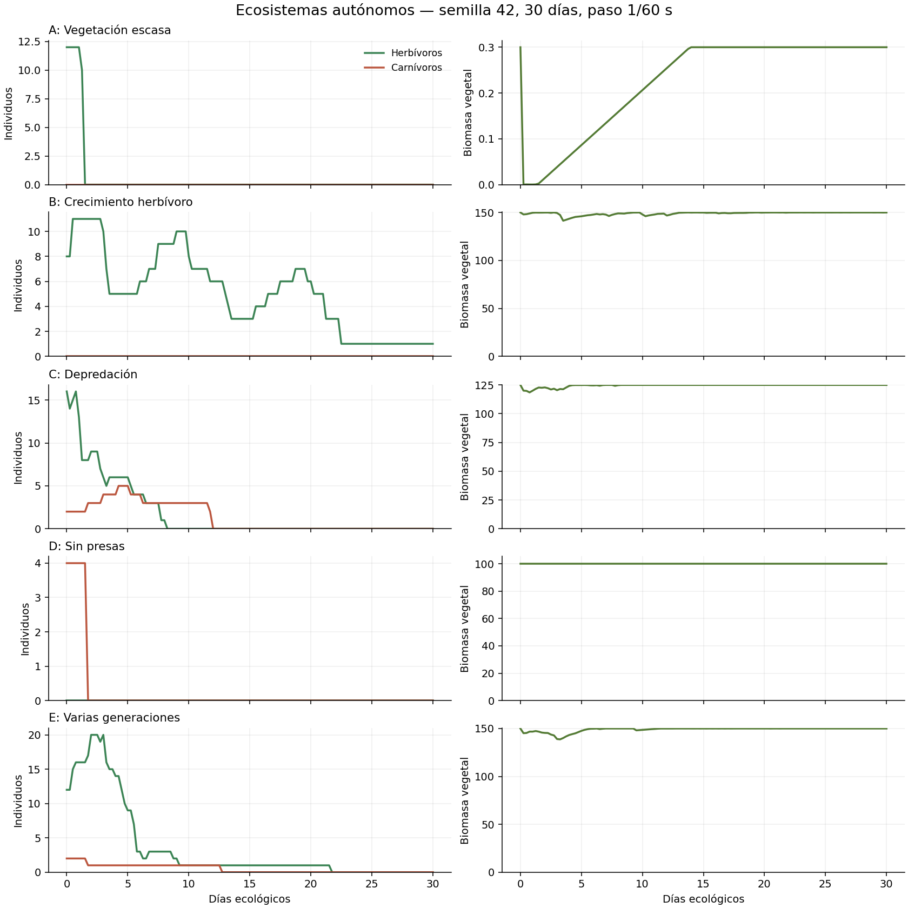
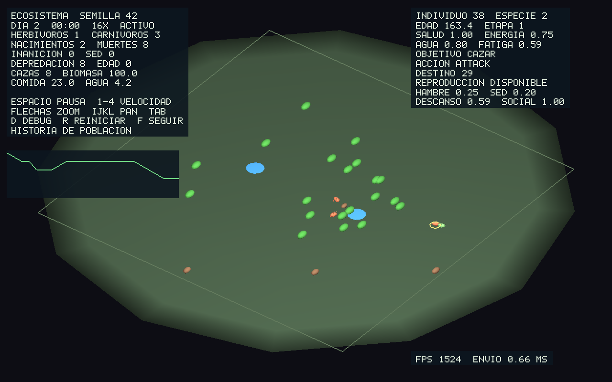

# Simulación de ecosistemas

Implementación inicial de vida artificial, independiente del renderizado. Dos ejecutables comparten exactamente el mismo núcleo ecológico: `demos/demo_ecosystem_headless` y `demos/demo_ecosystem`. No hay horarios animales ni eventos ecológicos programados. Los escenarios sólo establecen condiciones iniciales y perfiles; los individuos deciden mediante percepción, memoria y utilidad.

## Auditoría de partida y dependencias

Se inspeccionó `main` después de `git fetch origin main`: ambos apuntaban a `1c483c9`, con árbol limpio. Se leyeron `AGENTS.md`, `CREATURE_AI_ARCHITECTURE.md`, `ANATOMICAL_INTERACTIONS.md`, las interfaces/ciclos de IA, los adaptadores de escena y los puntos de construcción anatómica, animación, alcance, límites y Ager. CodeGraph se utilizó para consultar estructura y dependencias.

| Hallazgo solicitado | Verificación en la revisión de partida |
|---|---|
| Perfil y mente separados | Confirmado: `BrainProfile` prestado e inmutable; `CreatureMind` privado por actor. |
| Percepción, decisión, navegación y ejecución modulares | Confirmado en `CreatureMind_Update` y los módulos correspondientes. |
| `forager` y hambre | Confirmado: búsqueda, aproximación y contacto oral de comida. |
| Nutrición sin descuento de recurso | Confirmado: `CreatureActions_Update` llamaba directamente a `CreatureNeeds_Satisfy`. |
| Registro de 128 y consultas lineales | Confirmado: almacenamiento embebido y recorridos de `AIWorld`. |
| A* de 48×48 y selección lineal de abierto | Confirmado en `CreatureNavigation_Plan`. |
| Dos actores y lógica mezclada en escena | Confirmado: `UpdateSceneAI(StageActor *dog, StageActor *lizard, ...)` y arrays locales de dos actores. |
| Alcance anatómico/contacto estable | Confirmado: `InteractionTarget`, `AnatomicalReach`, postura corporal y contacto de 0,25 s. |
| Ager no equivale a ciclo biológico | Confirmado: interpola anatomía/apariencia; no posee población ni fisiología. |
| Ausencia de gestor ecológico completo | Confirmado en módulos, entradas y pruebas existentes. |

La referencia `make -j6 test demos benchmarks/benchmark_ai` pasó antes de editar. El benchmark de IA anterior, 100 agentes y 3.600 frames, dio 0,174968 ms/frame de media y 0,487 ms máximo. Ese microbenchmark no incluye la economía, fisiología ni colisiones del ecosistema y no debe compararse como si midiera la misma carga.

`Creature`, recetas y variaciones resuelven fenotipo/anatomía; `CreatureRig`, `MonsterAnimation`, `ProceduralAnimator` y `AnatomicalReach` ejecutan un cuerpo procedural; `CreatureBoundary` impone su envolvente; `MonsterAger` interpola representaciones. Esas responsabilidades se conservan. Ninguna de ellas almacena la mente o la identidad ecológica nueva. No se modificaron shaders ni cabeceras generadas.

## Módulos y contratos

| Módulo nuevo | Responsabilidad |
|---|---|
| `SimulationClock` | Ticks fijos, deuda de presentación, pausa, velocidad y día ecológico. |
| `CreaturePhysiology` | Reservas de energía/agua, fatiga, salud, etapas y daño progresivo. |
| `CreatureGenome` | Siete rasgos semánticos, recombinación y mutación acotada; PRNG sin globales. |
| `CreatureReproduction` | Perfil biparental, condiciones individuales y estado de gestación/ascendencia. |
| `EcosystemResources` | Biomasa, regeneración, agua explícitamente infinita y decadencia de cadáveres. |
| `EcosystemWorld` | Propiedad, IDs, fases, cuerpo ligero, arbitraje de interacciones, nacimientos, muertes y estadísticas. |
| `EcosystemScenario` | Condiciones iniciales reproducibles A–E, sin intervenir después del arranque. |

Cada módulo tiene cabecera pública documentada en español y fuente inscrita en `CORE_SRCS`. No incluye SDL/GL. La simulación no crea `Monster`, SDF, mallas ni contextos gráficos.

### Propiedad e identidad

El mundo reserva arrays de entidades, especies, recursos, orden y nacimientos al inicializarse. La capacidad es configurable y no crece durante los ticks. Se comprueban asignaciones, perfiles, coordenadas y límites. Los perfiles se copian; los nombres de las especies se guardan en el mundo. Cada individuo posee su propio perfil resuelto, `CreatureMind`, fisiología, genoma, PRNG, cuerpo y reproducción.

El ID es el identificador monotónico de `AIWorld`, compartido por criaturas y recursos. Reutilizar una ranura no reutiliza su ID. Al agotar el espacio de IDs, el registro rechaza nuevas altas. La memoria sólo guarda IDs y observaciones por valor. Los punteros devueltos por consultas son préstamos inmediatos; no deben guardarse en mentes ni conservarse tras una mutación del mundo. Un reinicio destruye el mundo entero y sus referencias externas deben descartarse.

`AIWorld_Init` conserva el almacenamiento embebido heredado, sin nuevas obligaciones de liberación. `AIWorld_InitCapacity` reserva almacenamiento propio y requiere `AIWorld_Destroy`. **No copiar por valor un `AIWorld` dinámico ni un `EcosystemWorld`.** Los consumidores históricos que usan inicialización embebida siguen funcionando.

`EcosystemEntity.visual` es un préstamo opcional propiedad del adaptador. El núcleo no lo consulta ni lo libera. La demo dibuja por identidad y estado; no necesita asociar una malla exclusiva a cada criatura.

Las muertes se solicitan y se aplican al final del tick. Una muerte pendiente ya impide acciones, consumo, reproducción y ataques adicionales. Retirar un recurso invalida sus objetivos y memoria. La muerte retira el objeto observable antes de reutilizar su ranura. Los recién nacidos se incorporan en el commit y empiezan a actuar en el tick siguiente.

### Tiempo autoritativo

Por defecto: paso `1/60 s`, día ecológico de `120 s`, velocidad 1×. La presentación aporta tiempo real a un acumulador. Se procesan como máximo 64 pasos por frame; acelerar usa más pasos pequeños, nunca un `dt` grande. La deuda restante se conserva y `clock.behind`/el HUD muestran `ATRASO`. No se elimina tiempo biológico para recuperar FPS.

El ejecutable headless llama a pasos fijos sin esperar presentación: máxima velocidad. La edad, metabolismo, memoria, acciones, gestación, regeneración y cooldowns sólo avanzan durante esos pasos. Pausar impide consumir ticks y acumular tiempo nuevo. La cámara y la selección siguen disponibles durante la pausa. El PRNG xorshift32 pertenece al mundo o a cada mente; no se usa `rand()`.

La reproducción determinista se garantiza para la misma configuración, semilla y build/plataforma matemática. No se promete identidad bit a bit entre compiladores, arquitecturas o implementaciones de `libm`.

### Orden de actualización

1. El reloj concede un tick fijo.
2. Regeneración, decadencia y publicación de disponibilidad de recursos.
3. Fisiología, edades, etapas y capacidades de todos los individuos.
4. Publicación de un snapshot observable común, anterior al movimiento.
5. Todas las mentes ejecutan percepción/memoria, utilidad y acciones contra ese snapshot.
6. Navegación/motor y movimiento corporal, con barridos estáticos y discos conservadores entre criaturas.
7. Actualización de la punta oral y publicación de las posiciones resultantes.
8. Validación y resolución de consumo, ataques y aceptación reproductiva.
9. Encolado de descendencia, retirada de muertos/cadáveres e incorporación de nacidos.
10. Estadísticas y snapshot que utiliza el render.

Se ordenan los individuos por **ID ascendente**, también tras reutilizar ranuras. Ese orden arbitra recursos escasos, daño, encuentros y colisiones. La percepción no ve movimientos parciales de otros individuos. Las interacciones validan los resultados corporales posteriores al movimiento. El daño se aplica secuencialmente: una víctima que muere antes de su turno ya no ataca. Esta prioridad es determinista y explícita, no una resolución simultánea simétrica.

### Economía y fisiología

La energía normalizada es autoritativa; hambre = `1 - energy`. Sed = `1 - hydration`; descanso deriva de fatiga. La IA ecológica tiene `externalPhysiology=true`, por lo que no integra un segundo metabolismo de urgencias. Se vuelven a sincronizar las necesidades después de resultados confirmados.

Con `transactionalIntake=true`, `CreatureActions` publica cantidad solicitada y necesidad. La acción conserva el contrato oral existente. El mundo vuelve a comprobar identidad, dieta, fase, velocidad, resultado corporal, orientación, contacto de al menos 0,25 s, distancia tridimensional, accesibilidad, oclusión y cantidad. Retira como máximo lo solicitado, el déficit y la biomasa disponible. Sólo entonces aplica energía/agua y confirma la satisfacción. La segunda criatura recibe únicamente lo que queda. Cancelar o fallar borra la solicitud.

Los consumidores históricos de `CreatureMind_Update` mantienen el modo previo por defecto. `CreatureMind_ConfirmIntake` permite integrar otros libros de recursos. Cambiar de perfil conserva las opciones de fisiología externa y transferencia transaccional.

Las plantas regeneran hasta su máximo. Su disponibilidad observada sólo cambia en la memoria al volver a observar; una planta lejana no comunica mágicamente su recuperación. El árbitro sí verifica el estado actual al intentar consumirla. El agua puede ser finita/regenerable o explícitamente infinita, siempre sujeta a acceso y contacto. Los cadáveres conservan especie, biomasa, nutrición, posición y vida de decadencia; desaparecen cuando se agotan.

Metabolismo basal, gasto por movimiento, hidratación, fatiga, descanso, recuperación y daño son parámetros. El tamaño heredado modifica el metabolismo y la gestación añade gasto basal. Inanición y deshidratación dañan progresivamente; salud cero, depredación o edad máxima producen muerte. No hay satisfacción por mera proximidad visual.

### IA, caza y cuerpo

Se amplían `BrainProfile`, `CreatureDecision`, `CreatureActions`, `CreaturePerception`, `CreatureMotor` y `CreatureMind`; no se introduce otro cerebro. Dieta, categorías de presa/amenaza, pesos y capacidades son datos, independientes del nombre y de la receta. El sensor recuerda especie, categoría, disponibilidad, rol, preparación reproductiva y velocidad observada.

El peligro observado interrumpe incluso alimentación y retirada. La huida mantiene brevemente el recuerdo de la amenaza, prueba direcciones transitables y usa la misma navegación/motor. Caza exige presa reconocida, energía y fatiga admisibles; compara distancia y velocidad relativa observada. La persecución actualiza destinos móviles y abandona tareas imposibles por fallo, progreso insuficiente, pérdida de observación, agotamiento o timeout de 25 s. Los objetivos fallidos conservan cooldown por entrada.

El motor tiene una intención de persecución que evita frenar hasta una velocidad inferior a la de una presa próxima. Sigue limitada por la velocidad máxima y el giro del cuerpo. Aproximación ordinaria y consumidores existentes conservan su frenado.

Un ataque exige acción/target correctos, presa viva y elegible, capacidad, energía, orientación, línea libre, alcance corporal y cooldown. Aplica daño configurable; una presa puede sobrevivir varios ataques. La muerte por salud cero genera un cadáver y nunca concede nutrición directamente al atacante.

El cuerpo MVP es cinemático: discos para desplazamiento/evitación y una cadena oral analítica de dos segmentos iguales. La punta se mueve con velocidad acotada dentro de la esfera físicamente alcanzable; el codo se resuelve conservando longitud de ambos segmentos. Se comprueban residuo, dirección, bloqueo y estabilidad antes del contacto. La demo puede mostrar la cadena con `D`. **Este cuerpo no certifica los límites articulares de una receta procedural concreta.** El adaptador anatómico existente conserva `AnatomicalReach`, `MonsterAnimation` y `CreatureBoundary`; sustituir el cuerpo ligero por uno de esos adaptadores debe devolver resultados corporales reales, sin relajar sus restricciones.

### Reproducción y desarrollo

Dos participantes deben elegir al otro independientemente, ser compatibles (especie/roles complementarios), estar maduros, sanos, suficientemente nutridos/hidratados, fuera de cooldown y próximos sin oclusión. El árbitro valida ambos estados y realiza una reserva exclusiva antes de fecundar. Gastan energía ambos. Tras la fecundación se libera la reserva; gestación y cooldown impiden otra pareja simultánea.

El rol gestante guarda genoma y generación del fecundante, IDs de concepción y fecha de parto. La ascendencia propia se guarda por separado: reproducirse no sobrescribe quiénes fueron los padres del individuo. Si muere el fecundante después de la concepción, la gestación continúa con esos datos copiados. Si muere el gestante, se cancela. Desaparecer durante el acercamiento invalida la tarea.

Los nacimientos se encolan y se busca espacio libre cerca del gestante. Si faltan capacidad o posiciones válidas se registra fallo y termina ese embarazo, sin reintentar nacimientos infinitamente. El gestante entra en cooldown también después del parto.

El genoma contiene tamaño adulto, velocidad, eficiencia metabólica, percepción, pigmento, morfología oral y maduración. Cada rasgo se recombina con contribuciones de ambos padres y mutación configurable; se limita a rangos físicos. El hijo recibe nuevo ID, PRNG, mente, reservas y ascendencia. Tamaño, capacidades y apariencia proxy se resuelven desde esos rasgos. La cronología es independiente de `MonsterAger.perc`: juveniles crecen, se hacen adultos reproductivos y finalmente senescentes. No se reconstruye geometría al avanzar edad o biomasa.

## Uso

```sh
make test
make demos
make benchmarks/benchmark_ecosystem

./demos/demo_ecosystem_headless --seed=42 --days=30 \
  --herbivores=8 --carnivores=2 --plants=20 --capacity=256 \
  --fixed-dt=0.016666666666666666 --day-duration=120 \
  --summary=build/ecosystem-summary.json --history=build/ecosystem-history.csv

./demos/demo_ecosystem --seed=42 --scenario=E
./demos/demo_ecosystem --frames=900 --speed=16 \
  --capture=build/ecosystem.ppm --profile=build/ecosystem-visual.json

python3 tools/validate_ecosystem.py
./benchmarks/benchmark_ecosystem 100 12000 10000
make ecosystem-sanitize
```

`--help` enumera las opciones. Headless acepta semilla uint32, días, poblaciones, plantas, capacidad, paso, duración del día y escenario. La salida JSON va a stdout si no se indica archivo. Los directorios de salida deben existir. La historia CSV se muestrea cuatro veces por día; no crece por tick. `--trace` activa instantáneas diagnósticas cada diez segundos. `--events=archivo.csv` habilita registro detallado de interacciones después de crear las condiciones iniciales; puede ser voluminoso y está desactivado por defecto.

Los eventos CSV codifican: 1 alta, 2 muerte, 3 alimento, 4 agua, 5 ataque, 6 fecundación, 7 nacimiento, 8 nacimiento rechazado, 9 cadáver sin capacidad. Se registra tick, tiempo, actor y target. El hash del resumen encadena eventos ordenados, incluso con el registro detallado desactivado.

| Escenario | Condición inicial y propósito |
|---|---|
| `reference` | 8 herbívoros, 2 carnívoros, 20 plantas y 2 estanques. |
| `A` / `scarce` | 12 herbívoros, 2 plantas de capacidad/regeneración muy bajas. |
| `B` / `growth` | 8 adultos sanos, 30 plantas, sin depredadores. |
| `C` / `predator` | 16 herbívoros y 2 depredadores desde el arranque; no hay introducción programada. |
| `D` / `no-prey` | 4 depredadores y ninguna presa. |
| `E` / `generations` | 12 herbívoros, 2 carnívoros, 30 plantas; relación de velocidades menos favorable a captura de adultos. |

Seleccionar un escenario aplica sus valores por defecto antes de las opciones explícitas de población del headless. Los escenarios no fuerzan equilibrio. Extinción, crecimiento o colapso son resultados válidos.

### Controles visuales

- Espacio: pausa/reanuda todo el estado biológico.
- 1, 2, 3, 4: 1×, 2×, 4×, 16×.
- Flechas izquierda/derecha: órbita; arriba/abajo: zoom.
- I/K y J/L: desplazamiento de cámara; F: seguir al seleccionado.
- Tab: siguiente individuo; D: objetivos y cadena oral.
- R: reconstruye el mundo con la semilla elegida por CLI.
- Escape: salir.

HUD: día/hora, velocidad/deuda, poblaciones, nacimientos, muertes por causa, capturas, consumo y biomasa. La selección muestra especie, edad, etapa, salud, energía, hidratación, fatiga, objetivo, acción, target y estado reproductivo. El historial de población usa un anillo visual de 160 muestras; las estadísticas no guardan historiales ilimitados en memoria.

Se crean seis mallas proxy compartidas una vez. Individuos, tamaños, cabeza/punta oral, pigmento y movimiento se dibujan desde el estado lógico. Plantas/cadáveres usan escala basada en biomasa; no se remallan. Son representaciones de baja resolución, no las recetas completas de perro/lagarto.

## Validación y mediciones

Las pruebas nuevas se registran en `tests/main_test.c` y `TEST_SRCS`, sin cambiar ninguna aserción existente. Cubren reloj/deuda/pausa, 30 frente a 144 Hz, 4× frente a 1×, impulso social con fisiología externa, reservas y causas de muerte, contactos y competición transaccional, recursos agotados/retirados, capacidad/IDs y 1.000 ciclos de retiro, ataques/cooldown/daño/cadáver, persecución/huida, presa encerrada, consentimiento mutuo, gestación/cooldown/capacidad, muerte de progenitores y descendientes maduros con rasgos acotados.

`tools/validate_ecosystem.py` ejecuta A–E, valida balances de población y consumo, causas de muerte y resultados pertinentes; repite E y compara JSON y CSV completos. El benchmark mide CPU por tick con percentiles y reutilización de ranuras, no FPS. ASan/UBSan se compila en un binario aislado que no modifica objetos de producción.

Los resultados finales, comandos y hardware medidos se incorporan al final de este documento y en `validation/ecosystem/`.

## Límites y siguientes pasos

- El registro y varias consultas siguen siendo lineales; el presupuesto de memoria es fijo por configuración. La memoria perceptiva sigue acotada a 32 observaciones con sustitución de la más antigua. No se promete escalabilidad a miles de individuos.
- Se conserva el A* de 48×48 y el barrido lineal del abierto. Se midió antes de proponer una sustitución. La revisión de navegación cambia sólo para geometría no transitable; los objetos tienen una revisión propia de contacto. Regenerar plantas o publicar animales no obliga a replantear rutas estáticas.
- Los discos y la desviación lateral local evitan contactos conservadores; la huida busca direcciones libres. No hay un solucionador recíproco de tráfico: pueden aparecer congestión y fallos cerca de estanques. Los counters los hacen observables; no se certifica navegación óptima ni supervivencia por tener agua en el mapa.
- La visión es geométrica simple; no hay olfato, comunicación, evaluación sofisticada de riesgo ni caza colectiva. El rol reproductivo observado es una simplificación de reconocimiento de pareja.
- Los genomas tienen siete rasgos, sin cromosomas ni evolución sofisticada. El cuerpo y los visuales proxy los utilizan; aún no hay un adaptador de descendientes que resuelva esos rasgos en recetas anatómicas completas, caché de fenotipos y rigs de producción.
- No se serializa/reanuda un mundo ni se reproduce bit a bit en plataformas distintas. Los JSON/CSV son salidas de observación, no archivos de guardado.
- La población puede extinguirse. No se añaden alimento, parejas o presas desde fuera para mantenerla viva. La calibración de tráfico, reserva energética y tasas ecológicas merece otro estudio con varias semillas.

Los siguientes trabajos recomendados son un adaptador corporal anatómico seleccionable por nivel de detalle, medidas de congestión y perfiles de múltiples semillas; después, sólo donde el perfil lo justifique, índice espacial y heap del A*. Estos cambios deben conservar el libro transaccional, la mente por entidad y la certificación corporal real.

## Archivos de la implementación

Nuevos pares `include/` + `src/`: `SimulationClock`, `CreaturePhysiology`, `CreatureGenome`, `CreatureReproduction`, `EcosystemResources`, `EcosystemWorld`, `EcosystemScenario`.

Nuevas entradas/herramientas: `demos/demo_ecosystem.c`, `demos/demo_ecosystem_headless.c`, `benchmarks/benchmark_ecosystem.c`, `tests/test_ecosystem.c`, `tools/validate_ecosystem.py`, este documento y los artefactos de validación asociados.

Modificados: `.gitignore`, `Makefile`, `tests/main_test.c`, `include/AIWorld.h`, `src/AIWorld.c`, `include/BrainProfile.h`, `src/BrainProfile.c`, `include/CreatureMind.h`, `src/CreatureMind.c`, `include/CreatureMotor.h`, `src/CreatureMotor.c`, `include/CreaturePerception.h`, `src/CreaturePerception.c`, `src/CreatureDecision.c`, `src/CreatureActions.c`, `include/OpenGLRenderer.h`, `src/OpenGLRenderer.c`. El renderizador añade únicamente entrada de cámara y primitivas reutilizables de texto/gráfica; SDL/GL siguen confinados a ese archivo.

## Desviaciones justificadas respecto al plan sugerido

La demo usa especies de demostración definidas por perfiles y un cuerpo ligero común. Esto permite ejecutar y mostrar todas las mecánicas sin crear cientos de tuberías SDF; no se presenta como integración terminada de descendientes en recetas de perro/lagarto. No se cambia la calidad de esas recetas existentes.

Se conservaron el tamaño del grid y el algoritmo A*: la carga medida cabe en el presupuesto del MVP. Se añadieron almacenamiento configurable, separación entre revisiones de contacto/navegación y evitación lateral local antes de plantear una reescritura. La nueva prueba de cruce exige avance real, separación entre discos y conservación de las longitudes orales.

El consentimiento reproductivo se resuelve mediante elecciones mutuas y reserva atómica al encontrarse; no hay una reserva prolongada que impida observar otros candidatos durante el acercamiento. Nadie fecunda unilateralmente ni puede completar dos encuentros a la vez. La gestación implementada es interna y continúa tras morir el fecundante; no se añadieron huevos ni modos asexuales.

El escenario C inicia los depredadores junto a los herbívoros. No los introduce por un temporizador externo. La demo y los escenarios no fuerzan un balance ecológico ni rescatan poblaciones extinguidas.


## Escenarios finales: 30 días, semilla 42

Todos usan 216.000 ticks y la misma implementación del ejecutable headless. La repetición completa de E produjo JSON y CSV idénticos.

| Escenario | Población final | Nacimientos | Muertes | Capturas | Generación máxima |
|---|---:|---:|---:|---:|---:|
| A | 0 | 0 | 12 | 0 | 0 |
| B | 1 | 12 | 19 | 0 | 4 |
| C | 0 | 9 | 27 | 21 | 2 |
| D | 0 | 0 | 4 | 0 | 0 |
| E | 0 | 13 | 27 | 8 | 4 |

En C y E se observan escapes, ataques, capturas y consumo de carne. En D no hay capturas ni comida consumida: los depredadores agotan reservas y mueren. En A se agota vegetación y ocurre inanición. B y E llegan a la cuarta generación. Estos resultados no demuestran equilibrio; algunas poblaciones se extinguen antes de terminar los treinta días.



Datos completos: [scenarios.json](validation/ecosystem/scenarios.json); historias CSV reproducibles en `build/ecosystem-validation-final/`.


## Resultados finales de ejecución (2026-10-18)

Equipo: AMD Ryzen 5 5600H, NVIDIA GeForce RTX 3050 Laptop GPU, driver 580.173.02, Linux 7.0.0-34-generic, GCC 13.3.0. Compilación `-Wall -Wextra -Wpedantic -O2`, sin advertencias nuevas. No había otros benchmarks o validadores ejecutándose durante las mediciones de rendimiento siguientes.

- `make -B -j6 run_tests demos benchmarks/benchmark_ecosystem benchmarks/benchmark_ai benchmarks/benchmark_interactions`: compilación completa aprobada.
- `make test`: todas las suites existentes y la nueva suite ecológica aprobadas después del último cambio de código.
- `python3 tools/validate_ecosystem.py --output=build/ecosystem-validation-final`: A–E y comparación determinista aprobadas.
- `make ecosystem-sanitize`: ASan, UBSan y detección de fugas sin errores en 100 criaturas, 3.600 ticks y 10.000 ciclos de alta/muerte.
- `benchmarks/benchmark_interactions`: completado; los objetivos lejanos conservan residual cercano a 9,5 y no se convierten en éxito ficticio.
- `ldd demos/demo_ecosystem_headless`: sólo dependencias de C/libm; no SDL/OpenGL.
- `git diff --check`: aprobado.

### Rendimiento headless

Comando: `./benchmarks/benchmark_ecosystem 100 12000 10000`. Condición inicial: 80 herbívoros, 20 carnívoros, 40 plantas, 2 aguas y capacidad de 200 criaturas. La población cambia durante la medición; no se repone para sostener artificialmente cien agentes.

| Métrica | Resultado |
|---|---:|
| Población inicial / final | 100 / 69 |
| Ticks medidos | 12000 |
| CPU media por tick | 0.727690 ms |
| p50 / p95 / p99 por tick | 0.671 / 1.272 / 1.948 ms |
| Máximo por tick | 3.720 ms |
| Ciclos de creación/retirada | 10000 |
| CPU media por ciclo | 0.001638 ms |
| Pico RSS tras calentamiento / final | 3124 / 3124 KiB |

El RSS y los arrays permanecieron acotados en esta carga. El resultado de ASan complementa esa observación; no se extrapola a cualquier perfil o duración. El coste de navegación y de consultas sigue dependiendo de densidad, obstáculos y replanteamientos.

### Rendimiento visual

Ventana 1280×800, MSAA=0, VSync desactivado, seis mallas compartidas, HUD e historial activos. Se midieron 900 frames sin límite de FPS. La referencia usa 8 herbívoros y 2 carnívoros a 16× (`--frames=900 --speed=16`), por lo que atraviesa dos días, nacimientos y muertes. La carga grande usa `--herbivores=80 --carnivores=20 --frames=900` a 1×. La población es dinámica en ambos casos.

| Métrica | Referencia a 16× | 100 criaturas iniciales a 1× |
|---|---:|---:|
| Frame medio | 1.017 ms | 2.076 ms |
| Frame p50 | 0.970 ms | 1.923 ms |
| Frame p95 | 1.880 ms | 3.243 ms |
| Frame p99 | 2.824 ms | 4.363 ms |
| CPU del proceso por frame | 1.015 ms | 2.076 ms |
| Simulación por frame | 0.511 ms | 0.830 ms |
| GPU media por frame | 0.934 ms | 2.014 ms |
| Pico RSS | 116956.000 KiB | 113972.000 KiB |

La media GPU proviene de consultas asíncronas del frame completo, no de sumar mediciones por individuo. El tiempo de frame incluye envío y swap; la fila CPU usa tiempo del proceso. No se suman CPU y GPU como si fueran etapas seriales. En estas configuraciones de **proxies**, p95 queda por debajo de 33,33 ms y se supera el objetivo de 30 FPS. Esto no certifica el mismo resultado con cien criaturas SDF de alta resolución ni una ejecución visual de treinta días.



### Matriz de regresión anterior: dos fallos previos confirmados

Se ejecutó `python3 tools/validate_creature_ai.py --variants --regressions --captures --output=build/ecosystem-ai-final`: **19 de 21 casos aprobados**. Pasan los perfiles normales y waterless, mutación durante aproximación/bebida, repetición determinista, ejecución natural larga, ocho variantes, navegación y límites/skinning CPU/GPU.

`variant-2` y `variant-7` salen con código 1 porque el lagarto transformado no completa bebida en 3.600 frames. Para comprobar causalidad se creó un worktree separado y limpio de `1c483c9`, se compiló su escena sin cambios y se ejecutaron exactamente esos casos: **ambos fallan también en main**, con sed 1, cero bebidas completadas y tres fallos de acción, iguales al resultado nuevo. No se han relajado aserciones, alterado el validador ni marcado esos casos como aprobados.

La matriz global sigue teniendo esos dos fallos. Su reparación anatómica queda fuera del adaptador proxy del ecosistema y requiere el diagnóstico de sus variantes; no se concede bebida a distancia para ocultarlos. Evidencia compacta: [baseline-regressions.json](validation/ecosystem/baseline-regressions.json) y [ai-regressions.json](validation/ecosystem/ai-regressions.json).

Métricas completas y hardware: [results.json](validation/ecosystem/results.json). La reproducción de los escenarios y las capturas puede producir otras duraciones de CPU/GPU según carga, frecuencia y cachés del equipo.
