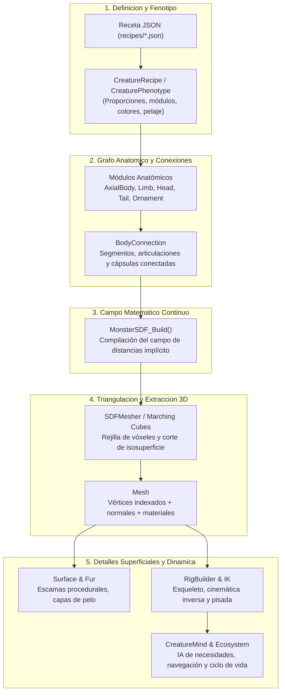

# Guía de Arquitectura, Algoritmos y Optimización de Generación

Esta guía está diseñada para desarrolladores que dominan el lenguaje **C** pero tienen poca experiencia en **álgebra lineal** o **gráficos procedurales**, y desean:
1. Comprender con claridad cómo funciona el motor desde adentro.
2. Añadir nueva diversidad biológica y anatómica (criaturas, partes, módulos).
3. Entender y optimizar los algoritmos de generación y remallado 3D para que sean mucho más rápidos sin sacrificar calidad visual.

---

## 1. Filosofía del Motor y el Pipeline Completo

A diferencia de los motores comerciales convencionales (Unity, Unreal Engine o Godot), **Monster Engine no almacena modelos 3D prediseñados** (como archivos `.obj` o `.fbx`). Todo cuerpo de criatura se calcula de forma puramente algorítmica y matemática en tiempo de ejecución.

### Principios Fundamentales
- **Núcleo desacoplado e independiente del renderizado (`CORE_SRCS`):** El motor matemático, la anatomía, el mallado, la animación y la IA están escritos en **C99/C11 puro** y no dependen de SDL2 ni de OpenGL. Solo enlazan con `libm` (matemáticas de C) y `pthread` (hilos POSIX).
- **El renderizado es una capa intercambiable (`RENDER_SRCS`):** El renderizador OpenGL (`src/OpenGLRenderer.c`) solo implementa la interfaz `MonsterRenderer` definida en `include/RenderInterfaces.h`. Si mañana quisieras renderizar en Vulkan, DirectX o un renderizador por software por consola, el núcleo no cambia ni una sola línea.
- **Continuidad biológica en 4 etapas:** Toda especie soporta 4 etapas de desarrollo ontogénico:
  1. `INFANT` (Cría)
  2. `JUVENILE` (Joven)
  3. `ADULT` (Adulto)
  4. `ELDER` (Anciano)
  El motor debe poder interpolar de una etapa a otra suavemente sin romper la topología ni crear costuras.



---

## 2. Matemáticas 3D Sin Dolor (Álgebra Intuitiva para Programadores de C)

Para trabajar con este motor **no necesitas cálculo diferencial ni álgebra abstracta**. Solo necesitas comprender 3 conceptos geométricos intuitivos:

### 2.1. Puntos y Vectores en C
En el motor, un punto o una dirección en el espacio 3D es simplemente un struct de tres números de coma flotante (`float`):

```c
typedef struct Vector3 {
    float x; // Izquierda / Derecha
    float y; // Arriba / Abajo (altura)
    float z; // Adelante / Atrás (profundidad)
} Vector3;
```

- **La Distancia entre dos puntos ($A$ y $B$):** Es el Teorema de Pitágoras extendido a 3 dimensiones.
  $$\Delta x = B.x - A.x, \quad \Delta y = B.y - A.y, \quad \Delta z = B.z - A.z$$
  $$\text{distancia} = \sqrt{\Delta x^2 + \Delta y^2 + \Delta z^2}$$
  En código: `Vec3_Distance(a, b)` o `Vec3_Length(Vec3_Sub(b, a))`.

---

### 2.2. ¿Qué es un SDF (Signed Distance Field)?
Imagina que estás parado en una habitación oscura donde hay una estatua invisible.
Tienes un radar (o "termómetro") que puedes colocar en cualquier coordenada $(x, y, z)$ del espacio. El radar te devuelve un único número:

$$\text{Distancia con Signo} = d$$

- Si $d > 0$: Estás en el **aire exterior**, a una distancia $d$ de la superficie.
- Si $d = 0$: Estás exactamente sobre la **piel** del monstruo.
- Si $d < 0$: Estás **dentro** de la carne del monstruo, sumergido a una profundidad $|d|$.

Este concepto es brillante porque **no requiere guardar polígonos**. Una criatura entera puede describirse como una función matemática que dice: *"dado el punto $p(x, y, z)$, ¿a qué distancia está la piel del monstruo más cercano?"*.

---

### 2.3. Primitivas Básicas: Cómo se calcula la distancia

Toda la anatomía del motor se construye combinando primitivas muy sencillas (`src/SDFPrimitives.c`):

#### A. La Esfera
Para una esfera con centro $C$ y radio $r$:
```c
float SDF_Sphere(Vector3 point, Vector3 center, float radius) {
    // Distancia desde el punto al centro, menos el radio
    return Vec3_Distance(point, center) - radius;
}
```
*Si estás a 5 unidades del centro y el radio es 3, el resultado es $+2$ (estás a 2 metros de la piel en el aire).*

#### B. La Cápsula (El ladrillo de construcción de huesos y extremidades)
Casi todo miembro animal (fémur, húmero, cuello, falanges) es esencialmente una **cápsula** (un cilindro con extremos redondeados).
Se define por dos extremos $A$ y $B$ y un radio $r$:

```c
float SDF_Capsule(Vector3 p, Vector3 a, Vector3 b, float radius) {
    Vector3 pa = Vec3_Sub(p, a);
    Vector3 ba = Vec3_Sub(b, a);
    // Proyección escalar sobre el segmento AB limitada a [0, 1]
    float h = Math_Clamp01(Vec3_Dot(pa, ba) / Vec3_Dot(ba, ba));
    // Punto más cercano sobre el eje del hueso
    Vector3 closest = Vec3_Add(a, Vec3_Scale(ba, h));
    return Vec3_Distance(p, closest) - radius;
}
```

---

### 2.4. Mezcla Biológica: La Unión Suave (`SmoothUnion` o `smin`)

Si unes dos primitivas geométricas con un `min(distanciaA, distanciaB)`, obtienes una intersección dura como la chapa de un coche. Los animales reales no son así: el cuello se funde con el torso de forma suave y continua.

Para lograr esta fusión orgánica tipo "plastilina" o "tensión superficial", el motor usa la **Unión Suave Polinómica** (`src/SDFOperations.c`):

```c
float SDF_SmoothUnion(float d1, float d2, float k) {
    if (k <= 0.0f) return (d1 < d2) ? d1 : d2; // Unión dura estándar
    // Factor de mezcla proporcional a la distancia entre ambas formas
    float h = Math_Clamp01(0.5f + 0.5f * (d2 - d1) / k);
    // Interpolación suave y resta del radio de transición 'k'
    return Math_Lerp(d2, d1, h) - k * h * (1.0f - h);
}
```
- El parámetro $k$ controla qué tan "derretida" o elástica es la unión.
- Un $k$ de `0.4` da uniones musculares sólidas; un $k$ alto hace que parezca una masa amorfa.

#### Sustracción Suave (`SDF_Subtract`):
Para crear orificios (abrir la cavidad de la boca, las fosas nasales o las cuencas de los ojos en `src/MonsterSDF.c`), simplemente invertimos la distancia de la herramienta de corte:
$$\text{restar}(A, B) = \max(A, -B)$$
Con la versión suave, los labios de la boca adquieren un reborde biselado natural sin tener que modelar vértices a mano.

---

## 3. De la Receta a la Estructura de Datos del Monstruo

Cuando el motor crea una criatura, atraviesa las siguientes etapas de código:

1. **Lectura de Receta (`src/CreatureRecipe.c`):**
   Carga desde un archivo JSON (o struct C) parámetros como:
   - Longitudes axiales (tronco, cuello, cola).
   - Tipos de miembros: `LIMB_ARCHETYPE_DIGITIGRADE` (cánido), `LIMB_ARCHETYPE_UNGULATE` (ungulado con pezuñas), etc.
   - Adornos: cuernos (`ORNAMENT_ARCHETYPE_HORN`), crestas, púas.
2. **Generación del Grafo Anatómico (`src/Anatomy.c`):**
   Crea los segmentos corporales (`BodyPart`) y las conexiones (`BodyConnection`).
   Cada conexión tiene:
   - Posición inicial y final ($A$ y $B$).
   - Radios de inicio y fin (la extremidad puede ser más ancha en el muslo y fina en el tobillo).
   - Suavidad de anclaje local (`localSmoothness`).
   - Material asignado (`SDF_MATERIAL_SKIN`, `SDF_MATERIAL_HOOF`, `SDF_MATERIAL_HORN`).
3. **Construcción del Campo SDF (`MonsterSDF_Build` en `src/MonsterSDF.c`):**
   Empaqueta todos los módulos en arrays compactos para evaluación rápida:
   - `sdf->axialStations`: secciones transversales del tronco y cuello.
   - `sdf->connectors`: lista lineal de todas las cápsulas óseas y musculares.
   - `sdf->mouths`: módulos cefálicos con cortadores de boca, órbitas y cavidades.

---

## 4. El Algoritmo de Mallado (Marching Cubes a Fondo)

Una vez que tenemos el campo matemático implícito `MonsterSDF`, las tarjetas gráficas (OpenGL) **no saben qué hacer con una fórmula**: necesitan una lista de triángulos definidos por vértices (coordenadas $X, Y, Z$) e índices (`Mesh` en `include/Mesh.h`).

El traductor entre la fórmula matemática y los triángulos es el **Mallador** (`src/SDFMesher.c`).

### 4.1. La Rejilla 3D (Vóxeles)
1. El motor calcula la caja que encierra al monstruo (`AABB3D`).
2. Divide esa caja en una rejilla regular de pequeños cubos de tamaño $\text{voxelSize}$ (por ejemplo $48 \times 48 \times 48$ cubos).
3. En cada esquina (nodo) de la rejilla, llama a `MonsterSDF_Evaluate(sdf, punto)` y guarda el número $d$ obtenido en un buffer plano (`gridDistances`).

```
          (Nodo 7) +--------+ (Nodo 6)
                  /|       /|
                 / |      / |
       (Nodo 3) +--------+ (Nodo 2)
                |  |     |  |
                |  +-----|--+ (Nodo 5)
                | /      | /
                |/       |/
       (Nodo 0) +--------+ (Nodo 1)
```

---

### 4.2. Cómo Funciona Marching Cubes en Cada Celda
Para cada uno de los cubos de la rejilla:

1. **Clasificación de Esquinas:** Cada una de las 8 esquinas puede estar dentro ($d < 0$) o fuera ($d \ge 0$).
   Esto equivale a un número binario de 8 bits (un `uint8_t`), lo que da exactamente $2^8 = 256$ posibles configuraciones:
   ```c
   int cubeIndex = 0;
   for (int c = 0; c < 8; ++c) {
       if (cornerDistances[c] < 0.0f) cubeIndex |= (1 << c);
   }
   ```
2. **Caso 0 ó 255 (Todo Fuera o Todo Dentro):**
   Si todas las esquinas están en el aire ($d \ge 0$) o todas están bajo tierra ($d < 0$), la piel del monstruo **no atraviesa este cubo**. Saltamos al siguiente cubo inmediatamente sin hacer nada.
3. **Casos Mixtos (Corte de la Piel):**
   Si algunas esquinas están dentro y otras fuera, ¡la piel del monstruo pasa por el interior del cubo!
   Consultamos una tabla precalculada (`MarchingCubes_GetEdgeMask(cubeIndex)` en `src/MarchingCubes.c`) para saber qué aristas del cubo son cortadas por la piel.
4. **Interpolación Lineal del Vértice:**
   Si la esquina $A$ tiene $d = -2$ y la esquina $B$ tiene $d = +3$, la piel ($d = 0$) no está en el punto medio, sino a $\frac{2}{5}$ del camino entre $A$ y $B$:
   $$t = \frac{-d_A}{d_B - d_A}, \quad \text{Vértice} = A + t \times (B - A)$$
5. **Cálculo de la Normal de la Superficie (Para Iluminación):**
   La normal es el vector unitario perpendicular a la piel (hacia dónde apunta). Se calcula mediante **diferencias finitas del gradiente**:
   $$N_x = \frac{d(x + \varepsilon, y, z) - d(x - \varepsilon, y, z)}{2\varepsilon}$$
   $$N_y = \frac{d(x, y + \varepsilon, z) - d(x, y - \varepsilon, z)}{2\varepsilon}$$
   $$N_z = \frac{d(x, y, z + \varepsilon) - d(x, y, z - \varepsilon)}{2\varepsilon}$$
   Se normaliza el vector $N$ a longitud $1$ (`Vec3_Normalize`).
6. **Caché de Aristas para Compartir Vértices:**
   Un cubo comparte sus aristas con hasta otros 3 cubos adyacentes. Para no duplicar vértices en la memoria de la GPU ni repetir cálculos, el motor almacena los índices en arrays dedicados:
   - `mesher->xEdges`
   - `mesher->yEdges`
   - `mesher->zEdges`
   Si otra celda ya calculó el vértice para esa misma arista, simplemente reutiliza su índice.

---

## 5. Anatomía del Rendimiento: ¿Dónde se va el tiempo y por qué es lento?

El mallado por SDF es computacionalmente intensivo. Para entender cómo optimizarlo, debemos examinar la complejidad computacional.

### 5.1. El Gran Cuello de Botella: $O(\text{Vóxeles} \times \text{Componentes})$
Supongamos una resolución cúbica modesta de $64 \times 64 \times 64$:
- Número de nodos de la rejilla $= 65 \times 65 \times 65 \approx \mathbf{274.625\text{ puntos}}$.
- Si la criatura tiene $120$ componentes (vértebras, costillas, extremidades, falanges, garras, cuernos, cavidades bucales), evaluar cada nodo requiere:
  $$274.625 \times 120 = \mathbf{32.955.000\text{ evaluaciones de distancia por frame}}.$$

### 5.2. El Coste Oculto del Cálculo de Normales
Observa la fórmula de diferencias finitas de la sección 4.2:
Para calcular la normal en un solo vértice, se necesita muestrear el campo SDF en $6$ puntos auxiliares:
$(\pm \varepsilon$ en $X$, $\pm \varepsilon$ en $Y$, $\pm \varepsilon$ en $Z$).
Si una malla genera $15.000$ vértices, ¡eso suma $15.000 \times 6 = \mathbf{90.000\text{ llamadas completas a MonsterSDF\_Evaluate}}$ adicionales!

---

### 5.3. Qué Optimizaciones Ya Existen en el Motor
Si revisas `src/SDFMesher.c` y `src/MonsterSDF.c`, verás que el motor actual ya implementa varias técnicas avanzadas:

1. **Poda por Cajas Envolventes (`compBoxes`, `cellCandidateMask`, `nodeCandidateMask`):**
   Antes de evaluar la rejilla, el motor recoge las cajas AABB de cada componente (`field->getComponentBounds`).
   Si un cubo de la rejilla está fuera de todas las cajas con un margen de seguridad, se marca como $0$ en la máscara. **No se evalúa el SDF en cubos de aire vacío lejano**.
2. **Poda Temprana de Conectores (`MonsterSDF_ShouldPruneGroup`):**
   Durante la evaluación de un punto, si la distancia acumulada actual ya es menor que la distancia mínima teórica a un grupo de apéndices distantes, ese grupo se omite por completo (`continue`).
3. **Piscina de Hilos POSIX (`SDFSamplingPool`):**
   El muestreo de la rejilla se divide en rebanadas paralelas en el eje $X$ y se reparte entre los hilos de la CPU (`samplingThreadCount`).
4. **Remallado Localizado por Chunks (`MorphChunkManager` y `MorphSpatialCache`):**
   Cuando un monstruo camina o envejece suavemente, no todo su cuerpo cambia de forma a la vez. El motor divide el espacio en bloques (*bricks*) y solo regenera los bloques que intersectan las AABB "sucias" (que se han movido).

---

## 6. Estrategias y Hoja de Ruta para Acelerar la Generación

Si tu objetivo es hacer que los cuerpos se creen y remallen mucho más rápido sin perder calidad visual, aquí tienes las rutas de optimización de mayor impacto, explicadas desde una perspectiva técnica de C:

### Ruta 1: Normales Interpoladas en vez de Diferencias Finitas (Aceleración ~20% - 35%)
- **Problema actual:** Por cada vértice que genera Marching Cubes, hace 6 llamadas a `MonsterSDF_Evaluate` para calcular las normales finitas.
- **Solución:** Las 8 esquinas del cubo ya tienen evaluada su distancia. Podemos calcular el gradiente analítico en los vértices del cubo una sola vez, o incluso interpolar trilinealmente los gradientes de las 8 esquinas para el vértice de la arista.
- **Impacto:** Elimina casi el 100% de las 6 llamadas extras por vértice en tiempo de triangulación.

---

### Ruta 2: Vectorización SIMD (AVX2 / SSE / NEON) (Aceleración ~2x - 4x)
- **Problema actual:** `MonsterSDF_EvalConnectorDistance` evalúa una cápsula con un solo punto $(x, y, z)$ usando operaciones float escalares normales.
- **Solución:** Las instrucciones SIMD de la CPU (como AVX2 en procesadores x86_64 modernos) tienen registros de 256 bits (`__m256`) que pueden procesar **8 floats a la vez en un solo ciclo de reloj**.
  En lugar de evaluar la distancia a un punto:
  ```c
  float dist = EvalCapsule(point, a, b, r);
  ```
  Se evalúan 8 puntos contiguos de la rejilla a la vez:
  ```c
  __m256 dist8 = EvalCapsule_AVX2(pointsX8, pointsY8, pointsZ8, a, b, r);
  ```
- **Ubicación clave:** En `SDFMesher_SamplingSliceWork` (`src/SDFMesher.c`).

---

### Ruta 3: Jerarquía de Volúmenes Envolventes (BVH) para Primitivas (Aceleración ~2x - 5x en monstruos complejos)
- **Problema actual:** Aunque existe poda con `MonsterSDF_ShouldPruneConnector`, la función `MonsterSDF_Evaluate` sigue iterando secuencialmente sobre un bucle `for` de hasta decenas de conectores.
- **Solución:** Agrupar las partes del cuerpo en un árbol binario de cajas (BVH):
  - Tronco
    - Cabeza y Cuello
    - Extremidades Delanteras (Izquierda / Derecha)
    - Extremidades Traseras (Izquierda / Derecha)
    - Cola
  Si un punto de la rejilla está cerca de la pata trasera izquierda, el test de la caja de las extremidades delanteras falla de inmediato y se descartan 20 primitivas de golpe sin evaluarlas una a una.

---

### Ruta 4: Marching Cubes Adaptativo / Octree Esparso (Aceleración ~3x - 8x)
- **Problema actual:** Si la criatura mide 2 metros de largo pero sus cuernos o dedos son delgados, la rejilla uniforme debe ser muy fina en TODO el espacio ($64^3$ o $128^3$), desperdiciando millones de muestras en el aire o dentro del estómago.
- **Solución:** Usar una estructura de Octree (como el módulo en desarrollo `SDFAdaptiveMesher.c`).
  Se empieza con cubos grandes (baja resolución). Solo si las esquinas del cubo tienen signos opuestos ($d$ cruza el cero), el cubo se divide en 8 subcubos más pequeños. El aire vacío permanece como cubos gigantes que se descartan en 1 solo paso.

---

## 7. Cómo Añadir Diversidad sin Romper el Motor

Para añadir nuevas criaturas o componentes anatómicos manteniendo la estabilidad del motor, sigue estas reglas:

### 7.1. Añadir una Criatura mediante Receta JSON
El método más seguro y sin compilar C es crear un archivo en `recipes/`:
1. Crea `recipes/mi_criatura.creature.json` copiando la estructura de `recipes/brumacerno.creature.json` o `recipes/explorador.creature.json`.
2. Define los parámetros fenotípicos para las 4 etapas (`infant`, `juvenile`, `adult`, `elder`):
   ```json
   {
     "id": 1001,
     "name": "MiCriatura",
     "bodyPlan": {
       "archetype": "quadruped",
       "torsoSegments": 3,
       "neckLength": 1.2,
       "tailLength": 2.5
     },
     "limbs": [
       { "type": "foreleg", "archetype": "digitigrade", "scale": 1.0 },
       { "type": "hindleg", "archetype": "digitigrade", "scale": 1.1 }
     ],
     "stages": { }
   }
   ```
3. Registra el nombre del archivo en `recipes/catalog.txt`.
4. Abre el editor visual ejecutando:
   ```sh
   make creature-editor
   ```
   y accede a `http://127.0.0.1:8765` para previsualizar en 3D en tiempo real.

---

### 7.2. Añadir Nuevos Módulos Anatómicos en C
Si deseas crear un nuevo tipo de apéndice (por ejemplo alas membranosas o tentáculos):
1. Revisa `include/CreaturePhenotype.h` y `include/Anatomy.h`.
2. Añade el nuevo enum de arquetipo anatómico (ejemplo `LIMB_ARCHETYPE_WING` o `ORNAMENT_ARCHETYPE_TENTACLE`).
3. En `src/Anatomy.c`, implementa la función generadora de segmentos y conectores correspondientes.
4. En `src/MonsterSDF.c`, asegúrate de asociar el material adecuado en `MonsterSDF_ConnectionMaterial`.

> [!WARNING]
> Nunca cambies las firmas de las interfaces públicas (`include/*.h`) sin verificar que compila el conjunto de tests. Recuerda que el Makefile compila con `-Wall -Wextra -Wpedantic -O2`, por lo que cualquier advertencia no atendida será tratada como un fallo.

---

## 8. Flujo de Trabajo del Desarrollador (Medir y Probar)

Antes y después de cualquier cambio en algoritmos o código de C, debes seguir este flujo estricto:

### 1. Comprobar que los tests pasan (Sin necesidad de entorno gráfico)
```sh
make test
```
*Compila la suite completa de tests de regresión y ejecuta las validaciones. Siempre debe terminar con `100% Passing`.*

### 2. Medir tiempos de generación (Benchmarks)
Para saber si tu optimización realmente ha acelerado el motor y cuántos milisegundos has ganado:
```sh
make benchmark
```
*Mide la velocidad de muestreo del SDF y triangulación por CPU.*

Para medir el coste del envejecimiento continuo y morphing dinámico:
```sh
make benchmark-ager-realtime
```

### 3. Probar en el Editor Interactivo
```sh
make creature-editor
```
*Abre el servidor local en Python en el puerto 8765 con WebGL para validar visualmente que el mallado se ve nítido, sin agujeros ni deformaciones.*

---

## Resumen de Archivos Clave para Explorar

| Archivo | Qué hace | Por qué te interesa para optimizar |
|---|---|---|
| `src/SDFMesher.c` | Orquestador principal de Marching Cubes y muestreo | **Punto crítico #1:** Aquí se decide la resolución de la rejilla, la paralelización por hilos y la triangulación. |
| `src/MonsterSDF.c` | Compila y evalúa el campo de distancias del monstruo | **Punto crítico #2:** `MonsterSDF_Evaluate` es la función más invocada de todo el motor. Cada microsegundo ahorrado aquí multiplica los FPS. |
| `src/SDFPrimitives.c` | Fórmulas matemáticas de esferas, cápsulas y cajas | Aquí es donde se pueden implementar versiones vectorizadas SIMD (AVX2/NEON). |
| `src/MarchingCubes.c` | Tablas de lookup de 256 casos e índices de aristas | Mapeo rápido de cortes de aristas a triángulos. |
| `src/MorphSpatialCache.c` | Caché espacial de bloques 3D para morphing | Evita recalcular partes estáticas del cuerpo en transformaciones. |
| `src/Anatomy.c` | Ensamblado de módulos anatómicos | Aquí se añade nueva diversidad de huesos, extremidades y órganos. |
