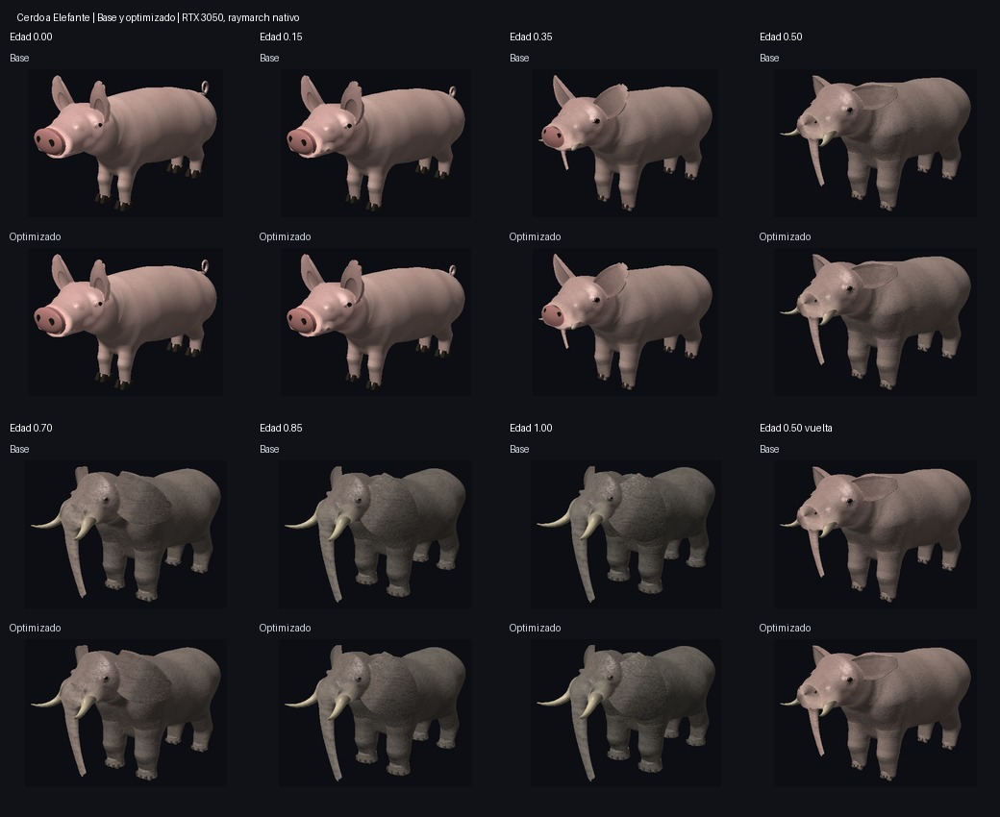

# Recuperación de rendimiento de la demo de metamorfosis

La demo evita volver a resolver la anatomía, compilar el campo y trazar la superficie cuando se mantiene la vista. Durante una transición reutiliza la memoria del campo y la topología ocular. La mejora de fluidez depende del backend y la escena. Los casos de mayor coste siguen limitados por la GPU, especialmente la extracción densa durante el movimiento.

## Causas y revisiones

- **Antes del cerdo (`d06a802`)** ya se compilaba un SDF para la cámara y otro para render. También se interpolaba en cada llamada de demo a `MonsterAger_SetPerc`, se calculaba el snapshot de geometría CPU en backends sin consumidor y `E` incluía el oráculo exacto y omitía la malla asíncrona. El exacto procesa bandas de framebuffer y puede sincronizar la GPU por banda con el paso diagnóstico explícito.
- **Cerdo (`18c25de`)** añadió los ojos a la presentación SDF y extendió el uso de las posiciones publicadas en los dominios de cesión. En Perro → Lagarto, el trabajo ocular mediano pasó de ausente a 1,53 ms por cuadro sin un salto equivalente del tiempo GPU. La cesión debe seguir incluyendo todos los vértices deformados con vinculación al módulo.
- **Elefante (`8c67aca`, base de la recuperación)** integró la trompa, fosas pareadas, defensas y piel con arrugas. El informe anatómico cuenta 93 conectores en Elefante adulto y 66 en Cerdo. El shader evalúa material del lumen al llegar a la superficie y las arrugas hacen salida temprana con contribución cero. Esa cifra de conectores y el muestreo CPU de 700.000 puntos aportan contexto anatómico. Los tiempos GPU muestran que el coste interactivo depende de la escena y el backend.
- **Cola y primer uso**. El raymarch sin límite de cuadros en vuelo dejaba al controlador agrupar varios envíos. En Cerdo → Elefante alternaban cuadros entregados en 1–4 ms y esperas cercanas a 100 ms. Los cambios de backend también exponían compilación síncrona del controlador. Denso y disperso comparten buffers de extracción, por lo que el cambio necesita invalidar su contenido y sus generaciones.
- **Worker**. Ya se coalescían solicitudes dentro de una pareja. Un cambio de extremos podía dejar un pendiente asociado a la pareja anterior o mantener una construcción en curso cuyo resultado no podría publicarse. Se descarta ese pendiente y los puntos de cancelación del mallador detectan la generación obsoleta. La igualdad de huella exige también igualdad de generación.

## Cambios

- Una sola instancia `MonsterSDF` compartida por encuadre y presentación en el hilo principal. La edad y la pareja invalidan campo y material. El muestreo de límites de extracción usa un monstruo temporal independiente. Los workers conservan sus propios snapshots.
- Las vistas estacionarias reutilizan color y profundidad SDF a resolución nativa. Se invalida con cámara, edad, pareja, modo, pelaje, malla alámbrica o visualización de materiales. Ojos, pelo largo y HUD se dibujan sobre la profundidad compuesta.
- Las regiones de cesión acumulan AABB por conexión en una sola pasada de la malla publicada, usando la posición actual de cada vértice. La unión con los dominios presentes, cefálicos y de retiro sigue el cálculo previo.
- El globo ocular conserva la misma resolución y topología, con la esfera unitaria transformada por el shader. La textura conserva semilla, fórmula, tamaño y filtrado. Se evita calcular fibras fuera del soporte del iris y se reutilizan parámetros invariantes y objetos de textura.
- El raymarch completo conserva su AABB inicial y omite el bucle de intervalos de cesión donde no hay cesiones. La rejilla densa evalúa la función escalar de distancia. Se enlazan solamente los programas GPU requeridos por cada ruta. Se limita la cola de raymarch a un cuadro pendiente para evitar ráfagas de presentación. El mecanismo no impone una tasa de refresco.
- **E** alterna raymarch y malla asíncrona. **Mayús+E** incluye las rutas experimentales densa y dispersa en hardware compatible. El oráculo se solicita con `--surface-mode=exact-sdf` y debe ejecutarse con un límite externo. `--native-resolution` desactiva la adaptación existente para medir o usar raymarch a resolución completa.

## Equipo y método

Ryzen 5 5600H (12 hilos lógicos), NVIDIA GeForce RTX 3050 Laptop GPU de 4 GiB, controlador 580.178.04, OpenGL 4.6, GCC 13.3.0 con `-O2`, 1280 × 720, MSAA 4, semilla 42. En legacy hay un coordinador de malla con pool de cuatro participantes (tres auxiliares) y un productor separado de pelo largo cuando se necesita. El perfil conserva pelaje y sombreado de producción. Las secuencias perfiladas usan el mismo productor de pelo que la interacción.

El reloj monótono mide cuadro y fases CPU. El reloj de CPU del hilo principal excluye sus esperas. La duración GPU se obtiene por pares de timestamps disponibles en cuadros posteriores, con 16 ranuras y sin descargar resultados pendientes. El arranque y calentamiento se distinguen de las muestras. El FPS de rendimiento es cuadros/segundo observado en toda la ventana. El FPS mediano se calcula a partir de p50 y puede ser engañoso cuando el controlador entrega cuadros en lotes. La memoria es RSS máximo del proceso, sensible al estado de la caché del compilador. El perfil registra por separado la duración de la última construcción y la latencia de solicitud a publicación del resultado mostrado.

```sh
make demos/demo_morph_species
python3 tools/benchmark_morph_demo.py --binary demos/demo_morph_species \
  --out build/morph-profile --pair Cerdo:Elefante --mode sdf-raymarch \
  --scenario scrub --scenario static-0.5 --samples 96
```

Repetir `--binary` fija el orden A/B o ABBA. `--cwd` permite usar el catálogo de cada revisión. `--native-resolution` fija la escala de raymarch y `--unpaced` permite desactivar la cola acotada para uno de los índices de binario instrumentado. El perfil emite muestras CSV y el script resume en JSON. `--count-allocations` habilita una sonda opcional glibc de llamadas malloc, calloc y realloc en el hilo principal. Conviene ejecutarla aparte de la medición de FPS. Los registros de esta ejecución se indexan en `build/morph-recovery/final/manifest.json`. La instrumentación aplicada a la instantánea histórica de HEAD está en `build/morph-recovery/baseline-instrumentation.patch`.

## Resultados

Cada celda muestra base → optimizado. «FPS» es rendimiento efectivo. CPU y GPU son p50 en ms. Los percentiles p95 y p99 corresponden al tiempo de pared. — indica que el caso no usa worker o el percentil no tenía una publicación registrada. Las filas raymarch usan escala 1,0 en ambas versiones.

| Caso | FPS | FPS mediano | FPS 1% bajo | p95 / p99 (ms) | CPU (ms) | GPU (ms) | Worker / solicitud a publicación (ms) | RSS (MiB) |
|---|---:|---:|---:|---:|---:|---:|---:|---:|
| Perro → Lagarto, scrub nativo | 39.0 → 42.5 | 39.8 → 42.8 | 30.0 → 31.9 | 29.5 → 27.2 / 33.3 → 31.3 | 3.1 → 2.1 | 24.1 → 21.0 | — | 105.6 → 102.2 |
| Caballo → Cerdo, scrub nativo | 29.8 → 30.6 | 26.3 → 30.2 | 22.4 → 25.3 | 43.0 → 37.8 / 44.6 → 39.5 | 3.4 → 2.4 | 34.3 → 30.7 | — | 111.2 → 103.8 |
| Caballo → Elefante, scrub nativo | 29.8 → 24.5 | 23.8 → 24.4 | 22.0 → 15.8 | 44.5 → 52.0 / 45.4 → 63.3 | 3.8 → 2.9 | 41.7 → 38.2 | — | 129.7 → 104.3 |
| Cerdo → Elefante, scrub nativo | 28.5 → 23.3 | 226.5 → 23.4 | 10.1 → 18.9 | 97.8 → 50.4 / 98.8 → 52.8 | 3.3 → 2.7 | 44.2 → 40.2 | — | 119.6 → 102.2 |
| Elefante → Lagarto, scrub nativo | 28.6 → 25.3 | 216.7 → 25.0 | 10.2 → 19.1 | 97.2 → 49.7 / 98.2 → 52.5 | 3.8 → 2.8 | 42.8 → 37.7 | — | 120.8 → 103.5 |
| Brumacerno → Elefante, scrub nativo | 29.7 → 26.6 | 31.1 → 27.0 | 16.1 → 19.2 | 60.3 → 46.4 / 62.2 → 52.0 | 4.1 → 2.7 | 39.0 → 34.5 | — | 116.0 → 102.3 |
| Cerdo → Elefante, fijo 0,5 nativo | 28.5 → 661.1 | 508.6 → 698.8 | 9.8 → 144.4 | 101.1 → 2.0 / 102.4 → 6.9 | 1.3 → 0.4 | 48.7 → 0.1 | — | 115.5 → 100.5 |
| Cerdo → Elefante, denso scrub | 8.4 → 9.0 | 8.8 → 9.4 | 6.7 → 7.0 | 146.8 → 139.3 / 149.8 → 142.2 | 5.4 → 4.1 | 111.0 → 104.6 | — | 106.8 → 106.3 |
| Cerdo → Elefante, disperso scrub | 28.1 → 28.0 | 29.0 → 28.9 | 22.6 → 21.8 | 43.4 → 43.7 / 44.2 → 45.9 | 4.9 → 3.9 | 32.4 → 33.6 | — | 462.1 → 454.4 |

Los valores extremos de FPS mediano en la base de Cerdo → Elefante reflejan cuadros agrupados. El p95 y el FPS de rendimiento muestran las esperas. El perfil sin límite mide la capacidad del pipeline y el bucle normal conserva el límite anterior de 60 Hz.

- **Cerdo → Elefante, fase CPU**. En raymarch nativo durante scrub, el SDF bajó de 0,17 a 0,10 ms p50, la interpolación de 0,84 a 0,47 ms y ojos de 1,53 a 0,60 ms. A edad fija, campo e interpolación costaron 0 ms en estado estable. En movimiento el caché revisado observó un fallo de caché de textura por cuadro p50, con ~0,5 ms de generación y ~0,01 ms de envío GL. El coste de topología del globo queda limitado a su creación.
- **Desglose de interpolación**. La sonda CPU de 450 edades por pareja midió 0,379 ms medios para `CreatureMorph_Interpolate` en Cerdo → Elefante. `MixGraph` aportó 0,211 ms, `MixProfile` 0,095 ms, remapeo 0,030 ms y dominios de pigmento 0,001 ms. El SDF con memoria reutilizada costó 0,071 ms. La pareja más cara fue Elefante → Lagarto con 0,494 ms. Se omitieron snapshots sin consumidor y llamadas repetidas a la misma edad. Recompilar correspondencias del grafo por pareja queda como mejora de CPU secundaria.
- **Pacing ABBA con la misma resolución**. Cerdo → Elefante nativo pasó de p95 100,1–100,2 ms a 48,6–48,9 ms con la cola acotada. El rendimiento pasó de 28,9–29,0 FPS a 24,0–24,2. Con la política adaptativa existente, la cadencia revisada dio p95 33,6–35,0 ms y 34,0–35,4 FPS, con escala mediana 0,73–0,75 frente a 0,85 sin límite de cola. Esa comparación adaptativa incluye un cambio de escala decidido por el controlador de resolución existente. Para Perro → Lagarto nativo, el coste de la cola fue de alrededor de 2 FPS en la prueba con el mismo binario.
- **GPU compute**. En scrub, los marcadores dan 29,0 ms de muestreo y 57,1 ms de emisión densa, con 18,0 ms de dibujo. El disperso midió 7,9, 2,0 y 14,4 ms respectivamente. Los buffers declarados ocuparon alrededor de 86 MiB y 298 MiB respectivamente. Los tiempos de compilación y el pico de RSS variaron con la caché del controlador. La eliminación de programas inutilizados reduce el trabajo solicitado a GL, y su beneficio de arranque queda sin una comparación fría controlada.
- **Efecto del cacheo cefálico**. Se conservó la variante UBO. Especializar también el número de iteraciones cefálicas se probó en ABBA y se descartó tras observar resultados sin mejora consistente.

| Revisión en Perro → Lagarto, raymarch scrub | CPU p50 (ms) | Ojos p50 (ms) | GPU p50 (ms) | p95 (ms) |
|---|---:|---:|---:|---:|
| d06a802 | 2.13 | 0.00 | 23.99 | 30.26 |
| 18c25de | 3.39 | 1.53 | 24.15 | 30.45 |
| 8c67aca | 3.32 | 1.54 | 24.28 | 29.72 |

| Legacy handoff, scrub | FPS | p95 / p99 (ms) | CPU / GPU p50 (ms) | Worker / solicitud a publicación p50 (ms) | Regiones p95 (ms) | RSS (MiB) |
|---|---:|---:|---:|---:|---:|---:|
| Cerdo → Elefante | 29.55 → 29.69 | 60.97 → 57.16 / 61.31 → 59.32 | 6.25 → 4.52 / 45.46 → 39.40 | 1214.65 → 1233.69 / 1256.39 → 1259.84 | 0.80 → 0.36 | 269.17 → 253.27 |
| Caballo → Cerdo | 28.94 → 29.71 | 81.01 → 53.08 / 94.34 → 54.63 | 8.41 → 4.99 / 105.10 → 104.38 | 568.75 → 831.35 / 788.43 → 851.83 | 1.78 → 0.27 | 348.50 → 278.07 |

En 160 cuadros por prueba, las regiones de cesión consumieron menos CPU, con mayor ganancia en Caballo → Cerdo. En estas secuencias el worker siguió tardando cerca de un segundo en varias reconstrucciones. El percentil de latencia describe el último resultado publicado de cada cuadro, que puede repetirse entre cuadros. El trabajo anterior se invalida ante un cambio de pareja. Dentro de una pareja sigue vigente la coalescencia existente y la cola admite un solo pendiente. La demo conserva recursos de los backends ya inicializados para cambios posteriores y los libera al salir.

## Validación anatómica



Se compararon 66 pares de capturas RGB a 1280 × 720, con cámara y semilla iguales. Los seis pares solicitados coinciden píxel por píxel en 11 posiciones, incluidas las siete edades de ida y cuatro muestras de retorno. Las capturas preservan ojos, pezuñas, orejas, trompa, defensas, piel, pelo y los pigmentos en esa vista. Se capturaron también Asno → Velkar y Explorador. También coincidieron ocho pares adicionales de Cerdo → Elefante a edades 0,5 y 1,0 en vistas lateral, frontal, cefálica y caudal. Los PPM y la comparación numérica están en `build/morph-recovery/final/visual/`.

Las pruebas nuevas verifican que la instancia ocular reproduzca la posición de cada vértice del globo original sin alterar su topología y que cada región de handoff contenga los vértices deformados vinculados a su módulo. El generador ocular se contrastó con la implementación anterior para 512 apariencias, cuatro pupilas y texturas 128 × 128. Los bytes fueron iguales y el tiempo medio de generación bajó de 1,384 a 0,399 ms por textura.

- `make test`, `make editor-test`, `make benchmark`, `make benchmark-ager-realtime` y la compilación de la demo pasaron. El benchmark de Ager midió 3,23 ms p95 de actualización CPU en 600 cuadros y desfase p95 de 0,0187 con 20 de 20 dígitos conservados.
- `--list` mostró nueve recetas. Pasaron los tres smoke tests solicitados con una salida acotada por `--frames` y el ciclo raymarch → handoff → denso → disperso → raymarch → handoff.
- `make visual-morph-gpu-regressions` pasó, incluida la caché densa y la raíz propietaria posterior. La comparación mostró un error máximo de aproximadamente 1,2 × 10⁻⁶ en las edades registradas. Cerdo y Elefante pasaron la paridad CPU/GPU en las cuatro etapas y los validadores de intervalos.
- `make visual-morph-ownership` pasó con un retraso de 3000 ms. El endpoint de Lagarto tuvo 89 píxeles adicionales y 2 faltantes sobre 25.459 de referencia. En el ciclo Cerdo → Elefante con retraso de 180 ms, el endpoint tuvo 0 píxeles adicionales y 1113 faltantes sobre 52.550 al comparar la silueta contra raymarch nativo.
- `make visual-ager-sparse` se detuvo al buscar el archivo `.scene.json` de su captura de referencia. El comando de captura del demo en `8c67aca` también guardaba únicamente el PPM y la comprobación acotada en esa revisión terminó con el mismo archivo ausente. Esta puerta anatómica regional quedó pendiente. La paridad de campo y las pruebas funcionales de los modos GPU se ejecutaron por separado.

- Una sonda headless de ocho cambios de extremos y cierre de un worker activo tuvo cero errores en Helgrind y cero bytes pendientes al salir en Memcheck. ThreadSanitizer no pudo iniciarse por la disposición de memoria del proceso en esta máquina.

## Límites de la recuperación

- Los escenarios nativos con Elefante siguen por debajo de 30 FPS sostenidos durante el scrub. La cola prioriza la regularidad y menor latencia de entrada a cambio de rendimiento en algunos casos. Caballo → Elefante tuvo una regresión tanto de rendimiento como de p95 en la muestra nativa. Denso continúa por debajo de 10 FPS en Cerdo → Elefante en movimiento. Disperso y legacy están cerca de 30 FPS en varios casos, con picos por encima de 33 ms.
- Los primeros usos pueden bloquear en compilación síncrona del driver, incluso cuando la ruta evita programas innecesarios. Los modos experimentales quedan accesibles de forma explícita. Para alcanzar 30 FPS nativos en el peor scrub, la primera prioridad es reducir fragmentos y evaluaciones de conectores y cabeza con culling espacial conservador. En denso la prioridad es la emisión antes que la CPU.
- El coste aislado de arrugas, ocupación GPU, divergencia y número de pasos o candidatos por fragmento quedan sin cuantificar individualmente. No hay VRAM global por proceso en los resultados. `compute_gpu_bytes` sólo informa los buffers declarados por los backends compute. El coste máximo de `exact-sdf` con Elefante no se midió. Se reservó la referencia exacta para validaciones acotadas.
- La comparación visual de las seis parejas usa una vista oblicua y las mismas edades. Otras cámaras se ejercitaron en las pruebas de órbita y el ciclo de presentación. La cobertura restante incluye poses y movimientos fuera de esas capturas.

La matriz posterior cubre las seis parejas y los ocho escenarios (edades 0, 0,5, 1, ida, vuelta, órbita, scrub y cambio rápido) en los cuatro backends. Raymarch tiene 48–80 muestras por caso y la matriz exploratoria de los otros tres modos tiene 24 por caso. Las comparaciones A/B principales usaron 48–160 muestras y las pruebas de cadencia usaron ABBA. Todas las ejecuciones de la matriz posterior completaron las muestras solicitadas. La comparación histórica mantiene Perro → Lagarto en las tres revisiones y hace los A/B de las nuevas especies contra el HEAD que las contiene.

La sonda de asignaciones de Cerdo → Elefante registró 36 → 32 llamadas p50 por cuadro durante el scrub y 31 → 20 a edad 0,5. Se contabilizaron las tres llamadas de heap interceptadas en el hilo de presentación. Trabajadores y asignaciones internas de GPU quedan fuera de ese contador.
