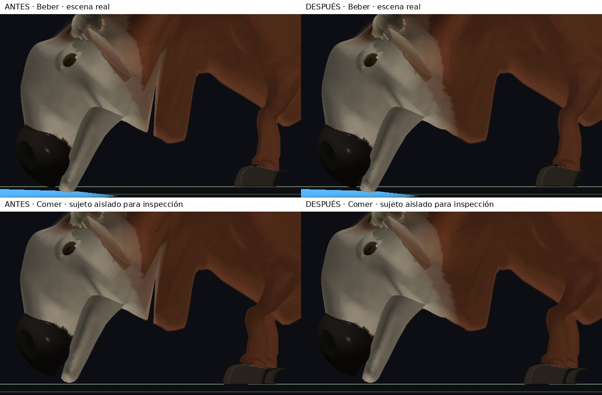

# Continuidad cervical al comer y beber

## Defecto reproducido

Con el estado inicial `e2ffefa`, al beber en NEAR aparecía una abertura vertical
entre la papada y la parte anterior del cuello. La malla tenía una componente:
no era un volumen ausente del SDF, sino una discontinuidad al deformarla.
La reproducción conserva los cambios locales preexistentes de demos y SDF.

## Causa y corrección

`AnatomyDeformer_BindCranium` elegía la propiedad craneal mediante
`bindings[v].connIndex[0]`, la conexión más cercana. Cuando dos conexiones
intercambian ese primer puesto, puntos vecinos podían pasar bruscamente de
seguir la cabeza a seguir el tórax. La alternativa basada en el campo cefálico
también utilizaba un umbral binario.

Se reemplaza ese interruptor, cuando está disponible el SDF de reposo, por:

1. La suma de los pesos de **todas** las conexiones que llegan a la cabeza.
2. Un soporte suave del campo cefálico, con banda derivada del collar existente
   y de la suavidad cabeza/cuerpo.
3. La mezcla con los pesos esqueléticos originales, conservando normalización.

La cara interior al campo sigue siendo rígida. El cuello y la papada hacen
una transición continua. No cambia la receta, el SDF, los shaders, las longitudes
óseas, el alcance del rig ni los movimientos para comer/beber. No se añade
geometría de relleno, pelo ni remallado por cuadro.

## Regresión

`cervicalOwnershipTest` usa la receta real en siete edades normalizadas:
0, 1/6, 1/3, 1/2, 2/3, 5/6 y 1. Dos muestras coincidentes tienen la misma
mezcla anatómica, con los dos vecinos empatados enumerados en orden inverso.
Al flexionar cuello y cabeza deben seguir coincidiendo. También comprueba
que la corrección no arrastre los cuatro puntos de apoyo.

La prueba se compila además contra el deformador anterior: debe fallar en
la coincidencia cervical, no en la construcción de la muestra. Con el
deformador corregido debe pasar en las siete edades.

## Capturas reproducibles

Se conserva el ejecutable anterior en
`build/brumacerno-neck-seam/ecosystem-before`. Los originales, perfiles y logs
quedan en `build/brumacerno-neck-seam/`.

```sh
make test
make demos/demo_ecosystem
mkdir -p build/cuello
DISPLAY=:0 ./demos/demo_ecosystem \
  --no-hud --inspect=neck --view=side --zoom=1.6 --focus-lod=near \
  --herbivores=1 --carnivores=0 --plants=0 --focus=3 --initial-age=200 \
  --frames=3600 --capture-state=drinking \
  --validate-mouth=240 --validate-skinning \
  --capture=build/cuello/drinking.ppm --profile=build/cuello/drinking.json
```

Para comida: 24 herbívoros, foco 23, sin desactivar plantas y
`--capture-state=feeding`. El demo imprime `CreatureLifeStage`:
`stage=1` significa adulto, no la etapa larva de la receta.

Las comparaciones usan el mismo encuadre y parámetros; se recorta el mismo
rectángulo de ambas capturas para mostrar el cuello sin el margen negro
inferior. No se retoca la silueta.



La comida queda tapada por plantas y otros animales en la escena completa.
Para la segunda fila se compiló una copia **de diagnóstico**, únicamente bajo
`build/`, que omite dibujar recursos no acuáticos y animales distintos del foco.
Los recursos, todos los individuos, la IA y sus interacciones siguen activos;
no se cambia su simulación, su pose, el cuerpo, la boca ni sus materiales.
Se usó la misma copia para ambos deformadores. El demo del repositorio no
se editó. Los logs confirman `action=eat` para el individuo 23 en ambos casos.
El generador local está en `build/brumacerno-neck-seam/capture_isolated.py`.

## Resultado de las comprobaciones

- `make test`: todas las suites pasan.
- Prueba contra `e2ffefa`: falla por separación cervical de las muestras
  empatadas; con la corrección, separación cero en las siete edades.
  Véanse [antes](regression-before.log) y [después](regression-after.log).
  Es una prueba de invariancia del binding, no una medida del ancho de la
  grieta de la captura.
- Capturas reales de bebida: GPU lateral con edades iniciales 0, 40, 90 y
  200 segundos; en adulto, además tres cuartos y skinning por CPU. No se
  observa la abertura cervical reproducida inicialmente.
- Comida: lateral y tres cuartos con sujeto aislado para inspección; la
  separación lateral anterior desaparece sin restringir la flexión.
- NEAR/MID/FAR: revisados en bebida en el fotograma 388. La selección
  automática de estado del demo exige NEAR; para MID/FAR se utilizó
  `--capture-state=overview --frames=388`, verificando `action=drink`.
  Los intentos iniciales de selección automática en esos LOD no capturaron.
- Validación GPU/CPU del skinning: error máximo de posición registrado
  **0**, de normal **2,68 × 10⁻⁷**, incluyendo un caso Velkar. El encuadre
  de este último no permite aprobar visualmente su cabeza.
- Contacto oral adulto antes/después: máximo **3,098 mm**, idéntico.
  Error plantar de apoyo adulto: **1,342 mm**, idéntico; máximo observado
  entre edades jóvenes: **2,398 mm**. Son diagnósticos del rig, no una
  medición exhaustiva de todos los triángulos de cada pezuña.

[Datos de comprobación](checks.json) · [LOD y CPU](lod-and-cpu.jpg) ·
[Crecimiento y tres cuartos](growth-and-three-quarter.jpg)

**Límites:** FAR conserva su collar voluminoso y unión tosca preexistentes,
visibles [antes y después](far-before-after.jpg); esto no es una nueva
aceptación estética de FAR. Tampoco se corrige aquí el aspecto mecánico
de la mandíbula abierta. No se repitieron ciclos temporales completos de
morph con retardo artificial del trabajador. El fallback histórico de
`BindCranium` sin SDF opcional no se modifica; los consumidores visuales
del motor proporcionan ese campo.

## Control de rendimiento

ABBA, RTX 3050 Laptop / NVIDIA 580.178.04 / OpenGL 4.6, 1280×800,
600 cuadros, semilla 42, 24 herbívoros + 6 carnívoros, sin plantas,
overview, zoom 40, sin HUD. A es el ejecutable conservado inmediatamente
antes de esta corrección, **no** el anterior a la reconstrucción anatómica.
Ambas variantes contienen los mismos cambios locales preexistentes de demo
e indexación. No se ejecutan otras validaciones propias en paralelo.

| Ejecución | Trabajo medio ms | P95 ms | GPU media ms | Preparación s |
| --- | --- | --- | --- | --- |
| A1 | 20,500 | 23,678 | 7,162 | 16,209 |
| B1 | 21,125 | 24,419 | 7,126 | 16,098 |
| B2 | 20,380 | 23,761 | 7,037 | 15,962 |
| A2 | 20,202 | 23,597 | 7,046 | 15,887 |

Promedio de medias: **20,351 → 20,753 ms (+1,97 %)**; GPU
**7,104 → 7,081 ms**. El contador del demo excluye la espera del limitador,
por lo que no se presenta su inversa como FPS reales. La preparación
promedia 16,048 → 16,030 s.

La población dibujada media es 28,265, rango 26–30, idéntica en las
cuatro ejecuciones. B1 registra 14 subidas de geometría estática frente
a 11 en las otras tres: el calendario asíncrono no fue idéntico.
Dos muestras por variante no permiten atribuir con precisión estas
pequeñas diferencias ni afirmar una aceleración.

[Comandos y perfiles ABBA](benchmark-results.json) ·
[Identidad de fuentes y ejecutables](sha256.json)
