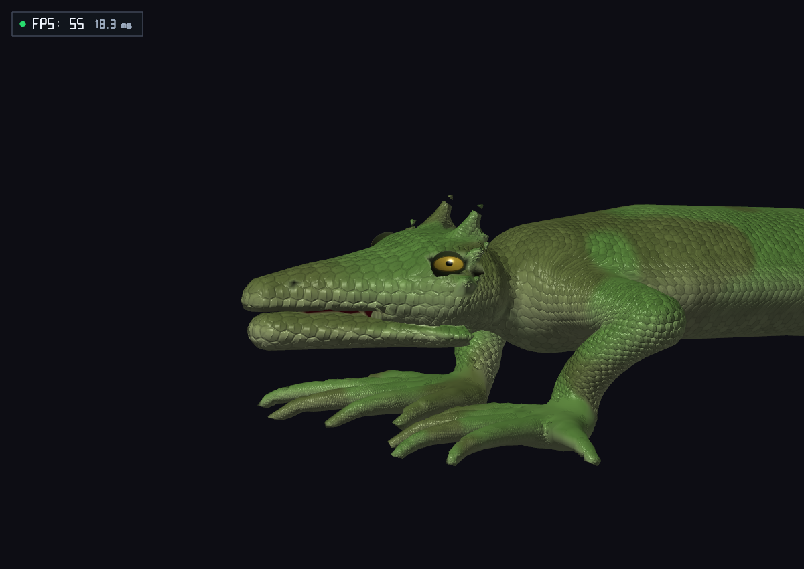

# Coste del arreglo de textura durante T

18 de octubre de 2026. Revisión de la actualización de material GPU en `demo_game_scene`.

## Trabajo eliminado

El arreglo de cobertura llamaba a `surfacePoseMaterial` desde el refinamiento de raíces. Esta función repetía la evaluación de mandíbula y hasta seis iteraciones de inversa de la costura que `sceneDetailed` ya había resuelto. El generador GLSL ahora extrae distancia, peso de anclaje y clasificación de lengua de una sola resolución. El empaquetado posterior sólo combina bits. La fórmula se deriva de `MonsterSDF_EvalPosedMouthDistance`; el evaluador CPU y la ruta GPU exclusiva de distancia conservan sus operaciones y orden aritmético.

También se evita reevaluar las raíces inmóviles con cobertura de piel 255 al cambiar únicamente la paleta. El shader sustituye completamente su color por pigmento procedural. Las raíces movidas, las mezclas de piel/tejido oral y la ruta sin superficie siguen evaluándose completamente. La huella de paleta incluye `hasSurface` para invalidar correctamente al desactivar el pigmento. No se añadieron pases de extracción, esperas, reducción de detalle o retrasos de edad.

## Medición y límites

RTX 3050 Laptop, 1200 × 850, MSAA 4, pelaje activo y voxel 0,075. Diez destinos completos desde Emerald Climber, semilla 42. Ejecuciones sin otras pruebas simultáneas. Se miden los cuadros 30–209, incluyendo la preparación de T. Las consultas GPU se asocian por generación y se deduplican. Los perfiles y capturas se ejecutan por separado.

La mejora global de FPS **no es sustancial ni uniforme en las repeticiones en caliente**. No se atribuyen al cambio las diferencias grandes de los primeros perfiles, que no se mantuvieron al repetir con ambas versiones preparadas. La eliminación de operaciones redundantes sí está implementada, pero el contacto CPU y el muestreo SDF siguen dominando el presupuesto de las mutaciones pesadas.

| Comparación en caliente | Media anterior → actual (ms) | p95 anterior → actual (ms) |
|---|---:|---:|
| Sailback, repetición A | 9,57 → 9,86 | 10,28 → 10,67 |
| Sailback, repetición B | 10,08 → 9,95 | 12,34 → 10,64 |
| Desert Horned | 16,46 → 16,73 | 19,95 → 20,03 |

Desert Horned conserva unos 10 ms medios de actualización CPU y no cumple 60 FPS constantes. Las grandes pausas al pulsar T no se reprodujeron en esta matriz: la preparación de T quedó entre 4,47 y 17,56 ms. Esto no certifica ausencia de pausas con cualquier carga externa o una caché de shaders fría.

Resultados de la matriz final:

| Variante | Media de trabajo (ms) | p95 de trabajo (ms) | Cuadro de T (ms) |
|---|---:|---:|---:|
| Emerald Climber | 7.78 | 8.39 | 4.47 |
| Desert Horned | 16.37 | 19.93 | 17.55 |
| Blue Runner | 9.49 | 10.32 | 10.11 |
| Fat-Tailed Gecko | 12.11 | 15.12 | 10.06 |
| Volcanic Spiny | 13.10 | 16.01 | 12.44 |
| Sand Burrower | 8.05 | 9.33 | 9.59 |
| Stone Armored | 11.15 | 12.39 | 11.30 |
| Sailback | 9.61 | 10.25 | 11.13 |
| Jewel Chameleon | 10.19 | 10.73 | 11.95 |
| Aquatic Fin-Tail | 9.02 | 9.68 | 10.25 |

## Validación posterior a la última edición

- `make -B -j6 test demos build/validate_morph_gpu_regressions`: todas las suites pasan; sin warnings de compilación.
- Regresión GPU de material: ocho estados de geometría, paleta y activación de superficie; diferencia RGB máxima cero frente a evaluación directa.
- Paridad CPU/compute/fragment en once edades: residuo máximo inferior a 0,000002.
- Escena de 240 cuadros con `--validate-gpu --validate-skinning --inspect-head`: paridad SDF, halos y articulación craneal pasan. Error craneal máximo registrado 0,00000013.
- Ocho capturas cercanas frente al binario anterior: cuatro son idénticas fuera del HUD; las otras difieren en un único píxel, con diferencia máxima de 3 niveles RGB. No hay pérdida de escamas ni cambio visible de cobertura.
- `git diff --check` sobre los archivos editados: pasa.

Datos: [mediciones.json](mediciones.json), [repeticiones.log](repeticiones.log), [regresiones-gpu.log](regresiones-gpu.log), [validacion-escena.log](validacion-escena.log) y [compilacion-pruebas.log](compilacion-pruebas.log).



## Reproducción

```sh
make -B -j6 test demos build/validate_morph_gpu_regressions
./build/validate_morph_gpu_regressions
./demos/demo_game_scene --headless --frames=240 --target=7 --seed=42 --benchmark-uncapped --profile=/tmp/textura-rendimiento.csv
./demos/demo_game_scene --headless --frames=240 --target=1 --seed=42 --stationary --inspect-head --validate-gpu --validate-skinning --capture-prefix=/tmp/textura-cabeza
```

Los CSV de la comparación y el binario anterior están en `build/texture-performance/` en este espacio de trabajo. Para una comparación válida, ejecutar ambas versiones alternadas, dejar terminar las compilaciones de shaders y separar capturas/readbacks del benchmark.
