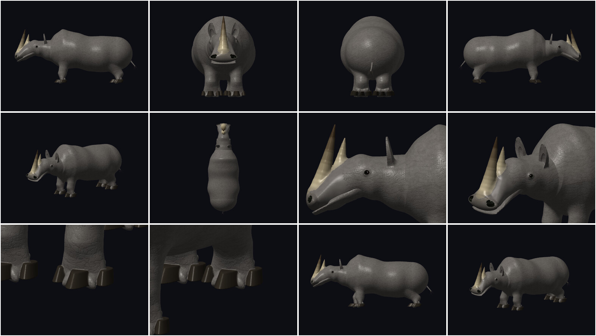
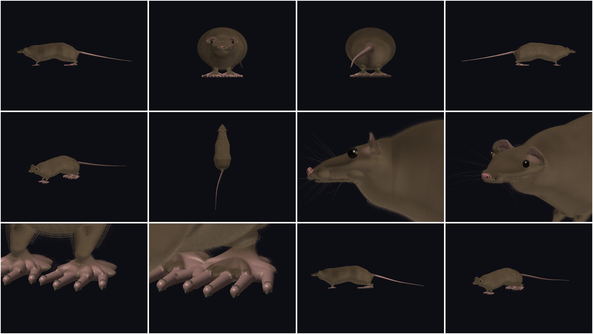
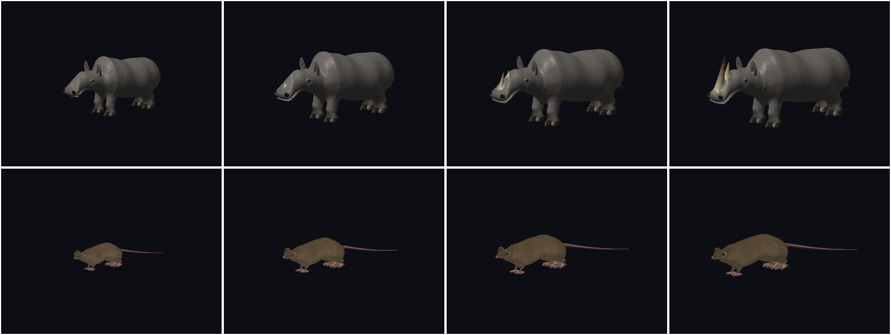
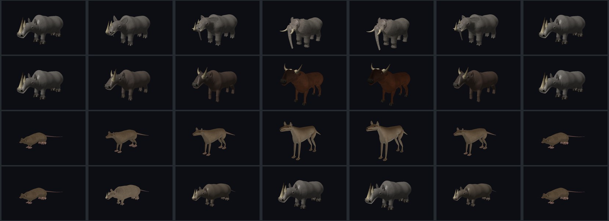
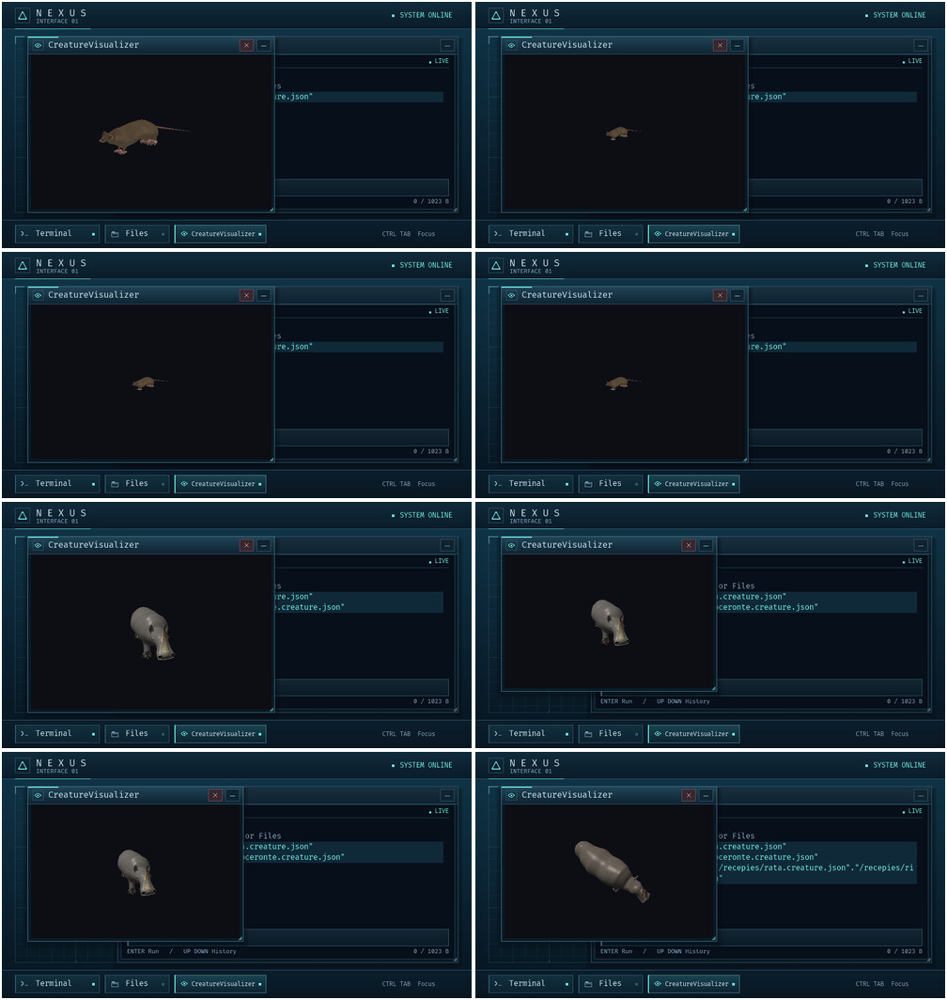
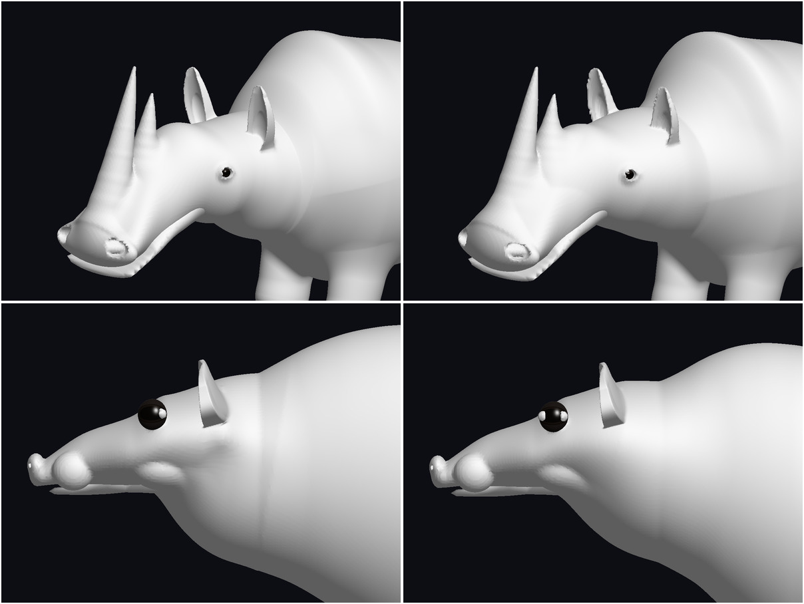
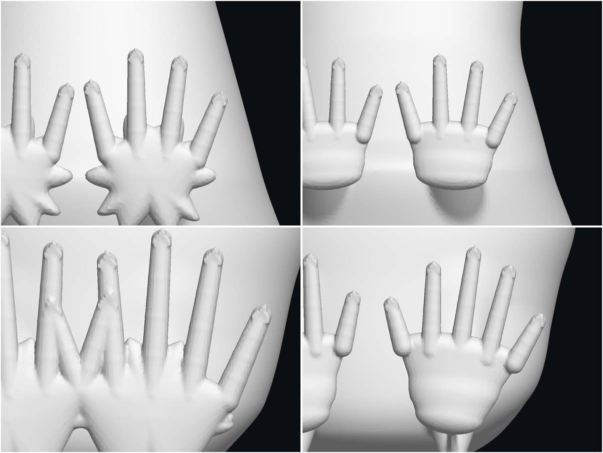
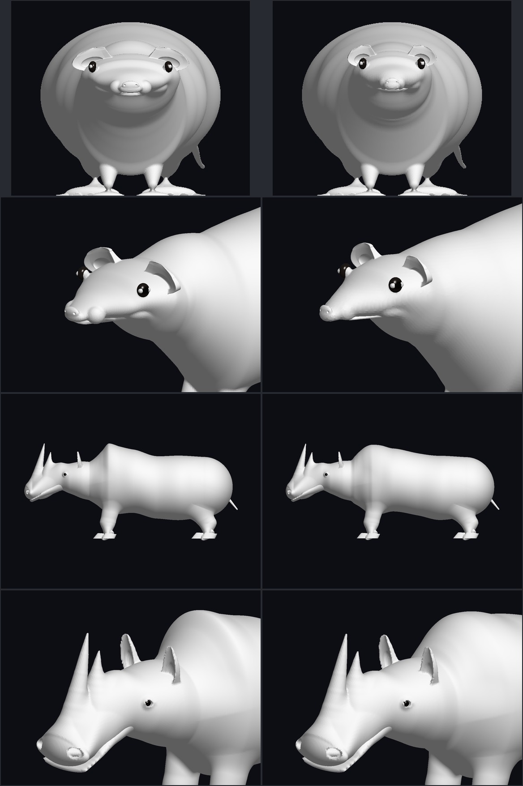

# Rinoceronte blanco y rata parda

Las recetas v1 `rinoceronte.creature.json` (1009, *Ceratotherium simum*) y
`rata.creature.json` (1010, *Rattus norvegicus*) entran por el catálogo externo.
Las cuatro etapas son posnatales y conservan las identidades de los módulos.
Las proporciones se expresan en unidades del motor. La rata usa una escala de
presentación mayor que la escala física relativa al rinoceronte para que sus
dedos y vibrisas sean visibles con las tolerancias actuales del SDF.

## Rinoceronte

La cruz elevada y el cuello bajo proceden del barrido axial. Los perfiles de
tórax y pelvis sostienen un abdomen ancho, y el perfil de miembro compacto
mantiene una transición continua hasta la suela. El primer ensayo usó el
cráneo bóvido y ocultaba el cuerno posterior. La cruz también era demasiado
puntiaguda y el abdomen ocultaba parte de los miembros posteriores. Las
secciones escapulares y abdominales se ajustaron tras las vistas laterales.
El perfil rinocerótido separa el
puente nasal inclinado de la premaxila ensanchada, con un labio inferior más
ancho. Las ranuras medianas siguen la superficie dorsal resuelta del rostro.
Las bases quedan dentro del campo cefálico y ambos cuernos acompañan una
rotación del rig. Cada pie tiene tres uñas de queratina sobre un mismo plano
de apoyo, con un dedo central más largo y ancho.

El perfil lateral distingue la cruz, el vientre y la cabeza baja. En vista
frontal los cuernos se superponen en el eje sagital y las tres uñas se
aprecian mejor en tres cuartos. Los bordes de las uñas conservan una corona
más recta que las del animal real. El relieve regional se ve en el cuello y
las articulaciones, aunque los pliegues carecen de compresión dinámica.
La cola lleva un pequeño penacho. El pelo en el borde auricular es sutil en
la captura cercana.

Se usaron las proporciones y vistas de [San Diego Zoo Wildlife Alliance](https://ielc.libguides.com/sdzg/factsheets/whiterhino/characteristics),
[San Diego Zoo](https://animals.sandiegozoo.org/animals/white-rhinoceros),
[SANParks](https://www.sanparks.org/conservation/parks/marakele-national-park/primary-consumers-herbivores/white-rhino),
[Wildlife World Zoo](https://zooinstitutes.com/animals/southern-white-rhinoceros-wildlife-world-zoo-aquarium-amp-safari-park-119494.html)
y la [vista posterior de Himeji Central Park](https://contest.55web.jp/zoo/past/show_album.html?all=&jumpp=14&key=&num=3&sort=).



## Rata

El dorso arqueado se alza sobre una caja torácica baja, con mayor volumen
caudal y patas traseras de mayor alcance. El cráneo canino en cuña del primer
ensayo dejaba una hendidura visible por encima de la mandíbula en reposo.
El vientre escondía parte del apoyo y las vibrisas se agrupaban en la punta
nasal. Se elevó el contorno ventral, se separaron los dedos y se trasladaron
los parches de pelo hacia los cojinetes. El perfil roedor cierra la mandíbula corta
y recoge los ojos en sus órbitas. Las vibrisas se proyectan con dos parches
deterministas de pelo largo fijados a la cabeza. El pelaje corto es pardo,
con una superficie ventral más clara y menor cobertura en pies, orejas y cola.
La cola del adulto mide algo menos que la longitud de cabeza y tronco.
Los pies delanteros tienen cuatro dedos y los traseros cinco, con uñas
terminales pequeñas que utilizan la misma ruta de queratina que las placas.

Las vibrisas se distinguen mejor en la captura de cabeza y pueden perder
contraste en la ventana pequeña. El pelaje aparece más uniforme que el
moteado de un adulto silvestre, y la curvatura de las uñas es aproximada.
La elevación distal compensó una penetración que se midió en el último
tercio de la cola durante la marcha. Se verificaron las estaciones en reposo
y en 60 poses consecutivas sobre el plano de apoyo. La cola conserva la
dinámica de pose del motor y la prueba usa terreno plano.

Las referencias fueron el [Smithsonian National Zoo](https://www.nationalzoo.si.edu/animals/norway-rat),
su [fotografía de un ejemplar vivo](https://www.si.edu/object/norway-rat%3Anzp_NZP-20110506-034MM),
el [Australian Museum](https://australian.museum/learn/animals/mammals/brown-rat/),
el [ejemplar Te Papa](https://collections.tepapa.govt.nz/object/1723442),
el [ejemplar dorsal del Auckland Museum](https://commons.wikimedia.org/wiki/File:Rattus_norvegicus_(AM_LM521).jpg),
la [guía de la FAO](https://www.fao.org/4/x5065e/x5065E0j.htm) y el
[capítulo anatómico de *Ferrets, Rabbits, and Rodents*](https://pmc.ncbi.nlm.nih.gov/articles/PMC7258799/).



Cada lámina de adulto muestra lateral, frontal, posterior y lateral opuesta
en la primera fila, tres cuartos, dorsal y dos detalles cefálicos en la
segunda, y pies delantero y trasero y dos vistas de marcha en la tercera.



Las columnas corresponden a `seed`, `larva`, `juvenile` y `adult`. Cada
captura encuadra su etapa. La escala aparente de las láminas sirve para
comparar proporciones, y el tamaño absoluto se verifica en la receta.

## Reproducción

Desde la raíz del repositorio con SDL2 y OpenGL disponibles.

```sh
make -j8 build/capture_creature build/creature_editor_bridge demos/interface_demo demos/demo_morph_species
make test editor-test interface-test interface-engine-test

for species in rinoceronte rata; do
    recipe="recipes/$species.creature.json"
    build/creature_editor_bridge validate "$recipe" > "/tmp/$species-v1.json"
    build/creature_editor_bridge validate "/tmp/$species-v1.json" > "/tmp/$species-roundtrip.json"
    cmp "/tmp/$species-v1.json" "/tmp/$species-roundtrip.json"
    for age in 0 0.33333334 0.66666669 1; do
        out="build/validation/$species/$age"
        mkdir -p "$out"
        build/capture_creature "$recipe" "$out" "$age" surface
    done
done

mkdir -p build/validation/morphs
for pair in rhino:elephant rhino:brumacerno rat:dog rat:rhino; do
    ./demos/demo_morph_species --from="${pair%:*}" --to="${pair#*:}" \
      --view=3 --no-msaa --validate-cycle="build/validation/morphs/${pair//:/-}"
done

NEXUS_VISUALIZER_PROFILE=1 ./demos/interface_demo
```

```text
CV.view."/recepies/rinoceronte.creature.json"
CV.view."/recepies/rata.creature.json"
CV.view.interpolation."/recepies/rata.creature.json"."/recepies/rinoceronte.creature.json"
```

La lámina de metamorfosis recorre de izquierda a derecha las edades 0, 0,35,
0,50, 0,85, 1, 0,50 de vuelta y 0 de vuelta. De arriba abajo se muestran
rinoceronte–elefante, rinoceronte–Brumacerno, rata–perro y rata–rinoceronte.



Los ciclos de la lámina usan el trazado SDF de producción. En el cruce
rata–rinoceronte, el loft del tronco termina en la grupa y los tramos
caudales se interpolan por separado. Así el diámetro de la pelvis queda
fuera de la cola intermedia. Los otros cambios visibles corresponden a las
patas, orejas y apéndices cefálicos. La aparición de la trompa y la reducción de los cuernos
se observaron en los fotogramas muestreados. La prueba sin GL compila los
cuatro pares en ambos órdenes. La inspección visual cubre esos ciclos
muestreados. En una pasada adicional de rinoceronte a elefante con
`legacy-handoff` y un retardo de worker de 80 ms se midieron 64 cuadros
después del calentamiento. El perfil marcó 26 solicitudes coalescidas,
4 cancelaciones y 0 resultados de topología obsoleta. Esta pasada cubre
una carga del backend diferido.

## Cámara y rendimiento



La órbita de Nexus se probó en una RTX 3050 Laptop con OpenGL 4.6 a 1×.
Se comprobó un giro de más de 360°, arrastre fuera del área, límites verticales
y de rueda, reinicio por doble clic, redimensionado, foco, cierre y rotación
durante la interpolación. Cambiar de receta conserva los tres valores de
órbita. En la rata estática, el perfil mantuvo `field_builds=1` al girar y al
hacer zoom. En esos 32 pases a 476 × 307, la mediana CPU fue 0,34 ms y
la GPU SDF tuvo una mediana de 26,26 ms y p95 de 68,74 ms, según el
ángulo y el zoom. Tras soltar el botón, volvió a haber cero pases 3D mientras la
escena estaba en reposo. Las pruebas de escritorio también verifican el
enrutamiento de Files, la rueda sobre ventanas de fondo y la cancelación
al minimizar o cerrar una ventana con captura. Se abrieron ambos archivos
desde Files en la aplicación gráfica y se verificó el pase 3D de cada ID.

Para comparar el coste del cambio con `3cdec34`, se ejecutó Cerdo → Elefante
con el mismo dispositivo, resolución nativa 1280 × 720, MSAA desactivado y
`--seed=42 --frames=100 --profile=20 --age-sequence=0.2,0.5,0.8,0.5`.
La mediana CPU pasó de 1,55 a 1,52 ms, y la mediana GPU pasó de
27,09 a 27,73 ms. El p95 de cuadro pasó de 34,28 a 34,36 ms. Es una comparación de
compatibilidad con una carga existente y una ejecución por versión.

## Unión cervical y planta de la rata

La revisión prolonga la inserción de la nuca dentro del barrido cervical.
Las secciones intermedias mantienen la transición de anchura y altura.
En el rinoceronte, la sección anterior del cuello se recoge bajo la
ganacha. En la rata, el cuello se acorta y el contorno ascendente comienza
más cerca de la cabeza. La lámina neutra muestra el rinoceronte arriba,
la rata abajo y el resultado revisado a la derecha.



La vista desde abajo mostró que el abanico de segmentos desde el carpo
o el tarso generaba puntas detrás y a los lados de los dedos. El perfil
plantígrado construye un talón estrecho y una planta redondeada y conecta
las bases digitales dentro de ese tejido. Las patas traseras se abren
ligeramente y sus dedos internos tienen separación en reposo. La planta
delantera aparece arriba y la trasera abajo, con el resultado revisado
a la derecha.



`build/capture_creature` genera los archivos `forefoot-sole.ppm` y
`hindfoot-sole.ppm` además de los primeros planos habituales. Las
pruebas comprueban el solapamiento de las bases digitales, la continuidad
plantar y la separación entre los dos pies traseros en las edades
muestreadas. Los ciclos SDF rata–perro, rinoceronte–elefante y
rata–rinoceronte se volvieron a capturar después de la revisión.

## Cara frontal de la rata y cresta del rinoceronte

En la rata, el ancho cigomático resuelto pasó de 0,517 a 0,405 unidades
del motor, aproximadamente un 22 %. La separación entre los ojos pasó
de 0,473 a 0,363. Los cojinetes de las vibrisas se recogen dentro del
contorno del hocico. La nuca y la sección anterior del cuello siguen la
nueva anchura.

En el rinoceronte, `withersRoundness` distribuye el ascenso a la cruz y el
descenso hacia el tórax en un arco más redondeado. La cruz conserva su
relieve sobre el lomo. Se compensó la longitud de las patas delanteras
por el descenso de la inserción escapular para mantener el apoyo.
Cuando el perfil cefálico solicita una unión cervical continua, el
collar se inserta en una fracción de la longitud anatómica del cuello y
las tangentes en sus extremos se ajustan a las tapas del barrido.
Esto reduce la marca transversal en la unión. En las capturas neutras
aún se aprecia una transición de sombreado tenue en algunas vistas.

En la lámina, la columna izquierda muestra el estado anterior y la
derecha el revisado. Las dos primeras filas corresponden a la rata de
frente y de tres cuartos. Las dos últimas muestran la silueta lateral
y el cuello del rinoceronte de tres cuartos.


